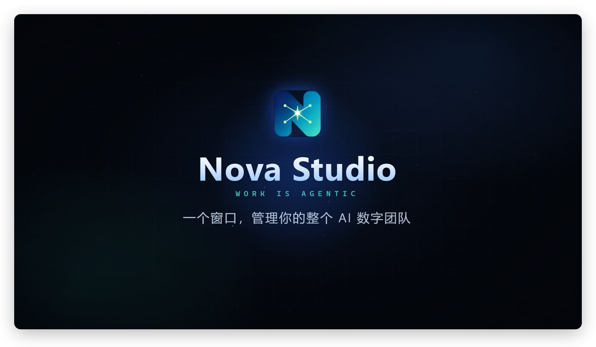

<p align="center">
  
</p>

<br>

<p align="center">
  本地优先的 AI 数字团队工作台。<br>
  把一次性的对话，沉淀为可复用的角色、可编排的流程、可追溯的产物。
</p>

---

<br>

<p align="center"><sub>S E S S I O N S</sub></p>

<a name="会话工作台"></a>

<h2 align="center">会话工作台</h2>

<p align="center">
  <a href="resources/preview/经典夜.png"></a>
</p>

<p align="center"><sub>经典 · 夜间 &nbsp;|&nbsp; 会话、文件、Git 与终端在同一个窗口</sub></p>

<br>

---

<br>

<p align="center"><sub>W O R K F L O W</sub></p>

<a name="工作流"></a>

<h2 align="center">工作流</h2>

<p align="center">
  节点引用数字员工，连线决定先后。<br>
  分支并行、汇合等待，每一步的结果与产物都会落盘。
</p>

<br>

<p align="center">
  <a href="resources/preview/工作流.png"></a>
</p>

<p align="center"><sub>需求分析 → 架构设计 → 前后端并行实现 → 代码评审 → 结束</sub></p>

<br>

---

<br>

<p align="center"><sub>E M P L O Y E E S</sub></p>

<h2 align="center">数字员工</h2>

<p align="center">
  人设、职责与可用能力，定义一次，多处复用。<br>
  员工只保存引用，资产在各自页面统一管理。
</p>

<br>

<p align="center">
  <a href="resources/preview/数字员工.png"></a>
</p>

<p align="center"><sub>产品经理 · 需求分析师 · 业务架构师 · 前后端工程师 · 代码评审员 · 测试工程师 · 数据分析师</sub></p>

<br>

---

<br>

<p align="center"><sub>A S S E T S</sub></p>

<h2 align="center">资产</h2>

<p align="center">
  Skill、MCP、知识库与提示词统一沉淀为可引用的资产。<br>
  运行时只加载该员工选中的能力，结束后清理临时配置。
</p>

<br>

<p align="center">
  <a href="resources/preview/MCP.png"></a>
</p>

<p align="center"><sub>MCP · stdio / HTTP / SSE 统一管理，支持 ${VAR} 占位符与密钥标记</sub></p>

<br>

---

<br>

<p align="center"><sub>W O R K S P A C E</sub></p>

<a name="工作区"></a>

<h2 align="center">工作区</h2>

<p align="center">
  不必离开 Nova，右侧常驻文件树、Git 状态与终端。
</p>

<br>

<p align="center">
  <a href="resources/preview/工作区.png"></a>
</p>

<p align="center"><sub>变更列表、diff、分支与提交都在同一个控制台</sub></p>

<br>

---

<br>

<p align="center"><sub>L O C A L &nbsp; F I R S T</sub></p>

<h2 align="center">本地优先</h2>

<p align="center">
  你的代码、资料和对话不属于任何云端服务。<br>
  所有状态，都留在你自己的机器上。
</p>

<br>

<p align="center">
  <sub>不做云端账号、模型托管、知识库向量化、多人协作与权限系统——单机、单用户、本地优先。</sub>
</p>

<br>

---

<br>

<p align="center"><sub>Q U I C K &nbsp; S T A R T</sub></p>

<a name="快速开始"></a>

<h2 align="center">快速开始</h2>

<p align="center">
  需要 Node.js 20+、npm 9+，以及本机安装好的 Claude Code CLI。当前主要面向 Windows。
</p>

```bash
npm install           # 安装依赖
npm run dev           # 开发模式：热更新窗口
npm run build         # 构建到 out/
npm run package:win   # 打包 Windows 安装包到 release/
```

1. **启动 Nova** —— 自动检测本机 Claude Code，未安装时给出安装命令。
2. **新建会话** —— 直接开始对话，需要读写文件时再绑定工作区。
3. **创建员工** —— 填人设与职责，勾选 MCP、Skill 与知识库。
4. **连成工作流** —— 拖上画布，配置并行与审核，点「调试」。

<br>

---

<br>

<p align="center"><sub>D O C U M E N T A T I O N</sub></p>

<h2 align="center">文档</h2>

<p align="center"><sub>27 篇工程文档，覆盖产品定位、架构决策与实现细节。</sub></p>

<details open>
<summary><b>工程文档</b></summary>

<br>

**产品与架构**

- [产品定位与功能全景](docs/00-产品定位与功能全景.md)
- [技术栈与工程结构](docs/01-技术栈与工程结构.md)
- [系统架构与关键决策](docs/02-系统架构与关键决策.md)
- [数据模型与数据库](docs/03-数据模型与数据库.md)
- [IPC 契约参考](docs/04-IPC契约参考.md)

**运行时与核心子系统**

- [Agent 运行时抽象](docs/05-Agent运行时抽象.md)
- [Claude Code 适配层](docs/06-Claude-Code适配层.md)
- [会话与聊天子系统](docs/07-会话与聊天子系统.md)

**工作流**

- [工作流：图模型与校验](docs/08-工作流-图模型与校验.md)
- [工作流：调度与执行](docs/09-工作流-调度与执行.md)
- [工作流：审核、续跑与产物](docs/10-工作流-审核续跑与产物.md)

**能力资产**

- [数字员工与能力绑定](docs/11-数字员工与能力绑定.md)
- [MCP 服务管理](docs/12-MCP服务管理.md)
- [Skill 技能管理](docs/13-Skill技能管理.md)
- [知识库与全文检索](docs/14-知识库与全文检索.md)
- [任务中心与触发器](docs/16-任务中心与触发器.md)

**个人工作**

- [待办、提示词与周报](docs/26-待办提示词与周报.md)

**工作区与界面**

- [工作区：文件、Git 与终端](docs/15-工作区-文件-Git-终端.md)
- [前端架构与状态管理](docs/17-前端架构与状态管理.md)
- [页面与交互规格](docs/18-页面与交互规格.md)
- [设计系统与皮肤](docs/19-设计系统与皮肤.md)
- [设置与 Agent 配置](docs/20-设置与Agent配置.md)
- [工作区设计语言](docs/25-工作区设计语言.md)

**工程保障**

- [安全与数据隔离](docs/21-安全与数据隔离.md)
- [构建、打包、发布与更新](docs/22-构建打包发布与更新.md)
- [测试与质量保障](docs/23-测试与质量保障.md)
- [复刻实施指南](docs/24-复刻实施指南.md)

**参考手册**

- [Claude Code CLI 参数参考](docs/27-Claude-Code-CLI参数参考.md)

</details>

<details open>
<summary><b>路线图</b></summary>

<br>

- [x] Claude Code 统一会话工作台
- [x] 数字员工（人设 / MCP / Skill / 知识库）
- [x] 工作流可视化编排、并行分支与人工审核
- [x] 画布内调试、运行记录与产物追溯
- [x] MCP / Skill / 知识库 / 提示词统一管理
- [x] 触发器与自然语言任务中心
- [x] 工作区文件、Git 与终端
- [ ] 中断恢复与断点续跑
- [ ] 知识库文档在线编辑
- [ ] 超大文档后台索引

</details>

<details open>
<summary><b>参与贡献</b></summary>

<br>

欢迎提交 Issue 与 Pull Request。提交前确认 `npm run build` 与 `npm run verify:skins` 通过，功能改动附使用说明或截图。

</details>

---

**许可**：MIT License。第三方资源与依赖的许可声明见 [resources/NOTICE.md](resources/NOTICE.md)。

<p align="center">
  <sub><b>Nova Studio</b> · Work is Agentic · 让每个数字员工都有自己的工位</sub>
</p>
