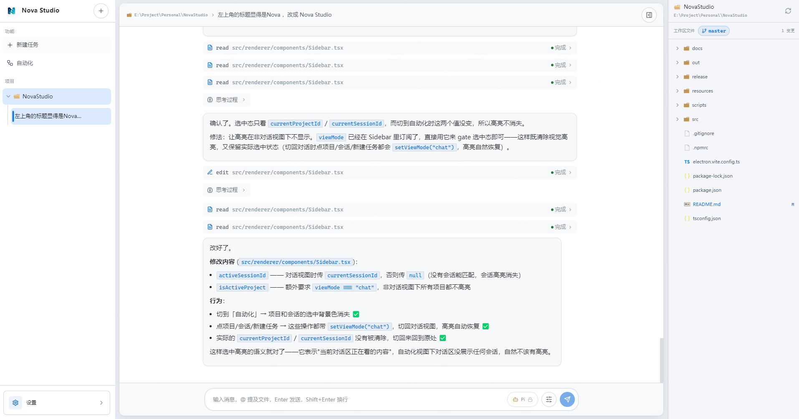
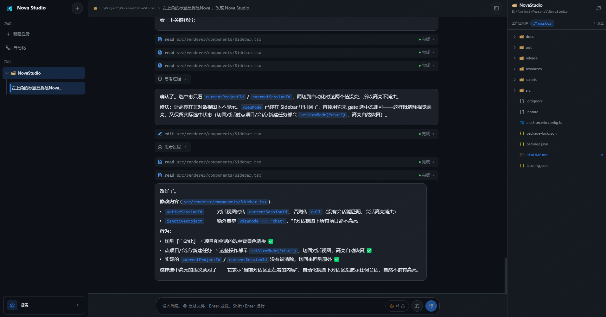
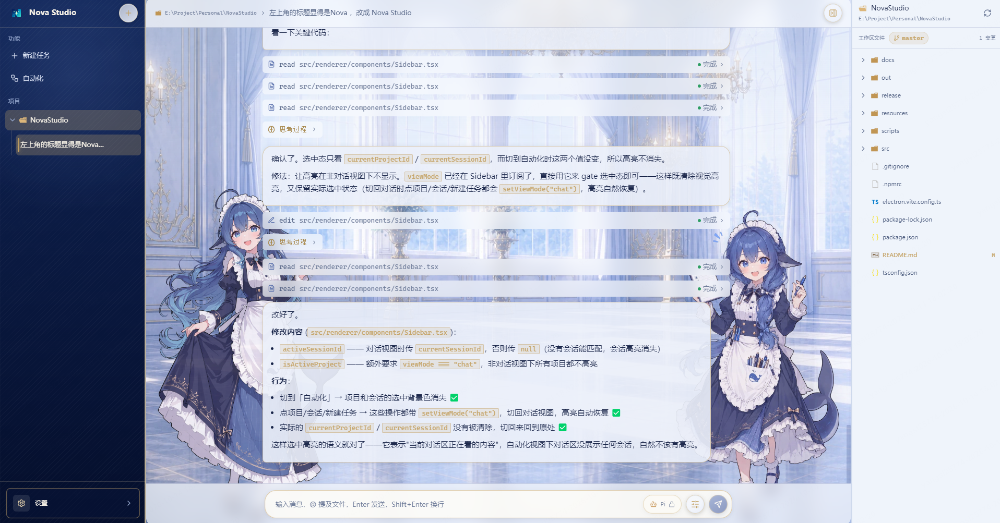
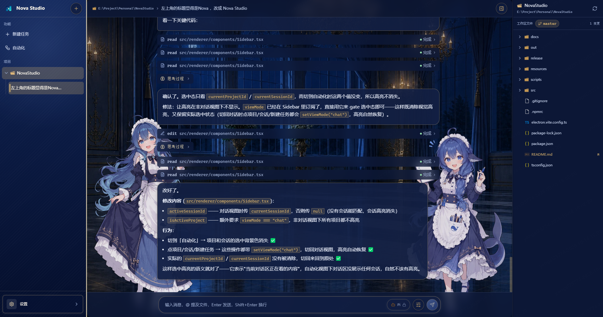

<p align="center">

</p>

<div align="center">

# Nova Studio

**AI 智能体 CLI 的统一桌面客户端 · 一个窗口接入所有 Agent**

<p>


</p>

面向 **Pi · OpenCode · Claude Code · Codex** 等本地智能体 CLI 的统一桌面客户端：扫描本机已安装的 Agent，spawn CLI 子进程并流式渲染思考 / 工具调用 / 正文分区，多轮对话复用 CLI 自带 session，安装即用。

<p>
<a href="#-nova-studio-是什么"><kbd>Nova Studio 是什么</kbd></a>
<a href="#-效果预览"><kbd>效果预览</kbd></a>
<a href="#-架构"><kbd>架构</kbd></a>
<a href="#-快速开始"><kbd>快速开始</kbd></a>
<a href="#-项目结构"><kbd>项目结构</kbd></a>
<a href="#-常用命令"><kbd>常用命令</kbd></a>
<a href="#-许可"><kbd>许可</kbd></a>
</p>

</div>

---

## ✨ Nova Studio 是什么

Nova Studio 是一个面向本地智能体 CLI 的**统一桌面客户端** —— 把散落在命令行里的 Pi、OpenCode、Claude Code、Codex 收拢进同一个窗口，不用再记每个 CLI 各自的参数与输出格式。

它不重造 Agent，也不重造会话存储。开一个会话时，Nova Studio 直接 spawn 本机已安装的 CLI 子进程，把输出按 **思考 / 工具调用 / 正文** 三个分区流式渲染；多轮对话复用 CLI 自带的 session，因此完整继承该 Agent 的工具生态（MCP、Skills、Hooks、子代理）。Nova Studio 自己只做两件事：呈现界面，以及用本地 SQLite 记录 UI 侧的事件流，让重启后能回放含思考与工具的完整对话。新增一个 Agent 也只需在 `src/main/agents/` 下加一个目录，引擎、IPC 与 UI 都无需改动。

交付形态是纯 Electron 单安装包，数据根目录 `~/.novastudio/` 与安装目录物理隔离，卸载不丢数据；进程间走 IPC 而非 WebSocket，没有外部服务依赖。除对话之外，窗口里还有会话树、工具检测、内置终端、自动化看板与设置中心；界面内置经典、女仆工坊等多套皮肤，Shiki 代码高亮主题随皮肤联动。

---

## 🖼️ 效果预览

<p align="center"><sub>点击图片查看完整尺寸</sub></p>

<table width="100%" style="width:100%">
<tr>
<td align="center" width="50%">
<a href="resources/preview/经典昼.png"></a>
<br><sub><b>经典 · 日间</b></sub>
</td>
<td align="center" width="50%">
<a href="resources/preview/经典夜.png"></a>
<br><sub><b>经典 · 夜间</b></sub>
</td>
</tr>
<tr>
<td align="center" width="50%">
<a href="resources/preview/女仆工坊昼.png"></a>
<br><sub><b>女仆工坊 · 日间</b></sub>
</td>
<td align="center" width="50%">
<a href="resources/preview/女仆工坊夜.png"></a>
<br><sub><b>女仆工坊 · 夜间</b></sub>
</td>
</tr>
</table>

> [!TIP]
> **皮肤说明**
> 每套皮肤均提供日间 / 夜间双模式，Shiki 代码高亮主题随皮肤联动；可在设置中心一键切换。

---

## 🏗️ 架构

### 会话职责分工

> [!NOTE]
> CLI 的 session 文件是给 AI 读的，不是给 UI 用的 —— Nova 不重造 Agent Loop，也不重造会话存储，只做两者的粘合。

| 职责 | 归属 | 说明 |
|---|---|---|
| AI 上下文（历史 / 压缩 / 工具状态 / 思考链） | CLI 自带 session | 复用 CLI 核心竞争力 |
| UI 展示（会话列表 / 事件渲染 / 搜索） | Nova 的 SQLite | 完整事件流落库，重启后可回放含思考与工具的完整对话 |
| session ID 映射 | SQLite 记录引用 | 多轮调用时传给 `--resume` |
| 会话删除 | SQLite 触发联动 | 删 Nova 会话时同步清理 CLI 侧 session 文件 |

### 数据与安全

| 方面 &emsp;&emsp;&emsp;&emsp;&emsp;&emsp; | 说明 |
|---|---|
| 🔒 **数据隔离** &emsp;&emsp;&emsp;&emsp;&emsp;&emsp; | 数据根目录 `~/.novastudio/`，与安装目录物理隔离，卸载应用不丢数据；SQLite 单文件 + WAL 模式 |
| 🛡️ **进程隔离** &emsp;&emsp;&emsp;&emsp;&emsp;&emsp; | 渲染进程关闭 `nodeIntegration`、开启 `contextIsolation` 与 `sandbox`；`child_process.spawn` 仅在主进程执行，通过 preload 的 `contextBridge` 暴露受限 IPC |

> [!CAUTION]
> `~/.novastudio/` 存的是全部会话记录与事件流。**手动删除该目录等于清空所有历史对话**，且无法从 CLI 侧恢复。

---

## 🚀 快速开始

> [!IMPORTANT]
> 需要 **Node.js 18+**、**npm 9+**，以及至少一个本地 Agent CLI（Pi / OpenCode / Claude Code / Codex 任选其一）。

```bash
npm install
npm run dev          # 开发模式
npm run package:win  # 构建 + Windows 安装包（产物在 release/）
```

首次启动 Nova 会自动扫描本机已安装的 Agent 并显示在侧栏；任选一个 Agent、绑定工作目录即可开始对话，多轮对话自动复用 CLI 的 session。

---

## 📁 项目结构

```
src/
├── main/           # 🧠 Electron 主进程
│   ├── agents/     # 🔌 Agent 适配器（每 Agent 一个目录，自动注册）
│   ├── engine/     # ⚙️ 通用执行引擎：spawn + 流式解析
│   ├── automation/ # ⏰ 自动化看板调度器
│   ├── db/         # 🗄️ SQLite 持久化
│   ├── ipc/        # 📡 IPC 通道与 handler
│   ├── terminal/   # 💻 内置终端（node-pty）
│   ├── files/      # 📁 工作区文件服务
│   └── git/        # 🌿 Git 集成
├── preload/        # 🌉 contextBridge 安全桥
├── renderer/       # 🎨 React UI
│   ├── skins/      # 👗 皮肤系统（经典 / 女仆工坊）
│   ├── components/ # 🧩 对话 / 看板 / 会话树等组件
│   └── stores/     # 🗃️ 状态管理（zustand）
└── shared/         # 🔗 跨进程共享
    └── contracts/  # 📜 Agent / IPC / 皮肤契约
```

---

## 🔧 常用命令

| 命令 | 说明 |
|---|---|
| `npm run dev` | 开发模式（热重载） |
| `npm run build` | 仅构建 |
| `npm run preview` | 预览构建产物 |
| `npm run package` / `package:win` | 构建 + 打包安装包 |
| `npm run verify:skins` | 校验皮肤 token 完整性 |

---

## 📄 许可

本项目**代码**基于 **MIT License** 开源，可自由使用、修改与分发。

> [!WARNING]
> **美术资源不适用 MIT，单独授权**
> 「女仆工坊」皮肤素材（立绘与背景）遵循 **CC BY-NC-SA 4.0** —— 署名 · **非商业性使用** · 相同方式共享。
> 即：即使代码是 MIT，**包含该素材的分发物仍不得用于商业目的**。
> 署名与修改情况见 [resources/NOTICE.md](resources/NOTICE.md)；第三方依赖许可证清单亦见该文件。
