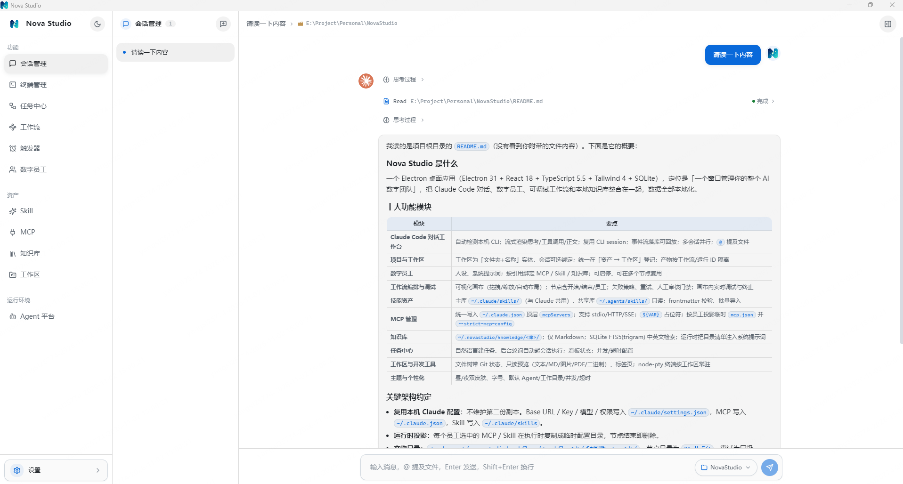
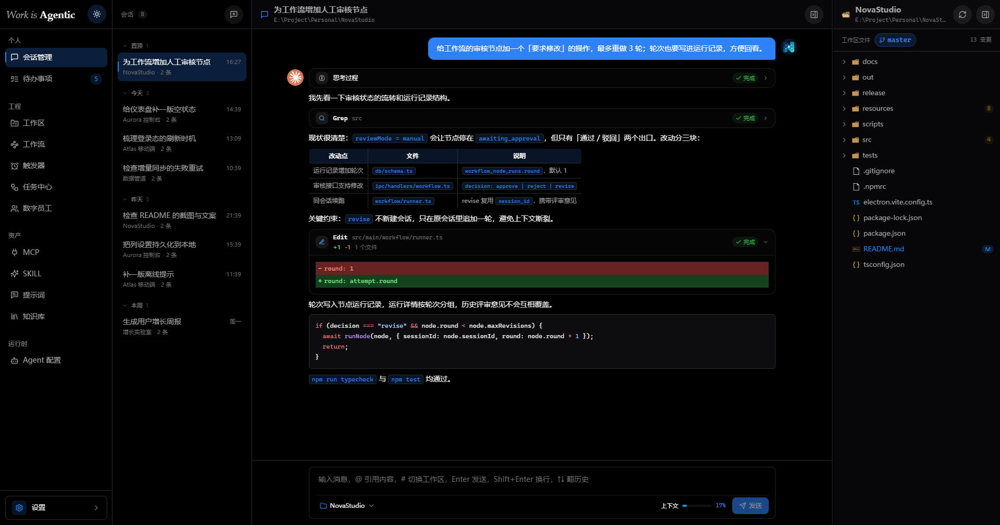
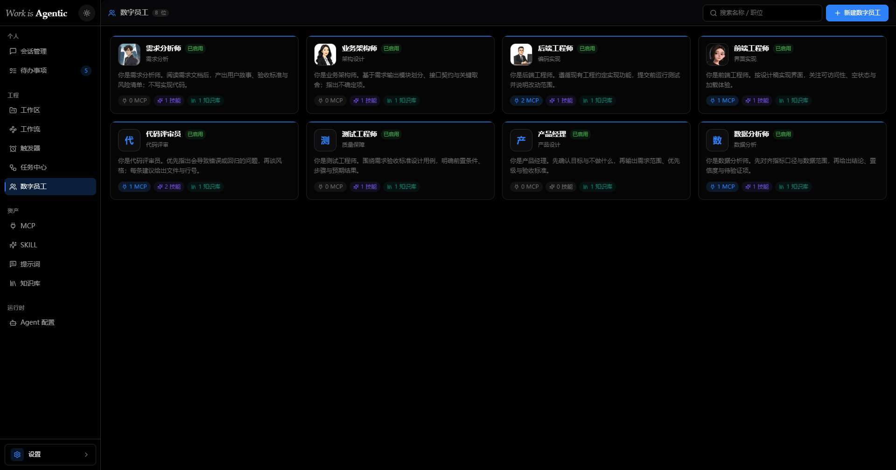
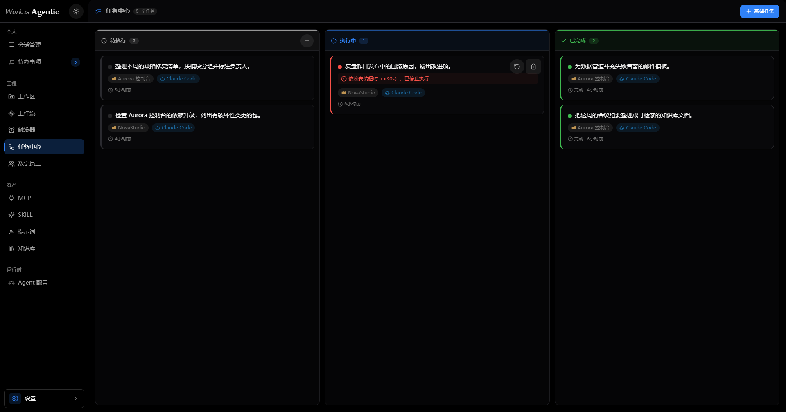

<p align="center">
  
</p>

<p align="center">
  <a href="#它是什么">它是什么</a>&nbsp;&nbsp;·&nbsp;&nbsp;<a href="#界面一览">界面一览</a>&nbsp;&nbsp;·&nbsp;&nbsp;<a href="#核心能力">核心能力</a>&nbsp;&nbsp;·&nbsp;&nbsp;<a href="#快速开始">快速开始</a>&nbsp;&nbsp;·&nbsp;&nbsp;<a href="#本地优先">本地优先</a>&nbsp;&nbsp;·&nbsp;&nbsp;<a href="#技术栈">技术栈</a>
</p>

<p align="center">
  <sub>Electron 31&nbsp;&nbsp;·&nbsp;&nbsp;React 18&nbsp;&nbsp;·&nbsp;&nbsp;TypeScript 5.5&nbsp;&nbsp;·&nbsp;&nbsp;SQLite&nbsp;&nbsp;·&nbsp;&nbsp;MIT License</sub>
</p>

---

## 它是什么

> **当你有多个项目、多个角色、多道工序时，如何让 AI 真正参与进来，并且每一步都看得见、接得住、留得下。**

大多数 AI 工具只解决「聊天」这一件事。Nova Studio 解决的是另一半：把一次性的对话，变成**可复用的角色、可编排的流程和可追溯的产物**。

你仍然在用 Claude Code，只是不再需要在终端、编辑器、文档和文件夹之间来回搬运上下文。

| 你正在经历的 | Nova 的解法 |
| :--- | :--- |
| 项目一多，会话、终端和文件就散落各处 | **会话工作台** —— 一个窗口容纳全部会话、文件、Git 与终端 |
| 同一套角色设定，每次都要重新粘贴给 AI | **数字员工** —— 把职责与能力固化成可复用的角色 |
| 多步骤任务，靠人把上一轮结果搬给下一轮 | **工作流** —— 可视化 DAG，节点自动流转、并行与汇合 |
| 只要结果，却不知道中间发生了什么 | **全程留痕** —— 思考、工具调用、产物与运行记录完整落库 |
| 不希望项目资料和对话记录上云 | **本地优先** —— 数据只存在本机 `~/.novastudio/` 与工作区 |

### 一条完整的工作链路

| # | 步骤 | 做什么 | 对应模块 |
| :---: | :--- | :--- | :--- |
| ① | **对话** | 在一个窗口里完成问答、读写文件与命令执行 | 会话工作台 |
| ② | **配置角色** | 把人设、职责与可用能力固化成可复用角色 | 数字员工 |
| ③ | **编排流程** | 把角色连成 DAG，配置并行、审核与失败策略 | 工作流 |
| ④ | **沉淀资产** | 统一管理 Skill、MCP、知识库与提示词 | 资产库 |
| ⑤ | **自动运行** | 按时间触发，或用自然语言交给任务中心 | 自动化 |

---

## 界面一览

<p align="center"><sub>经典皮肤 · 昼夜双主题，代码高亮随皮肤联动 · 点击图片查看原图</sub></p>

<table width="100%">
<tr>
<td align="center" width="50%">
<a href="resources/preview/经典昼.png"></a>
<br><sub>图 01 · 经典 · 日间</sub>
</td>
<td align="center" width="50%">
<a href="resources/preview/经典夜.png"></a>
<br><sub>图 02 · 经典 · 夜间</sub>
</td>
</tr>
</table>

> 主界面左上角可一键切换日夜皮肤，代码高亮主题会随皮肤联动。右侧常驻工作区面板：文件树、Git 状态与终端各就各位。

---

## 核心能力

### 会话工作台

*把 Claude Code 从终端搬进一个完整的桌面工作台。*

- **复用本机 Claude Code** —— 自动检测安装位置，直接沿用登录、模型、权限、MCP 与 Skill，不维护第二套配置。
- **完整过程呈现** —— 思考过程、工具调用与正文流式输出；工具调用带分类图标与调用摘要，diff 直接展开。
- **会话与工作区解耦** —— 不必先建项目；需要读写文件时再绑定工作区，多个会话可同时运行、互不阻塞。
- **消息暂存** —— 运行中继续发消息不会丢失，进入暂存区后按顺序排队发送。
- **内容与回放** —— 支持 `@` 提及文件、GFM 表格与代码高亮；历史事件完整落库，重启后可回放含思考与工具调用的对话。

### 数字员工

*把「人设 + 职责 + 可用能力」固化成可复用的角色。*

<p align="center">
  
</p>
<p align="center"><sub>图 03 · 数字员工 —— 按引用组合 MCP、Skill 与知识库，不在员工里复制资产</sub></p>

- 头像、姓名、职位与系统提示词，写清职责边界和输出要求；
- 按需勾选 MCP、Skill 与知识库，同一个人可在多个工作流节点复用；
- 资产统一在各自的页面管理，员工只保存引用，不产生重复副本；
- 一键启用 / 停用；工作流节点直接引用员工，不用重复填写角色信息。

<p align="center"><sub>常见角色：产品经理 · 需求分析师 · 业务架构师 · 前端 / 后端工程师 · 代码评审员 · 测试工程师 · 数据分析师</sub></p>

### 工作流

*把员工串成一张真正能跑起来的 DAG。*

<p align="center">
  
</p>
<p align="center"><sub>图 04 · 工作流画布 —— 可视化编排、并行分支与人工审核</sub></p>

- **可视化画布** —— 拖拽节点、缩放、平移、自动布局、撤销 / 重做、16px 网格吸附与对齐参考线。
- **并行与汇合** —— 分支并行（并发上限 3 个节点）与 AND 汇合，汇合节点等待全部上游完成。
- **节点策略** —— 任务详情、失败策略（停止 / 跳过 / 重试）与人工审核门禁。
- **人工审核** —— 执行后暂停；「要求修改」在同一会话继续重做（最多 3 轮），驳回则终止运行。
- **画布内调试** —— 节点实时显示执行中、等待审核、成功、失败、跳过、取消。
- **运行记录** —— 继续运行、从任意节点重跑，保留每次执行的对话、结果与产物文件。

一条常见的研发流水线：

<p align="center">
  <b>开始</b> → 需求分析 → 架构设计 → <b>后端实现 / 前端实现</b>（并行分支）→ 代码评审（AND 汇合）→ <b>结束</b>
</p>

每次运行都会在工作区 `.novastudio/` 下生成独立目录，按工作流与运行 ID 隔离，互不覆盖，也不污染业务仓库。

### 资产

*能力不写在每个员工里，而是统一沉淀为可复用的资产。*

<p align="center">
  
</p>
<p align="center"><sub>图 05 · MCP —— 统一管理 stdio / HTTP / SSE 服务，支持 ${VAR} 占位符与密钥标记</sub></p>

| 资产 | 做什么 |
| :--- | :--- |
| **技能 Skill** | 与 Claude 共用的全局技能目录，可新建、批量导入、编辑与校验 |
| **MCP** | 统一管理 stdio / HTTP / SSE 服务，支持 `${VAR}` 占位符与密钥标记 |
| **知识库** | Markdown 文档库，支持子文件夹、批量上传与中英文全文检索 |
| **提示词** | 沉淀常用提示词，一键送入当前会话 |

数字员工按引用组合这些资产。工作流节点运行时只加载该员工选中的能力，节点结束即清理临时配置，不在本机留下副本。

### 自动化

*让流程在你不在的时候也能跑。*

<table width="100%">
<tr>
<td align="center" width="50%">
<a href="resources/preview/任务中心.png"></a>
<br><sub>图 06 · 任务中心 —— 自然语言建任务，看板管理执行状态</sub>
</td>
<td align="center" width="50%">
<a href="resources/preview/触发器.png"></a>
<br><sub>图 07 · 触发器 —— 每天 / 每周 / 每 N 分钟启动工作流</sub>
</td>
</tr>
</table>

- **任务中心** —— 用自然语言创建任务，后台自动拾取、创建会话并执行，以看板管理待执行 / 执行中 / 已完成 / 失败。
- **触发器** —— 按每天、每周或每隔 N 分钟启动工作流；一个触发器可绑定多条工作流，卡片展示上次与下次触发时间。

### 工作区与开发工具

*文件、Git、终端都不必离开 Nova。*

<p align="center">
  
</p>
<p align="center"><sub>图 08 · 工作区 —— 变更列表、diff、分支与提交都在同一个控制台</sub></p>

| 工具 | 说明 |
| :--- | :--- |
| **工作区** | 一个本地文件夹，登记一次即可被会话和工作流复用 |
| **文件树** | 带 Git 状态标记，支持文本、Markdown、图片、PDF 与二进制预览 |
| **Git 面板** | 查看变更、暂存 / 取消暂存、查看 diff、切换与新建分支、提交、浏览提交记录 |
| **终端** | 按工作区常驻，切换页面或工作区都不会丢失进程与输出 |
| **待办事项** | 按截止时间分组，带日历、标签、排序与完成统计 |
| **主题** | 内置「经典 · 昼 / 夜」两套皮肤，界面与聊天字号可独立调整 |

### Agent 配置

侧栏「Agent 配置」是本机 Claude Code 的统一入口：查看安装状态、版本与配置路径，编辑 Base URL、API Key、默认模型和默认权限。所有修改直接写回本机配置，Claude CLI 与 Nova 共用同一份，不产生第二份副本。

---

## 快速开始

> [!IMPORTANT]
> **环境要求**：Node.js 20+、npm 9+，以及本机安装好的 Claude Code CLI。
> 当前主要面向 Windows；其他平台可通过源码运行，但未做完整验证。

```bash
npm install           # 安装依赖
npm run dev           # 开发模式：热更新窗口
npm run build         # 构建到 out/
npm run package:win   # 打包 Windows 安装包到 release/
```

首次启动后：

1. **启动 Nova** —— 自动检测本机 Claude Code，未安装时给出安装命令。
2. **新建会话** —— 点击「会话管理 → 新建会话」，直接开始对话。
3. **绑定工作区** —— 在「工作区」登记文件夹，并在输入框旁绑定，Agent 即可读写代码。
4. **跑起来** —— 创建数字员工、连成工作流，在画布点「调试」，跑完整流程。

---

## 本地优先

> **你的代码、资料和对话不属于任何云端服务。**

| 内容 | 位置 |
| :--- | :--- |
| 会话、员工、工作流、知识库、运行记录 | `~/.novastudio/` |
| 登录、模型、权限、MCP、Skill | 直接复用本机 `~/.claude` 配置 |
| 知识库正文与索引 | Markdown 明文 + 本地 SQLite 全文索引 |
| 工作流运行产物 | 工作区 `.novastudio/`，按运行 ID 隔离 |

删除工作区只清理 Nova 生成的内容，不会删除你的业务目录。

**明确的边界**：不做云端账号、不做模型托管、不做知识库向量化、不做多人协作与权限系统。它是一个单机、单用户、本地优先的工具。

> [!CAUTION]
> `~/.novastudio/` 保存了全部会话与工作流记录，手动删除该目录会清空这些历史数据。

---

## 技术栈

| 层 | 选型 |
| :--- | :--- |
| 桌面运行时 | Electron 31 · electron-vite 2 · electron-builder 24 |
| 前端 | React 18 · TypeScript 5.5 · Tailwind CSS 4 · Zustand 4 |
| 存储 | SQLite（better-sqlite3） |
| 内容渲染 | react-markdown · remark-gfm · Shiki |
| 终端 | xterm.js 6 · node-pty |
| 更新发布 | electron-updater（GitHub Releases） |

---

## 工程文档

[docs/](docs/README.md) 记录了完整的产品定位、架构决策与实现细节，共 27 篇：

- [产品定位与功能全景](docs/00-产品定位与功能全景.md)
- [系统架构与关键决策](docs/02-系统架构与关键决策.md)
- [数据模型与数据库](docs/03-数据模型与数据库.md)
- [工作流调度与执行](docs/09-工作流-调度与执行.md)
- [设计系统与皮肤](docs/19-设计系统与皮肤.md)
- [复刻实施指南](docs/24-复刻实施指南.md)

---

## Roadmap

| 已完成 | 规划中 |
| :--- | :--- |
| Claude Code 统一会话工作台 | 中断恢复与断点续跑 |
| 数字员工（人设 / MCP / Skill / 知识库） | 知识库文档在线编辑 |
| 工作流可视化编排、并行分支与人工审核 | 超大文档后台索引 |
| 画布内调试、运行记录与产物追溯 | — |
| MCP / Skill / 知识库 / 提示词统一管理 | — |
| 触发器与自然语言任务中心 | — |
| 工作区文件、Git 与终端 | — |

---

## 参与贡献

欢迎提交 Issue 与 Pull Request。

| 提交前 | 要求 |
| :--- | :--- |
| `npm run build` | 构建通过 |
| `npm run verify:skins` | 皮肤令牌校验通过 |
| 功能改动 | 附使用说明或截图 |
| 提交内容 | 勿包含 `out/`、`release/`、`node_modules/` 等产物 |

更完整的工程设计、数据模型与实现细节见 [docs/](docs/README.md)。

---

## 许可

项目代码基于 **MIT License** 开源，可自由使用、修改与分发。第三方资源与依赖的许可证声明见 [resources/NOTICE.md](resources/NOTICE.md)。

---

<p align="center">
  <sub><b>Nova Studio</b> · 让每个数字员工都有自己的工位</sub>
</p>
