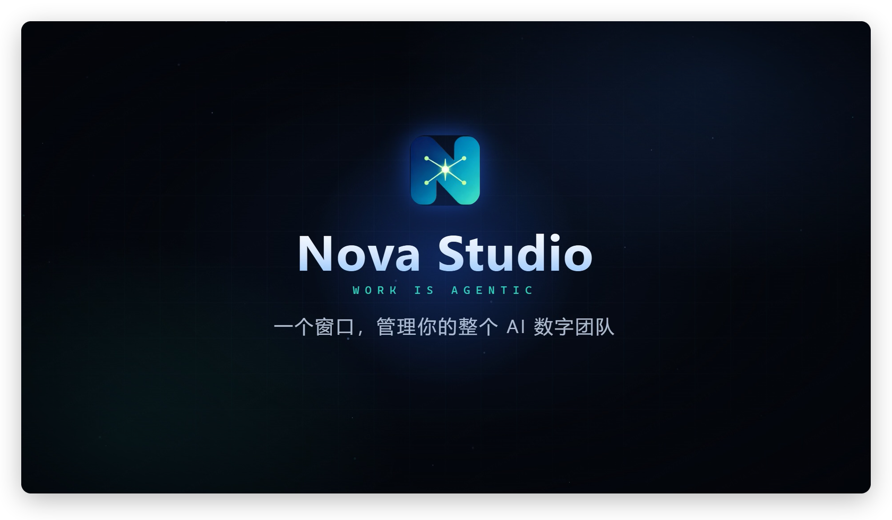
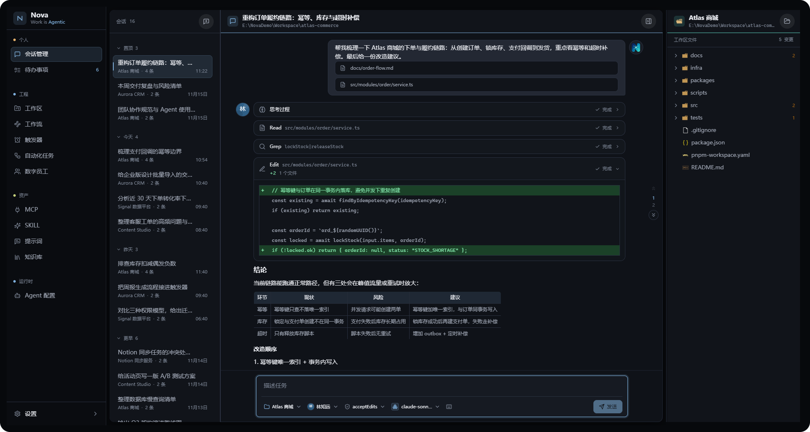
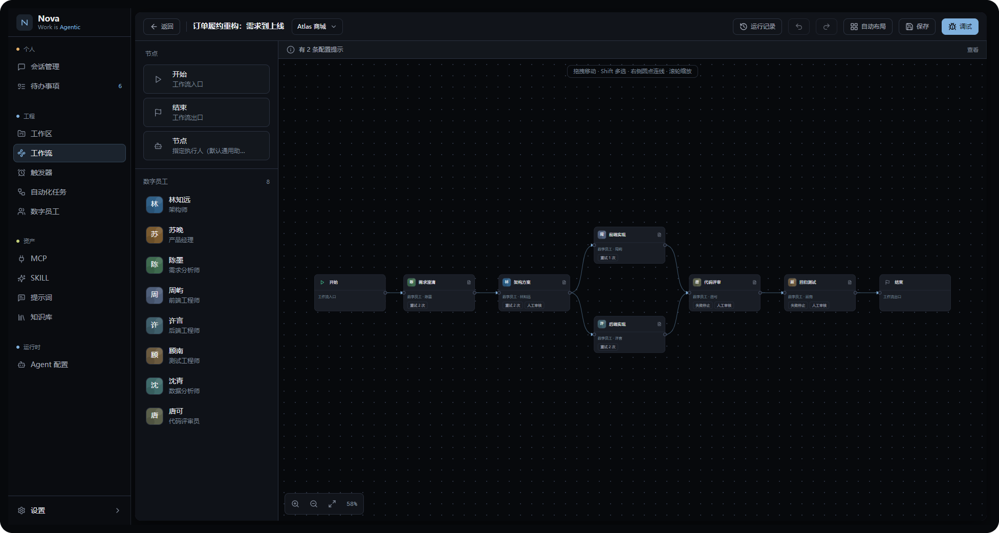
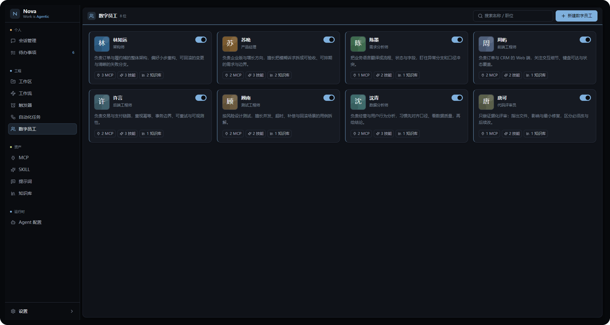
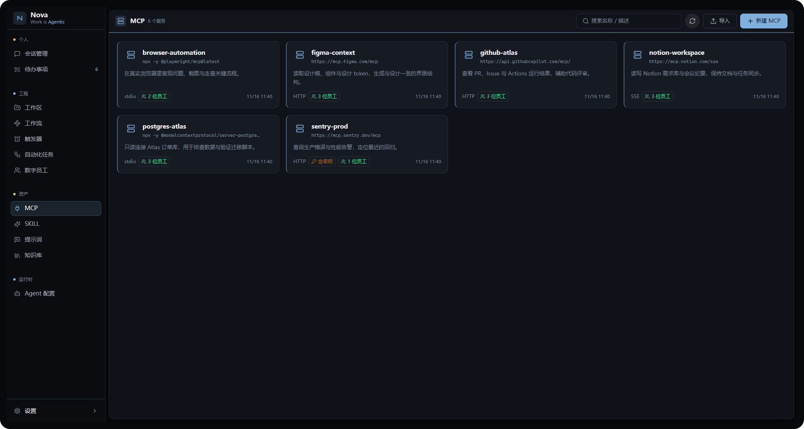
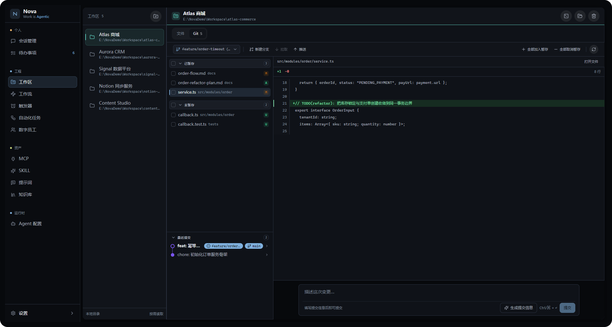

<p align="center"></p>

**本地优先的 AI 数字团队工作台。** 把一次性的对话，沉淀为可复用的角色、可编排的流程、可追溯的产物。

模型与工具来自本机安装的 Claude Code CLI；Nova 负责把会话、数字员工、工作流、本地资产与运行记录放进同一个窗口。不建云端账号，不上传你的代码与对话。

[会话工作台](#session) · [工作流](#workflow) · [数字员工](#employees) · [资产](#assets) · [工作区](#workspace) · [本地优先](#local-first) · [快速开始](#quick-start) · [文档](#docs)

<a name="session"></a>

## 01 会话工作台

多会话并行，事件按会话路由。历史完整落库，重启后连工具调用一起回放。

<a href="resources/preview/Nova夜.png"></a>

<sub>多会话并行 · 思考过程与工具调用可展开 · 右侧文件树、Git 与终端</sub>

- 流式渲染思考过程、工具调用与正文，支持 Markdown、表格与代码高亮。
- 会话级权限模式逐轮切换；CLI 请求工具授权时，在输入框上方逐次允许或拒绝，等待 5 分钟自动拒绝。
- 图片可粘贴、拖入或选择，发送前按长边 1568px 缩放。

<a name="workflow"></a>

## 02 工作流

节点引用数字员工，连线决定先后。分支并行、汇合等待，每一步的结果与产物都会落盘。

<a href="resources/preview/工作流.png"></a>

<sub>需求澄清 → 架构方案 → 前后端并行实现 → 代码评审 → 回归测试 → 结束</sub>

- 画布支持拖拽、缩放、自动布局与撤销重做，16px 网格吸附。
- 分支并行最多 3 个节点，AND 汇合；节点失败可停止、跳过或重试 1–5 次。
- 人工审核门禁可「要求修改」，复用同一会话续跑，最多 3 轮；审核等待 30 分钟按中断处理。
- 画布内调试，运行记录与每步产物可追溯。

<a name="employees"></a>

## 03 数字员工

人设、职责与可用能力，定义一次，多处复用。

<a href="resources/preview/数字员工.png"></a>

<sub>架构师 · 产品经理 · 需求分析师 · 前端 / 后端工程师 · 测试工程师 · 数据分析师 · 代码评审员</sub>

- 会话中用 `@` 选择本轮回答的员工；工作流节点直接引用员工，不重复填写角色信息。
- 从 MCP 服务、Skill 与知识库资料中勾选能力，一键启用或停用。
- 员工只保存引用；能力资产在各自页面统一管理。

<a name="assets"></a>

## 04 资产

Skill、MCP、知识库与提示词统一沉淀为可引用的资产。运行时只加载该员工选中的能力，结束后清理临时配置。

<a href="resources/preview/MCP.png"></a>

<sub>MCP · stdio / HTTP / SSE 统一管理 · 占位符与密钥标记</sub>

| 资产 | 做什么 |
|---|---|
| MCP | stdio / HTTP / SSE 三类服务统一管理，支持 `${VAR}` 占位符与密钥标记 |
| Skill | 全局技能的新建、编辑与删除 |
| 知识库 | Markdown 资料分目录收录，按需检索并注入上下文 |
| 提示词 | 常用指令存为资产，在输入框用 `#` 引用 |

<a name="workspace"></a>

## 05 工作区

不必离开 Nova，右侧常驻文件树、Git 状态与终端。

<a href="resources/preview/工作区.png"></a>

<sub>变更列表 · diff · 分支与提交在同一控制台</sub>

- 文件树按需展开，文件监听只建立在当前展开的目录上，预览只读。
- 变更列表、diff、分支切换与提交都在同一个控制台。
- 终端标签挂在会话页的中心标签栏，与对话并排。

<a name="local-first"></a>

## 本地优先

你的代码、资料和对话不属于任何云端服务。所有状态，都留在你自己的机器上。

不做云端账号、模型托管、知识库向量化、多人协作与权限系统——单机、单用户、本地优先。

<a name="quick-start"></a>

## 快速开始

需要 Node.js 20+、npm 9+，以及本机安装好的 Claude Code CLI。当前主要面向 Windows。

```bash
npm install           # 安装依赖
npm run dev           # 开发模式：热更新窗口
npm run build         # 构建到 out/
npm run package:win   # 打包 Windows 安装包到 release/
```

1. **启动 Nova** —— 自动检测本机 Claude Code，未安装时给出安装命令。
2. **新建会话** —— 直接开始对话，需要读写文件时再绑定工作区。
3. **创建员工** —— 填人设与职责，勾选 MCP、Skill 与知识库。
4. **连成工作流** —— 拖上画布，配置并行与审核，点「调试」。

<a name="docs"></a>

## 文档

27 篇工程文档，覆盖产品定位、架构决策与实现细节。

| 分组 | 文档 |
|---|---|
| 产品与架构 | [产品定位与功能全景](docs/00-产品定位与功能全景.md) · [技术栈与工程结构](docs/01-技术栈与工程结构.md) · [系统架构与关键决策](docs/02-系统架构与关键决策.md) · [数据模型与数据库](docs/03-数据模型与数据库.md) · [IPC 契约参考](docs/04-IPC契约参考.md) |
| 运行时 | [Agent 运行时抽象](docs/05-Agent运行时抽象.md) · [Claude Code 适配层](docs/06-Claude-Code适配层.md) · [会话与聊天子系统](docs/07-会话与聊天子系统.md) |
| 工作流 | [图模型与校验](docs/08-工作流-图模型与校验.md) · [调度与执行](docs/09-工作流-调度与执行.md) · [审核、续跑与产物](docs/10-工作流-审核续跑与产物.md) |
| 能力资产 | [数字员工与能力绑定](docs/11-数字员工与能力绑定.md) · [MCP 服务管理](docs/12-MCP服务管理.md) · [Skill 技能管理](docs/13-Skill技能管理.md) · [知识库与全文检索](docs/14-知识库与全文检索.md) · [任务中心与触发器](docs/16-任务中心与触发器.md) |
| 个人工作 | [待办、提示词与周报](docs/26-待办提示词与周报.md) |
| 工作区与界面 | [工作区：文件、Git 与终端](docs/15-工作区-文件-Git-终端.md) · [前端架构与状态管理](docs/17-前端架构与状态管理.md) · [页面与交互规格](docs/18-页面与交互规格.md) · [设计系统与皮肤](docs/19-设计系统与皮肤.md) · [设置与 Agent 配置](docs/20-设置与Agent配置.md) · [工作区设计语言](docs/25-工作区设计语言.md) |
| 工程保障 | [安全与数据隔离](docs/21-安全与数据隔离.md) · [构建、打包、发布与更新](docs/22-构建打包发布与更新.md) · [测试与质量保障](docs/23-测试与质量保障.md) · [复刻实施指南](docs/24-复刻实施指南.md) |

## 路线图

**已完成**

- [x] Claude Code 统一会话工作台
- [x] 数字员工：人设、MCP、Skill 与知识库
- [x] 工作流可视化编排、并行分支与人工审核
- [x] 画布内调试、运行记录与产物追溯
- [x] MCP、Skill、知识库与提示词统一管理
- [x] 触发器与自然语言任务中心
- [x] 工作区文件、Git 与终端
- [x] 中断恢复与断点续跑
- [x] 知识库文档在线编辑

**接下来**

- [ ] 员工记忆
- [ ] AI 团队
- [ ] 智能组织

## 参与贡献

欢迎提交 Issue 与 Pull Request。提交前确认 `npm run build` 与 `npm run verify:skins` 通过；功能改动附使用说明或截图。

---

**许可**：MIT License。第三方资源与依赖的许可声明见 [resources/NOTICE.md](resources/NOTICE.md)。

<p align="center"><sub>Work is Agentic · 让每个数字员工都有自己的工位</sub></p>
