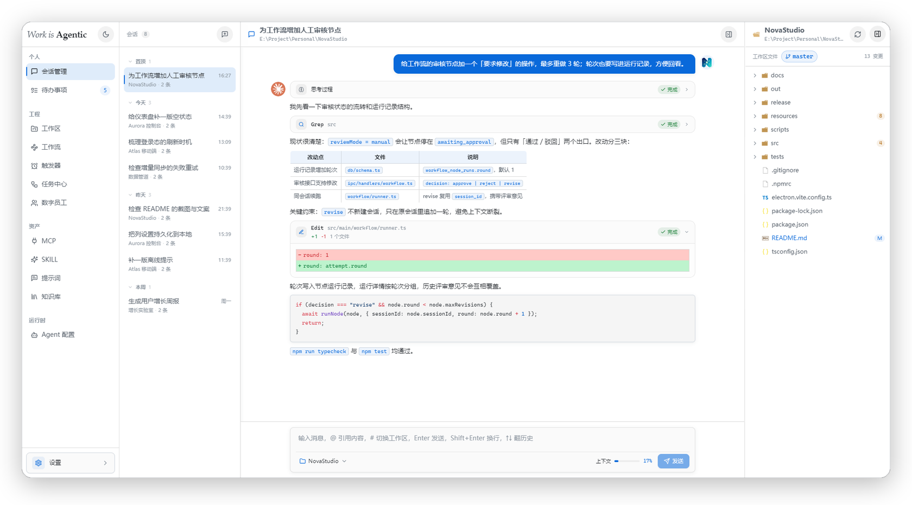
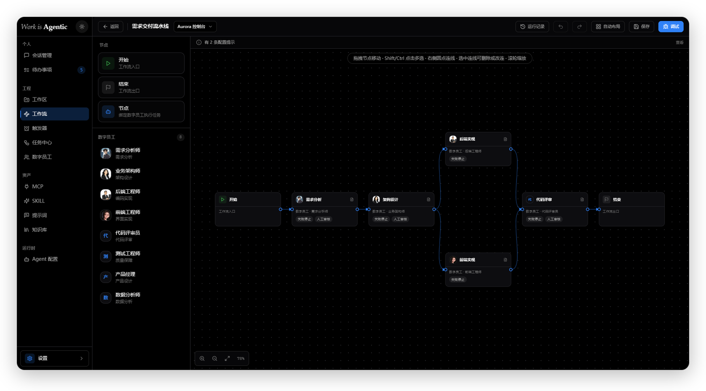
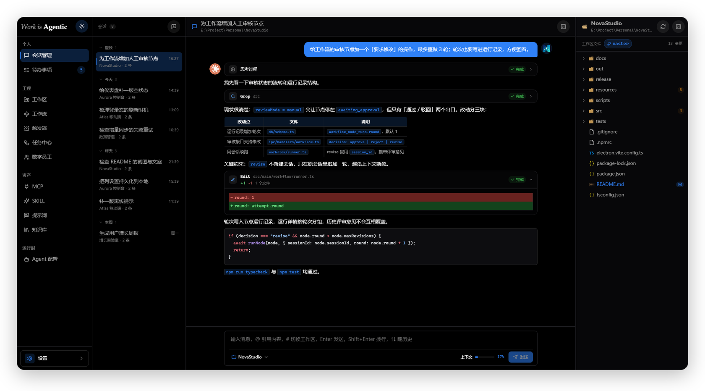
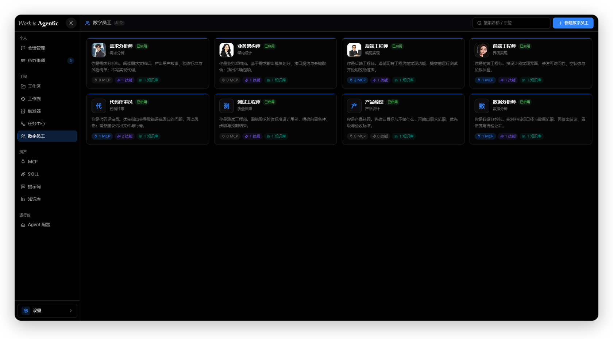
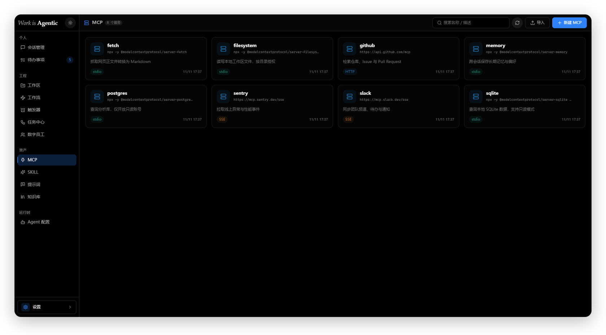
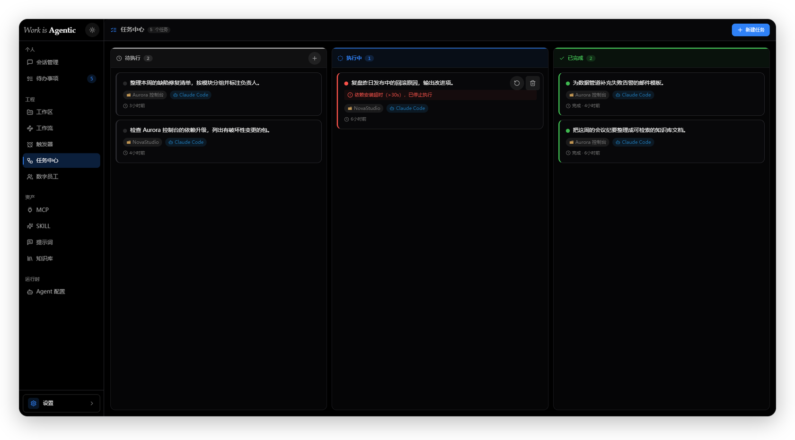
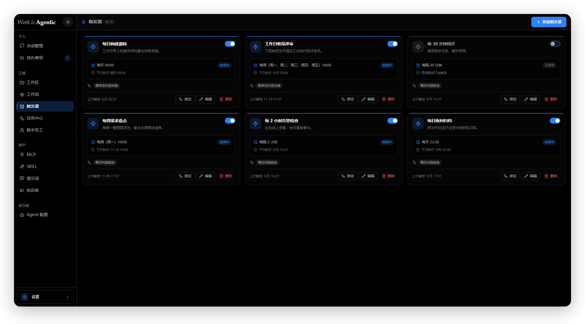
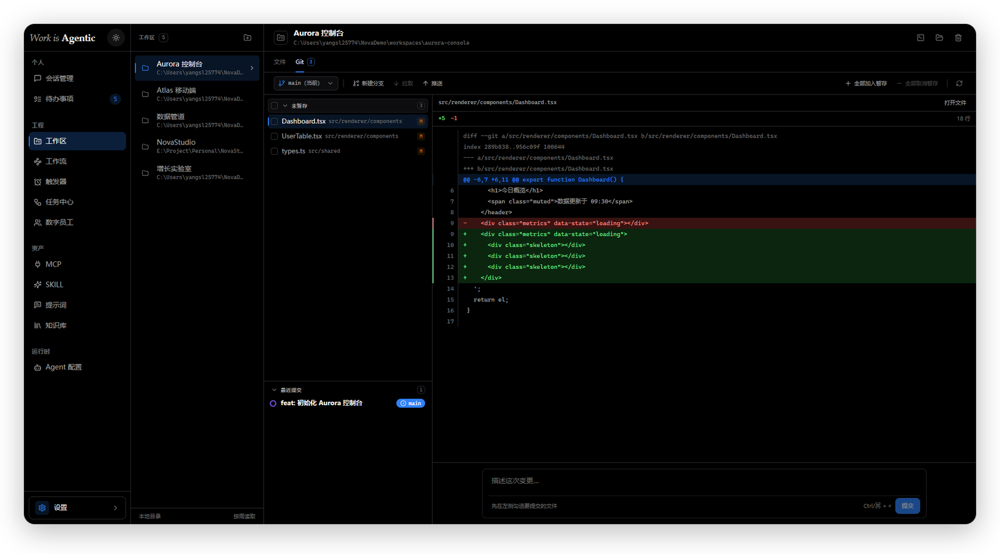

<p align="center">
  <picture>
    <source media="(prefers-color-scheme: dark)" srcset="resources/banner-dark.svg">
    
  </picture>
</p>

<p align="center"><sub>W O R K &nbsp; I S &nbsp; A G E N T I C</sub></p>

<p align="center">
  把一次性的对话，沉淀为可复用的角色、可编排的流程、可追溯的产物。<br>
  你仍然在用 Claude Code，只是不必再在终端、编辑器、文档和文件夹之间搬运上下文。
</p>

<p align="center">
  <a href="#快速开始"><b>开始使用</b></a> &nbsp;·&nbsp;
  <a href="docs/00-产品定位与功能全景.md"><b>阅读文档</b></a> &nbsp;·&nbsp;
  <a href="#界面"><b>查看界面</b></a>
</p>

<p align="center"><sub>v0.2.0 &nbsp;·&nbsp; Windows &nbsp;·&nbsp; MIT &nbsp;·&nbsp; Electron 31 &nbsp;·&nbsp; 数据只存本机</sub></p>

---

<sub>01</sub>

## 它是什么

大多数 AI 工具只解决「聊天」这一件事。Nova Studio 解决的是另一半：让对话真正进入工作流程，并且每一步都看得见、接得住、留得下。

<table width="100%">
<tr>
<td width="52%" valign="middle">

- 会话、终端和文件散落各处 → **会话工作台**收进一个窗口
- 角色设定每次都要重新讲 → **数字员工**把职责与能力固化下来
- 多步骤任务靠人搬运结果 → **工作流**用 DAG 自动流转、并行与汇合
- 只看得到结果、过程不可见 → **全程留痕**，思考与工具调用完整落库
- 不想让资料和对话上云 → **本地优先**，数据只存在本机

</td>
<td width="48%" align="center">

<a href="resources/preview/经典昼.png"></a>
<br><sub>图 01 · 会话、文件、Git 与终端在同一个窗口</sub>

</td>
</tr>
</table>

---

<sub>02</sub>

## 一条工作流

<p align="center">
  
</p>

<p align="center"><sub>图 02 · 需求分析 → 架构设计 → 前后端并行实现 → 代码评审在 AND 汇合点等待全部上游完成</sub></p>

<table width="100%">
<tr>
<td width="33%" valign="top">

**可视化编排**<br>
<sub>拖拽、缩放、自动布局、撤销重做，16px 网格吸附与对齐参考线。</sub>

</td>
<td width="33%" valign="top">

**并行与汇合**<br>
<sub>分支并行上限 3 个节点，AND 汇合点等待全部上游完成。</sub>

</td>
<td width="33%" valign="top">

**人工审核**<br>
<sub>执行后暂停；「要求修改」在同一会话原地重做，最多 3 轮。</sub>

</td>
</tr>
</table>

每次运行都在工作区 `.novastudio/` 下生成独立目录，按工作流与运行 ID 隔离，不覆盖、不污染业务仓库。

---

<sub>03</sub>

## 核心能力

<table width="100%">
<tr>
<td width="50%" valign="top">

#### 会话工作台

Claude Code 的完整桌面工作台，而不只是一个聊天框。复用本机登录、模型、权限、MCP 与 Skill；思考、工具调用与正文流式输出，diff 直接展开。

<sub>`本机 CLI` · `过程可见` · `多会话并行` · `完整回放`</sub>

</td>
<td width="50%" valign="top">

#### 数字员工

「人设 + 职责 + 可用能力」，定义一次，多处复用。按引用组合 MCP、Skill 与知识库，资产在各自页面统一管理，不产生重复副本。

<sub>`头像与职位` · `系统提示词` · `能力引用` · `一键启停`</sub>

</td>
</tr>
<tr>
<td width="50%" valign="top">

#### 工作流

把员工串成一张真正能跑起来的 DAG。分支并行、AND 汇合、失败策略与人工审核；节点状态实时显示，可从任意节点重跑并保留产物。

<sub>`可视化画布` · `并行汇合` · `审核门禁` · `断点重跑`</sub>

</td>
<td width="50%" valign="top">

#### 资产中心

能力不写进员工，而是统一沉淀为可引用的资产：Skill、MCP、知识库与提示词。运行时只加载该员工选中的能力，结束后清理临时配置。

<sub>`Skill` · `MCP` · `知识库` · `提示词`</sub>

</td>
</tr>
<tr>
<td width="50%" valign="top">

#### 自动化

流程在你不在的时候继续跑。自然语言创建任务，后台自动拾取、建会话并执行；触发器支持每天、每周或每 N 分钟启动工作流。

<sub>`任务中心看板` · `定时触发` · `多流程绑定`</sub>

</td>
<td width="50%" valign="top">

#### 工作区与开发工具

文件、Git、终端都不必离开 Nova。文件树带 Git 状态标记，Git 面板覆盖变更、diff、分支与提交，终端按工作区常驻，切换页面不丢进程。

<sub>`文件树` · `Git` · `终端` · `待办`</sub>

</td>
</tr>
</table>

---

<sub>04</sub>

## 界面

<p align="center"><sub>经典 · 日间 / 夜间，点击图片查看原图</sub></p>

<table width="100%">
<tr>
<td width="50%" align="center">

<a href="resources/preview/经典昼.png"></a>
<br><sub>经典 · 日间</sub>

</td>
<td width="50%" align="center">

<a href="resources/preview/经典夜.png"></a>
<br><sub>经典 · 夜间</sub>

</td>
</tr>
<tr>
<td width="50%" align="center">

<a href="resources/preview/数字员工.png"></a>
<br><sub>数字员工 · 人设、能力与启用状态</sub>

</td>
<td width="50%" align="center">

<a href="resources/preview/MCP.png"></a>
<br><sub>MCP · stdio / HTTP / SSE 统一管理</sub>

</td>
</tr>
</table>

<details>
<summary><sub>更多截图：任务中心、触发器、工作区</sub></summary>

<br>

<table width="100%">
<tr>
<td width="50%" align="center">
<a href="resources/preview/任务中心.png"></a>
<br><sub>任务中心 · 待执行 / 执行中 / 已完成</sub>
</td>
<td width="50%" align="center">
<a href="resources/preview/触发器.png"></a>
<br><sub>触发器 · 每天 / 每周 / 每 N 分钟</sub>
</td>
</tr>
<tr>
<td colspan="2" align="center">
<a href="resources/preview/工作区.png"></a>
<br><sub>工作区 · 变更列表、diff、分支与提交</sub>
</td>
</tr>
</table>

</details>

---

<sub>05</sub>

## 快速开始

**环境要求**：Node.js 20+、npm 9+，以及本机安装好的 Claude Code CLI。当前主要面向 Windows；其他平台可源码运行，未做完整验证。

```bash
npm install           # 安装依赖
npm run dev           # 开发模式：热更新窗口
npm run build         # 构建到 out/
npm run package:win   # 打包 Windows 安装包到 release/
```

首次启动：

1. **启动 Nova**：自动检测本机 Claude Code，未安装时给出安装命令。
2. **新建会话**：「会话管理 → 新建会话」，直接开始对话。
3. **绑定工作区**：在「工作区」登记文件夹并在输入框旁绑定，Agent 即可读写代码。
4. **跑起来**：创建数字员工、连成工作流，在画布点「调试」。

---

<sub>06</sub>

## 本地优先

**你的代码、资料和对话不属于任何云端服务。**

| 内容 | 位置 |
| :--- | :--- |
| 会话、员工、工作流、知识库、运行记录 | `~/.novastudio/` |
| 登录、模型、权限、MCP、Skill | 直接复用本机 `~/.claude` 配置 |
| 知识库正文与索引 | Markdown 明文 + 本地 SQLite 全文索引 |
| 工作流运行产物 | 工作区 `.novastudio/`，按运行 ID 隔离 |

删除工作区只清理 Nova 生成的内容，不会删除业务目录。

**边界**：不做云端账号、模型托管、知识库向量化、多人协作与权限系统——单机、单用户、本地优先。

> **注意**：`~/.novastudio/` 保存全部会话与工作流记录，手动删除会清空历史数据。

**技术栈**：`Electron 31` · `React 18` · `TypeScript 5.5` · `Tailwind CSS 4` · `Zustand 4` · `SQLite` · `Shiki` · `xterm.js` · `node-pty`

---

<sub>07</sub>

## 工程与路线图

<details>
<summary><b>工程文档</b> · 26 篇，覆盖产品定位、架构决策与实现细节</summary>

<br>

- [产品定位与功能全景](docs/00-产品定位与功能全景.md)
- [系统架构与关键决策](docs/02-系统架构与关键决策.md)
- [数据模型与数据库](docs/03-数据模型与数据库.md)
- [工作流：调度与执行](docs/09-工作流-调度与执行.md)
- [设计系统与皮肤](docs/19-设计系统与皮肤.md)
- [复刻实施指南](docs/24-复刻实施指南.md)

</details>

<details>
<summary><b>Roadmap</b></summary>

<br>

- [x] Claude Code 统一会话工作台
- [x] 数字员工（人设 / MCP / Skill / 知识库）
- [x] 工作流可视化编排、并行分支与人工审核
- [x] 画布内调试、运行记录与产物追溯
- [x] MCP / Skill / 知识库 / 提示词统一管理
- [x] 触发器与自然语言任务中心
- [x] 工作区文件、Git 与终端
- [ ] 中断恢复与断点续跑
- [ ] 知识库文档在线编辑
- [ ] 超大文档后台索引

</details>

<details>
<summary><b>参与贡献</b></summary>

<br>

欢迎提交 Issue 与 Pull Request。提交前确认：`npm run build` 构建通过、`npm run verify:skins` 皮肤令牌校验通过、功能改动附使用说明或截图、提交内容不含 `out/`、`release/`、`node_modules/` 等产物。

</details>

---

**许可**：项目代码基于 **MIT License** 开源，可自由使用、修改与分发。第三方资源与依赖的许可声明见 [resources/NOTICE.md](resources/NOTICE.md)。

<p align="center">
  <sub><b>Nova Studio</b> · Work is Agentic · 让每个数字员工都有自己的工位</sub>
</p>
