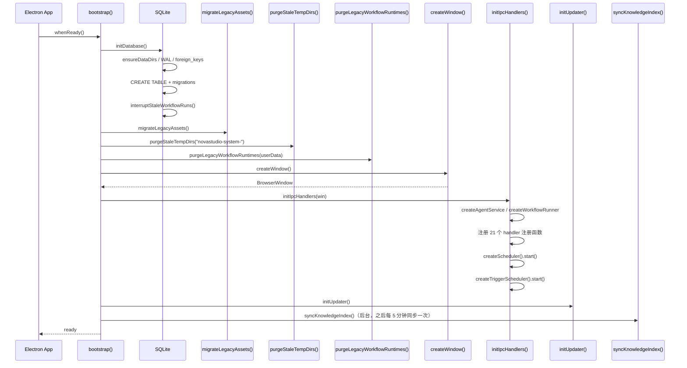
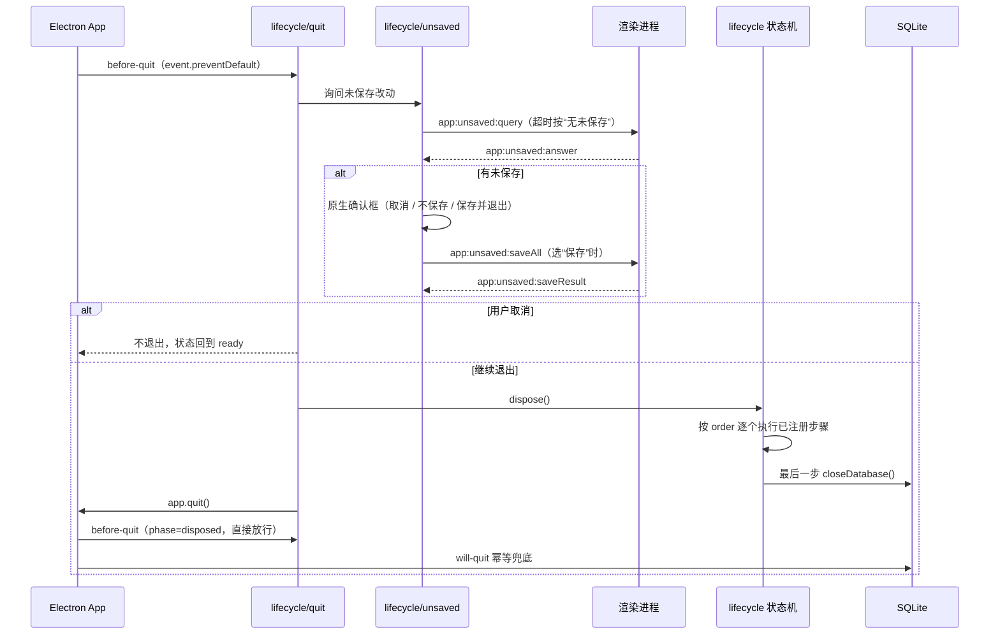
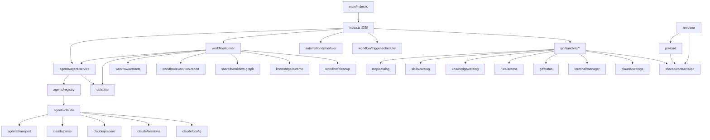
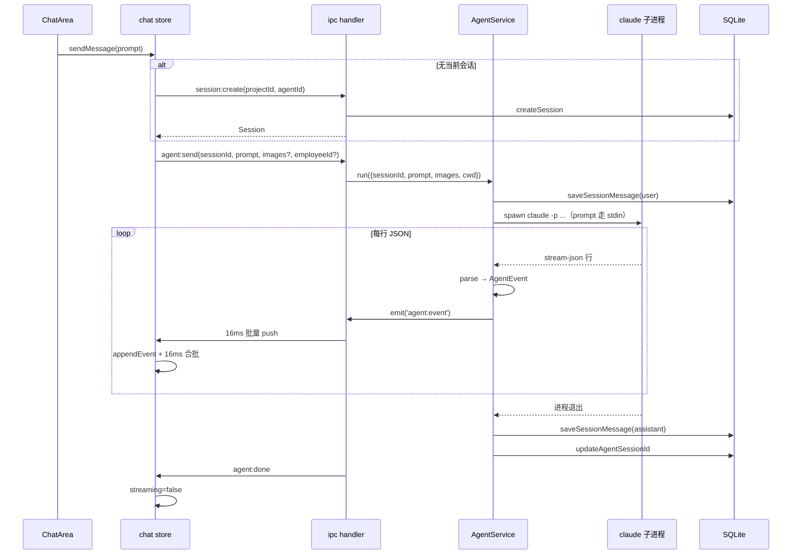
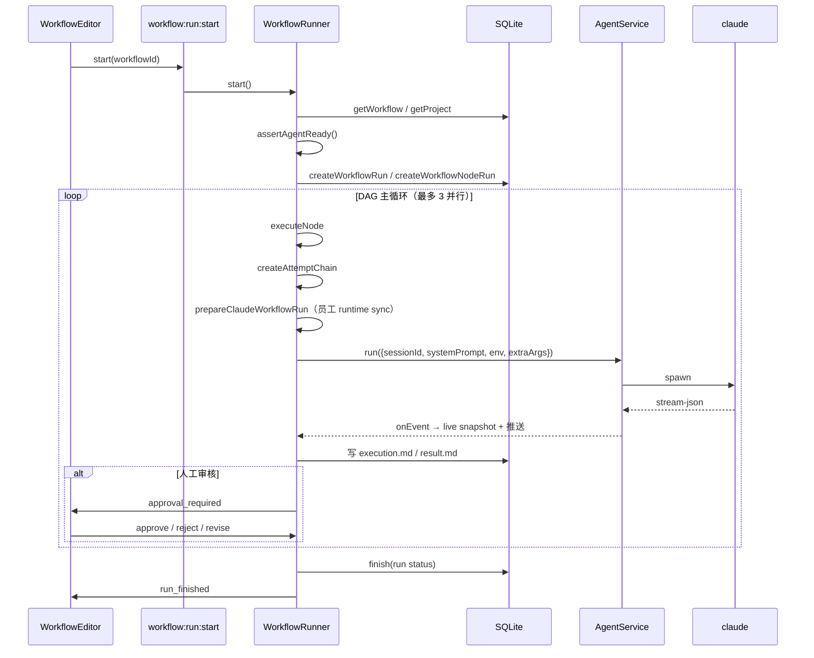
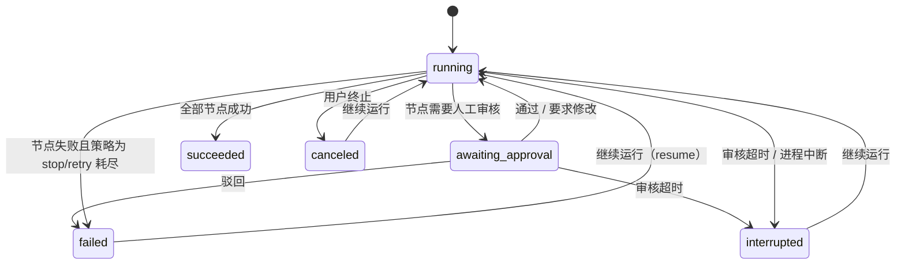
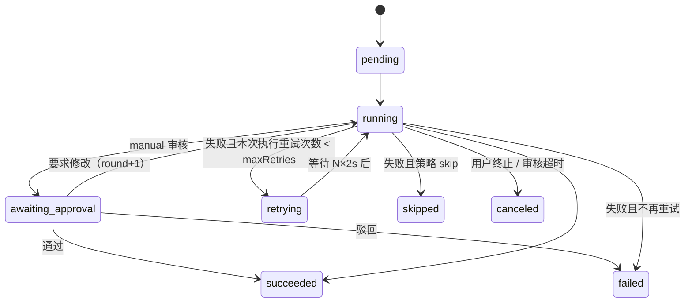

# 02 系统架构与关键决策

## 1. 进程模型

Nova 采用 Electron 标准三进程模型：

```
┌──────────────────────────────────────────────────────────────┐
│                        Main Process                          │
│  Electron 生命周期 / 窗口 / 数据库 / Agent 子进程 / 调度器      │
│  src/main/**                                                 │
└───────────────┬──────────────────────────────────────────────┘
                │ ipcMain.handle / webContents.send
┌───────────────▼──────────────────────────────────────────────┐
│                      Preload (sandbox)                       │
│  contextBridge 暴露 invoke / subscribe / getPathForFile      │
│  src/preload/index.ts                                        │
└───────────────┬──────────────────────────────────────────────┘
                │ window.nova
┌───────────────▼──────────────────────────────────────────────┐
│                     Renderer (sandboxed)                     │
│  React + Zustand + Tailwind + Markdown + xterm                │
│  src/renderer/**                                             │
└──────────────────────────────────────────────────────────────┘
```

### 1.1 安全边界

```ts
webPreferences: {
  preload: preloadPath,
  nodeIntegration: false,
  contextIsolation: true,
  sandbox: true,
}
```

- 渲染进程没有 Node.js 能力；
- preload 只暴露三个方法：`invoke(channel, ...args)`、`subscribe(channel, callback)` 与 `getPathForFile(file)`（拖入文件取真实路径）；
- 所有文件、进程、数据库操作都在主进程；
- 导航守卫拦截外部 URL，交给系统浏览器。

### 1.2 动态的后台节流

会话在后台也要持续接收流式事件。Chromium 默认在窗口失焦 / 被遮挡时把定时器节流到 1 次/秒；但长期关闭节流又会让空闲窗口全速跑定时器与动画。当前实现每 2 秒检查 `hasActiveBackgroundWork()`（聊天 / 自动化 / 工作流是否有运行），有负载时保持全速，空闲时恢复 Chromium 默认节流。

---

## 2. 分层架构

```
┌────────────────────────────────────────────────────────────┐
│ shared/          领域模型 + 契约 + 纯函数                    │
│   types.ts  contracts/*  agent-events.ts  workflow-graph.ts │
└───────────────▲──────────────────────────▲─────────────────┘
                │                          │
┌───────────────┴──────────────┐  ┌────────┴─────────────────┐
│ main/                        │  │ renderer/                │
│  ipc/        装配与通道        │  │  lib/ipc.ts              │
│  agents/     Agent 运行时      │  │  stores/                 │
│  workflow/   工作流引擎        │  │  components/             │
│  db/         持久化            │  │  hooks/                  │
│  knowledge/ mcp/ skills/     │  │  skins/                  │
│  files/ git/ terminal/       │  │                          │
│  automation/                 │  │                          │
└───────────────▲──────────────┘  └────────▲─────────────────┘
                │                          │
        ┌───────┴──────────────────────────┴────────┐
        │ preload/  contextBridge（只有类型导入）    │
        └───────────────────────────────────────────┘
```

### 2.1 依赖方向

- `shared` 不知道 `main` / `renderer` 的存在；
- `main` 可以依赖 `shared`，不能依赖 `renderer`；
- `renderer` 可以依赖 `shared`，不能依赖 `main`；
- `preload` 只依赖 `shared/contracts/ipc` 的类型；
- 所有跨进程调用必须经过 IPC 契约。

### 2.2 IPC 契约单一来源

`src/shared/contracts/ipc.ts` 同时被三处消费：

1. `src/main/ipc/register.ts` 的 `handle()`；
2. `src/preload/index.ts` 的 `invoke` / `subscribe`；
3. `src/renderer/lib/ipc.ts` 的 `call` / `on`。

任何一方改通道名或参数形状，另一方立即编译报错。这是整个工程最重要的结构约束。

---

## 3. 启动流程

入口：`src/main/index.ts`。



### 3.1 顺序约束（不能随意调整）

| 顺序 | 原因 |
|---|---|
| `initDatabase()` 最早 | 建表、运行清理、handler 都依赖 DB |
| `purgeStaleTempDirs()` 在迁移前 | 清理上次异常退出的临时系统提示词目录 |
| `migrateLegacyAssets()` 在窗口前 | 迁移 MCP/Skill 会写 `~/.claude`，失败要尽早暴露 |
| `purgeLegacyWorkflowRuntimes()` 在 IPC 前 | 单实例启动瞬间不可能有活跃运行，可安全删除旧版残留的凭证副本 |
| `createWindow()` 在 `initIpcHandlers()` 前 | push 模块需要真实窗口引用，否则事件静默丢弃 |
| `initUpdater()` 在 IPC 后 | 更新器需要推送通道 |
| `syncKnowledgeIndex()` 放后台 | 不阻塞启动 |

### 3.2 单实例

```ts
if (!app.requestSingleInstanceLock()) app.quit();
```

多实例会互相把对方的运行记录标记为“已中断”，因此强制单实例。第二个实例会聚焦已有窗口。

### 3.3 macOS 窗口重开

`activate` 时如果窗口数为 0，重新 `createWindow()` 并 `attachMainWindow(win)`，因为推送模块持有的是旧窗口引用。

---

## 4. 退出流程

退出由 `src/main/lifecycle/` 统一编排，`main/index.ts` 只做装配：

| 模块 | 职责 |
|---|---|
| `lifecycle/index.ts` | 显式状态机 `starting → ready → disposing → disposed` + 退出步骤注册表 |
| `lifecycle/unsaved.ts` | 未保存改动协议：向渲染层询问、弹原生确认、决定窗口是否关闭 |
| `lifecycle/quit.ts` | `before-quit` / `will-quit` 编排：确认 → 清理 → 关库 → 退出 |



### 4.1 退出步骤注册表

各模块在**创建资源的地方**注册释放步骤，退出主流程不再硬编码调用顺序：

| order | 步骤 | 来源 |
|---|---|---|
| 10 | knowledge-index | `main/index.ts` |
| 20 | automation | `ipc/index.ts` |
| 30 | triggers | `ipc/index.ts` |
| 40 | workflows | `ipc/index.ts` |
| 50 | terminals | `ipc/index.ts` |
| 60 | workspace-watchers | `main/index.ts` |
| 70 | agent-install | `ipc/index.ts`（npm 安装/升级子进程） |
| 80 | agents | `ipc/index.ts`（等消息落库，单步 10s） |
| 100 | database | `main/index.ts`（必须最后） |

- 每一步单独限时（默认 6s），失败/超时只记日志，不阻断后续步骤；
- 新增后台资源时只需 `appLifecycle.register(...)`，不需要改退出主流程；
- `lifecycle` 的 `dispose()` 幂等，重复 quit 共享同一次清理。

### 4.2 幂等与兜底

- 状态机取代了原来的 `quitting` / `cleanupFinished` / `backgroundStopped` / `databaseClosed` 四个布尔量；
- `before-quit` 在 `disposing` 期间继续 `preventDefault`，`disposed` 后放行；
- 清理完成后的 `app.quit()` 再挂 3s 强制退出兜底，防止卡在 `will-quit`。

### 4.3 未保存改动：决定权在主进程

**约束：渲染进程不得拥有否决关窗/退出的能力。**

- 渲染层不再注册 `beforeunload`（Electron 会**静默取消**关闭，用户看到的是“点 X 没反应”）；
- 组件通过 `useUnsavedGuard({ id, label, dirty, save })` 登记未保存状态；
- 主进程在 `win.on("close")` 里询问一次：有未保存才弹原生确认框，可选「保存并退出」；
- 询问 1.5s 超时按“无未保存”处理，渲染进程忙/崩不会把窗口卡住；
- `will-prevent-unload` 作为兜底永远 `preventDefault()`，任何遗留/第三方 `beforeunload` 都不能否决关闭。

---

## 5. 模块依赖图



---

## 6. 关键设计决策

### 决策 1：只实现 Claude Code，但保留 Provider 抽象

**现状**：`agents/claude/` 是唯一 provider。`resolveAgentId()` 直接取 `listProviders()[0]`。

**为什么**：

- 当前产品只需要 Claude Code；
- 但把「启动、切行、解码、历史、会话清理」封装在 provider 内，未来新增 Agent 只需加一个目录；
- 宿主（agent-service / ipc / runner）不出现任何具体 CLI 的工具名或协议细节。

**复刻要求**：保留 `AgentProvider` 接口与 registry，不要把所有 Claude 逻辑写进 `agent-service`。

### 决策 2：不维护第二套 Claude 配置

**现状**：

- 登录 / 模型 / 权限：`~/.claude/settings.json`
- MCP：`~/.claude.json` 顶层 `mcpServers`
- Skill：`~/.claude/skills`

**为什么**：

- 用户已经在终端使用 Claude Code，配置应该共享；
- 避免“Nova 里配好了，终端里不生效”；
- 避免凭证副本扩散。

**代价**：Nova 必须处理旧版私有配置的迁移，见 `migration/legacy-assets.ts`。

### 决策 3：员工运行时目录复用，不做每次尝试的临时投影

**现状**：聊天与工作流共用同一套员工运行时：

- 员工运行时：`~/.novastudio/runtime/<employeeId>/claude-home`（`CLAUDE_CONFIG_DIR`）与 `mcp.json`；
- 聊天会话运行时：`~/.novastudio/runtime/<sessionId>/`，员工 home 投影在其 `employees/<id>/` 下；base 与各员工共享同一份 `projects/`，保证 `--resume` 跨员工延续；
- 工作流节点通过 `prepareClaudeWorkflowRun` → `syncEmployeeRuntime` 增量同步（settings / 凭证按 mtime，skills 按目录指纹），并传：

```
CLAUDE_CONFIG_DIR=~/.novastudio/runtime/<employeeId>/claude-home
--mcp-config ~/.novastudio/runtime/<employeeId>/mcp.json
--strict-mcp-config
```

**为什么**：

- 员工只选择资产子集，不能让全局 MCP/Skill 泄漏给节点；
- 运行时目录可随时删除重建，唯一不可再生的是 `claude-home/projects/`（`--resume` 凭据）；
- 不再为每个 attempt 复制并删除凭证副本，避免残留与重复 IO；attempt 结束只删除会话 JSONL。

**复刻要求**：只投影员工勾选的资产；MCP 必须用 `--strict-mcp-config`；不要为每次 attempt 生成临时投影目录。

### 决策 4：工作流节点 = 独立会话 + 上游摘要传递

**现状**：

- 每个节点创建独立的 Nova 会话；
- 上游输出通过 `UPSTREAM_SUMMARY_LIMIT = 4000` 的摘要注入下游 prompt；
- 节点之间不共享上下文。

**为什么**：

- 避免一个超长会话把上下文撑爆；
- 失败重试可以开新会话，不污染原上下文；
- 人工「要求修改」才复用当前 attempt 的会话。

### 决策 5：工作区复用项目实体

**现状**：`projects` 表同时承担“工作区”语义；`WorkflowDraft.workspaceId` 指向 `projects.id`。

**为什么**：

- 会话、工作流都需要“一个文件夹 + 名字”；
- 避免维护两套实体与两套选择器；
- 删除工作区可以级联清理会话、工作流、运行产物。

**注意**：级联由 `deleteWorkspaceData()` 编排（先删工作流 / 运行 / 会话 / 产物，再删项目），不是数据库外键。DB 层 `deleteProject()` 本身只删 `automation_tasks`、`sessions`（messages 级联）与 `projects`。

### 决策 6：同一工作区同时只跑一条工作流

**现状**：`WorkspaceBusyError`；`workspaceBusy()` 同时检查 `activeRuns` 与 `reservations`。

**为什么**：

- 多个节点可能写同一个工作区文件；
- 触发器、手动运行、续跑都需要互斥；
- `reservations` 解决 `start()` 异步校验期间的竞争窗口。

**代价**：触发器需要排队重试（最多 30 分钟）。

### 决策 7：事件流完整落库

**现状**：`messages.content_json` 存 `AgentEvent[]`，包括 thinking、tool_call、tool_result、error。

**为什么**：

- 重启后仍能回放完整执行链路；
- 不依赖 CLI 侧 JSONL 的版本兼容性；
- 工作流运行详情需要精确到每次尝试的对话。

**兼容策略**：老会话没有本地消息时，首次运行前从 CLI 侧导入历史（`history_complete` 标记）。

### 决策 8：双层批量聚合

**现状**：

- 主进程 `push` 对 `agent:event` / `workflow:run:agentEvent` 做 16ms 批量；
- 渲染层 `chat.ts` 对文本批次再做 48ms（约 20Hz）合批，结构性事件（工具调用 / 结果 / 错误 / 收敛）立即 flush。

**为什么**：

- 每个 token 一个 IPC 是几十次/秒，React 无法跨任务自动合批；
- 主进程合批减少 IPC 抖动；
- 渲染层合批把 store 更新降到可见文本节流同阶，避免每个 token 重解析 Markdown；结构事件必须即时，否则工具状态会滞后。

### 决策 9：本地优先 + 无云端

**现状**：所有数据在 `~/.novastudio` 与本机 `~/.claude`；唯一网络请求是模型 API（由 Claude CLI 发出）与 GitHub Releases 更新检查。

**为什么**：

- 隐私；
- 离线可用（除模型调用）；
- 无账号体系，降低复杂度。

### 决策 10：Windows 优先的进程处理

**现状**：

- `claude` 通常是 `.cmd`，必须经 `cmd.exe` 解析；
- 自己拼命令串并开启 `windowsVerbatimArguments`，避免 `& | < > ^ ( )` 被拆分；
- 终止时用 `taskkill /T /F` 杀整棵进程树；
- 多行 prompt / system prompt 不走命令行参数，改写 stdin / 临时文件。

**为什么**：Windows 下 `shell: true` 或默认参数拼接会破坏含空格/元字符的路径。

---

## 7. 核心数据流

### 7.1 聊天一次发送



补充：

- `images` 与 `employeeId` 都是可选参数；`employeeId` 缺省时沿用会话当前绑定，显式传入会在运行前写回 `sessions.employee_id`。
- 会话级权限模式允许询问时，CLI 通过控制通道发起 `can_use_tool`。主进程转成 `agent:permission:request` 推送，渲染层回答后走 `agent:permission:respond`；这类询问**不落库、不进入 AgentEvent**，5 分钟未回答自动拒绝。
- 工作流与自动化固定以 `bypassPermissions` 运行，不发起授权询问。

### 7.2 工作流一次运行



---

## 8. 状态机

### 8.1 工作流运行状态



### 8.2 节点运行状态



### 8.3 会话运行状态

会话没有数据库状态字段，运行状态在内存 `running: Map<sessionId, RunSession>` 与渲染层 `streamingBySession` 中维护。

---

## 9. 错误处理策略

| 场景 | 处理 |
|---|---|
| IPC handler 抛错 | `ipcRenderer.invoke` reject，渲染层捕获并提示 |
| Agent 启动失败 | `RunOutcome.ok=false`，用户消息保留；`agent:send` 撤回计数 |
| Agent 非零退出 | `RunResult.error` + `error` 事件；工作流记为失败 |
| resume 失效 | 清空 `agentSessionId`，发 warning，下一轮新上下文 |
| 工作流图非法 | `GraphValidationError`，启动前拒绝 |
| 工作区被占用 | `WorkspaceBusyError`，触发器排队 |
| 审核超时 | `ApprovalTimeoutError` → 运行 interrupted，可续跑 |
| 工具授权超时 | 5 分钟无人回答自动拒绝，运行继续收尾 |
| 工具授权时无界面 / 窗口关闭 | `denyPendingPermissions` 统一拒绝，避免 CLI 挂起 |
| 用户取消 | `CanceledError`，节点/运行 canceled |
| 数据库关闭时收尾 | 捕获并记录，不影响进程退出 |
| 临时目录删除失败 | 记日志，不影响节点结果 |

---

## 10. 可观测性

- **运行事件**：`workflow_run_events` 表 + `workflow:run:event` 推送，可断线重放。
- **执行现场**：每个节点每次尝试写 `execution.md`，包含：
  - Agent 配置（模型、权限、Base URL、脱敏 Key）；
  - 注入的 MCP / Skill / 知识库清单；
  - 实际命令行、cwd、额外环境变量、移除的变量；
  - 系统提示词、任务输入、结果、错误。
- **实时对话**：`workflow:run:agentEvent` 推送；运行中打开运行记录可看到已产生的事件快照。
- **日志**：`console.warn` / `console.error`，主要覆盖启动失败、迁移失败、运行收尾失败、触发器失败。

---

## 11. 复刻验收清单

- [ ] 三进程模型与安全配置一致。
- [ ] `shared/contracts/ipc.ts` 是唯一通道定义来源，改一处三处报错。
- [ ] 启动顺序符合第 3 节，窗口先于 IPC。
- [ ] 退出先停后台任务再关库。
- [ ] 单实例锁生效。
- [ ] 工作流节点复用员工常驻运行时，attempt 结束只删会话文件。
- [ ] 同一工作区互斥，触发器排队。
- [ ] 事件流完整落库，重启可回放。
- [ ] 双层 16ms 合批生效。
- [ ] Windows 下 claude `.cmd` 能正常启动与终止。
