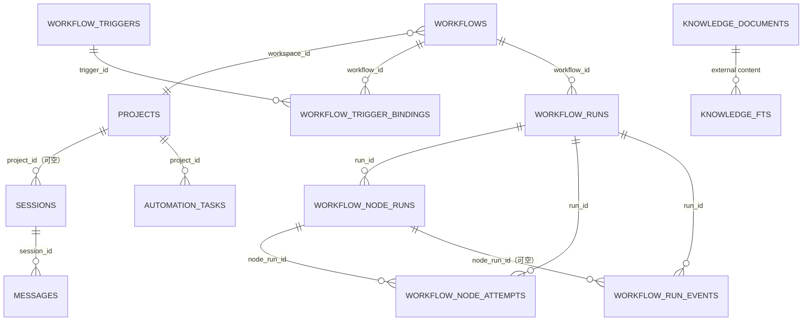
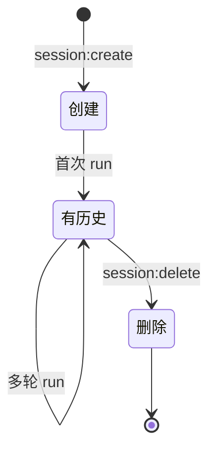

# 03 数据模型与数据库

## 1. 总览

- 引擎：`better-sqlite3`（同步 API，N-API，ABI 稳定）。
- 文件：`~/.novastudio/data.db`。
- 初始化：`src/main/db/sqlite.ts` 的 `initDatabase()`。
- 连接参数：
  - `journal_mode = WAL`
  - `foreign_keys = ON`
- schema 策略：**单一基线**。建表语句是唯一事实来源，结构变更直接改建表语句，不写增量迁移；`PRAGMA user_version` 标记版本（当前为 `1`）。发版前的旧库（`user_version = 0` 且已有表）会在启动时改名为 `data.db.bak-<时间戳>` 备份，然后按当前 schema 重建。
- 所有时间戳都是 **Unix 毫秒**（`INTEGER`）。
- 布尔值用 `INTEGER`（0/1）。
- 结构化字段用 `TEXT` 存 JSON。

### 1.1 实体关系



> 注意：`digital_employees` 不通过外键关联资产，只存资产引用 JSON；MCP / Skill / 知识库的实体在磁盘上，不在 DB 里（知识库有索引表）。

---

## 2. 表结构

### 2.1 `projects` — 项目 / 工作区

```sql
CREATE TABLE IF NOT EXISTS projects (
  id TEXT PRIMARY KEY,
  name TEXT NOT NULL,
  cwd TEXT NOT NULL,
  created_at INTEGER NOT NULL,
  updated_at INTEGER NOT NULL
);
```

| 字段 | 类型 | 说明 |
|---|---|---|
| `id` | TEXT PK | UUID |
| `name` | TEXT | 展示名，用户可改 |
| `cwd` | TEXT | 工作目录绝对路径 |
| `created_at` | INTEGER | 创建时间 |
| `updated_at` | INTEGER | 更新时间 |

**语义**：工作区复用项目实体。工作流必须归属一个工作区；会话可选绑定。

**删除**：`deleteProject(id)` 在事务中删除：
1. `automation_tasks`（该项目的任务）
2. `sessions`（该项目的会话，messages 外键级联）
3. `projects`

CLI 侧会话文件、工作区产物、工作流运行由 IPC handler 在调用前清理（见 `workflow/cleanup.ts`）。

### 2.2 `sessions` — 会话

```sql
CREATE TABLE IF NOT EXISTS sessions (
  id TEXT PRIMARY KEY,
  project_id TEXT,
  agent_id TEXT NOT NULL,
  agent_session_id TEXT,
  title TEXT NOT NULL,
  cwd TEXT NOT NULL,
  config_dir TEXT,
  source TEXT NOT NULL DEFAULT 'chat',
  message_count INTEGER NOT NULL DEFAULT 0,
  history_complete INTEGER NOT NULL DEFAULT 0,
  created_at INTEGER NOT NULL,
  updated_at INTEGER NOT NULL
);
```

| 字段 | 类型 | 说明 |
|---|---|---|
| `id` | TEXT PK | UUID |
| `project_id` | TEXT NULL | 绑定项目；NULL 表示未绑定 |
| `agent_id` | TEXT | provider id（当前 `claude`） |
| `agent_session_id` | TEXT NULL | CLI 侧会话引用；语义由 provider 解释 |
| `title` | TEXT | 默认「新会话」，首条消息后取前 40 字 |
| `cwd` | TEXT | 运行时工作目录 |
| `config_dir` | TEXT NULL | 工作流节点的独立 CLI 配置目录；普通会话 NULL |
| `source` | TEXT | `chat` / `workflow` |
| `message_count` | INTEGER | 消息计数（列表展示用） |
| `history_complete` | INTEGER | 本地 messages 是否已覆盖完整历史 |
| `pinned_at` | INTEGER NULL | 置顶时间；NULL 表示未置顶 |
| `created_at` / `updated_at` | INTEGER | 时间 |

**关键语义**：

- `source = 'workflow'` 的会话不出现在普通会话列表（`listSessions()` 过滤）。
- `agent_session_id` 只保存 CLI 侧的稳定引用；Claude 是会话 UUID。
- `config_dir` 用于工作流节点的隔离配置；历史缓存键必须包含它。
- `history_complete = 0` 的旧会话在下次运行前会从 CLI 侧导入历史。
- `pinned_at` 只影响列表排序（置顶组按置顶时间倒序），**不更新 `updated_at`**，
  因此置顶不会改变会话在「今天 / 昨天 / 更早」中的归属。

**索引**：

```sql
CREATE INDEX idx_sessions_chat_updated
  ON sessions (updated_at DESC) WHERE source <> 'workflow';
CREATE INDEX idx_sessions_project ON sessions (project_id);
```

### 2.3 `messages` — 会话消息

```sql
CREATE TABLE IF NOT EXISTS messages (
  id TEXT PRIMARY KEY,
  session_id TEXT NOT NULL,
  role TEXT NOT NULL,
  content_json TEXT NOT NULL,
  timestamp INTEGER NOT NULL,
  FOREIGN KEY (session_id) REFERENCES sessions(id) ON DELETE CASCADE
);

CREATE INDEX idx_messages_session_time
  ON messages (session_id, timestamp);
```

| 字段 | 说明 |
|---|---|
| `id` | 消息 UUID |
| `session_id` | 所属会话 |
| `role` | `user` / `assistant` |
| `content_json` | `AgentEvent[]` 的 JSON 序列化 |
| `timestamp` | 毫秒 |

**语义**：这是完整事件流，包含 thinking / tool_call / tool_result / error / text。一次 run 写一条 user + 一条 assistant；多轮对话自然追加。

**读取**：`readSessionMessages()` 按 `timestamp ASC, rowid ASC` 排序；单条 JSON 损坏会跳过，不影响其他消息。

### 2.4 `settings` — 键值设置

```sql
CREATE TABLE IF NOT EXISTS settings (
  key TEXT PRIMARY KEY,
  value TEXT NOT NULL
);
```

| 用途 | 键 | 值 |
|---|---|---|
| 默认 Agent | `defaultAgent` | provider id |
| 默认工作目录 | `defaultCwd` | 绝对路径 |
| 皮肤 | `theme` | 皮肤 id |
| 界面字号 | `fontSize` | 数字字符串 |
| 聊天字号 | `chatFontSize` | 数字字符串 |
| 终端字号 | `terminalFontSize` | 数字字符串 |
| 自动化并发 | `automationConcurrency` | 数字字符串 |
| 自动化轮询间隔 | `automationPollIntervalSec` | 秒 |
| 单次运行超时 | `agentTimeoutMinutes` | 分钟 |

### 2.5 `automation_tasks` — 任务中心

```sql
CREATE TABLE IF NOT EXISTS automation_tasks (
  id TEXT PRIMARY KEY,
  prompt TEXT NOT NULL,
  project_id TEXT NOT NULL,
  agent_id TEXT NOT NULL,
  status TEXT NOT NULL DEFAULT 'pending',
  session_id TEXT,
  created_at INTEGER NOT NULL,
  started_at INTEGER,
  completed_at INTEGER,
  error TEXT
);
```

| 字段 | 说明 |
|---|---|
| `status` | `pending` / `running` / `completed` / `failed` |
| `session_id` | 执行时创建的会话，详情页跳转用 |
| `error` | 失败原因 / “已手动停止” |

**语义**：只有 `pending` 会被轮询器拾取；`failed` 停留等待手动重试，不会自动无限重跑。

### 2.6 `workflows` — 工作流

```sql
CREATE TABLE IF NOT EXISTS workflows (
  id TEXT PRIMARY KEY,
  workspace_id TEXT,
  name TEXT NOT NULL,
  description TEXT NOT NULL DEFAULT '',
  graph_json TEXT NOT NULL DEFAULT '{"nodes":[],"edges":[]}',
  created_at INTEGER NOT NULL,
  updated_at INTEGER NOT NULL
);
```

| 字段 | 说明 |
|---|---|
| `workspace_id` | 指向 `projects.id`；旧数据可能为空 |
| `graph_json` | `WorkflowGraph`：`{ nodes, edges }` |

**图快照**：运行时会把 `graph_json` 复制进 `workflow_runs.graph_json`，运行中改工作流不影响本次执行。

**删除**：`deleteWorkflow(id)` 只删触发器绑定与工作流主表；运行记录 / 产物 / 会话由 `workflow/cleanup.ts` 级联清理。

### 2.7 `workflow_triggers` — 触发器

```sql
CREATE TABLE IF NOT EXISTS workflow_triggers (
  id TEXT PRIMARY KEY,
  title TEXT NOT NULL,
  description TEXT NOT NULL DEFAULT '',
  schedule_json TEXT NOT NULL,
  enabled INTEGER NOT NULL DEFAULT 1,
  last_fired_at INTEGER,
  next_fire_at INTEGER,
  last_error TEXT,
  created_at INTEGER NOT NULL,
  updated_at INTEGER NOT NULL
);
```

`schedule_json` 是 `WorkflowTriggerSchedule`：

```ts
type WorkflowTriggerSchedule =
  | { kind: "daily"; time: string }                 // HH:mm
  | { kind: "weekly"; time: string; weekdays: number[] } // 0=周日..6=周六
  | { kind: "interval"; minutes: number };
```

**语义**：

- `next_fire_at` 由调度器计算；应用重启后从“现在”重算，不补跑。
- `last_error` 记录最近一次启动失败原因；成功启动后清空。
- 损坏的 `schedule_json` 会被 `normalizeTriggerSchedule` 兜底为每天 09:00。

### 2.8 `workflow_trigger_bindings` — 多对多绑定

```sql
CREATE TABLE IF NOT EXISTS workflow_trigger_bindings (
  trigger_id TEXT NOT NULL,
  workflow_id TEXT NOT NULL,
  PRIMARY KEY (trigger_id, workflow_id)
);

CREATE INDEX idx_workflow_trigger_bindings_workflow
  ON workflow_trigger_bindings (workflow_id);
```

### 2.9 `workflow_runs` — 工作流运行

```sql
CREATE TABLE IF NOT EXISTS workflow_runs (
  id TEXT PRIMARY KEY,
  workflow_id TEXT NOT NULL,
  workspace_id TEXT NOT NULL,
  workflow_name TEXT NOT NULL,
  workspace_path TEXT NOT NULL,
  graph_json TEXT NOT NULL,
  artifact_dir TEXT NOT NULL,
  status TEXT NOT NULL,
  source TEXT NOT NULL DEFAULT 'manual',
  trigger_id TEXT,
  error TEXT,
  created_at INTEGER NOT NULL,
  started_at INTEGER,
  finished_at INTEGER
);
```

| 字段 | 说明 |
|---|---|
| `status` | `running` / `awaiting_approval` / `succeeded` / `failed` / `canceled` / `interrupted` |
| `source` | `manual` / `trigger` |
| `trigger_id` | 触发器运行时有值 |
| `graph_json` | 运行时图快照 |
| `artifact_dir` | 产物根目录 |

**索引**：

```sql
CREATE INDEX idx_workflow_runs_workflow
  ON workflow_runs (workflow_id, created_at DESC);
CREATE INDEX idx_workflow_runs_workspace
  ON workflow_runs (workspace_id, created_at DESC);
CREATE INDEX idx_workflow_runs_created
  ON workflow_runs (created_at DESC);
```

### 2.10 `workflow_node_runs` — 节点运行

```sql
CREATE TABLE IF NOT EXISTS workflow_node_runs (
  id TEXT PRIMARY KEY,
  run_id TEXT NOT NULL,
  node_id TEXT NOT NULL,
  node_name TEXT NOT NULL,
  node_type TEXT NOT NULL,
  employee_id TEXT,
  employee_name TEXT,
  agent_id TEXT,
  status TEXT NOT NULL,
  attempt INTEGER NOT NULL DEFAULT 1,
  round INTEGER NOT NULL DEFAULT 1,
  max_retries INTEGER NOT NULL DEFAULT 0,
  session_id TEXT,
  artifact_dir TEXT,
  input_path TEXT,
  output_path TEXT,
  output_summary TEXT,
  error TEXT,
  decision TEXT,
  decision_note TEXT,
  decided_at INTEGER,
  started_at INTEGER,
  finished_at INTEGER
);
```

| 字段 | 说明 |
|---|---|
| `status` | `pending` / `running` / `awaiting_approval` / `retrying` / `succeeded` / `failed` / `skipped` / `canceled` |
| `attempt` | 当前/最后一次执行尝试，从 1 开始 |
| `round` | 当前尝试内的轮次，人工要求修改会 +1 |
| `session_id` | 最新一轮的 Nova 会话；历史轮次在 attempts 表 |
| `artifact_dir` | 本轮产物目录 |
| `input_path` | `execution.md` |
| `output_path` | `result.md` |
| `output_summary` | 给下游的摘要（最多 4000 字） |
| `decision` | `approved` / `rejected` |
| `decision_note` | 审核备注 |
| `decided_at` | 审核时间 |

**索引**：

```sql
CREATE INDEX idx_workflow_node_runs_run ON workflow_node_runs (run_id);
```

### 2.11 `workflow_run_events` — 运行事件

```sql
CREATE TABLE IF NOT EXISTS workflow_run_events (
  seq INTEGER PRIMARY KEY AUTOINCREMENT,
  run_id TEXT NOT NULL,
  node_run_id TEXT,
  type TEXT NOT NULL,
  payload_json TEXT NOT NULL,
  created_at INTEGER NOT NULL
);
```

事件类型：

```ts
type WorkflowRunEventType =
  | "run_started"
  | "node_status"
  | "node_retry"
  | "approval_required"
  | "approval_decided"
  | "node_finished"
  | "run_finished"
  | "log";
```

**索引**：

```sql
CREATE INDEX idx_workflow_run_events_run ON workflow_run_events (run_id, seq);
CREATE INDEX idx_workflow_run_events_node ON workflow_run_events (node_run_id, seq);
```

**语义**：运行事件用于断线重放与提示列表；节点 token 事件不落库（量太大），实时对话走 `workflow:run:agentEvent` 推送，结束后以 `messages` 表为准。

### 2.12 `workflow_node_attempts` — 节点调用记录

```sql
CREATE TABLE IF NOT EXISTS workflow_node_attempts (
  id TEXT PRIMARY KEY,
  run_id TEXT NOT NULL,
  node_run_id TEXT NOT NULL,
  attempt INTEGER NOT NULL,
  round INTEGER NOT NULL DEFAULT 1,
  kind TEXT NOT NULL DEFAULT 'initial',
  session_id TEXT,
  artifact_dir TEXT,
  user_message_id TEXT,
  assistant_message_id TEXT,
  created_at INTEGER NOT NULL
);
```

| 字段 | 说明 |
|---|---|
| `kind` | `initial` / `retry` / `revise` |
| `attempt` / `round` | 与节点运行对应 |
| `session_id` | 本轮使用的 Nova 会话（revise 共用） |
| `user_message_id` / `assistant_message_id` | 本轮在 messages 表中的边界，运行详情据此切分对话 |

**索引**：

```sql
CREATE INDEX idx_workflow_node_attempts_run ON workflow_node_attempts (run_id);
CREATE INDEX idx_workflow_node_attempts_node
  ON workflow_node_attempts (node_run_id, attempt, round);
```

### 2.13 `digital_employees` — 数字员工

```sql
CREATE TABLE IF NOT EXISTS digital_employees (
  id TEXT PRIMARY KEY,
  name TEXT NOT NULL,
  role TEXT NOT NULL DEFAULT '',
  description TEXT NOT NULL DEFAULT '',
  avatar TEXT,
  system_prompt TEXT NOT NULL DEFAULT '',
  mcp_servers_json TEXT NOT NULL DEFAULT '[]',
  skills_json TEXT NOT NULL DEFAULT '[]',
  knowledge_json TEXT NOT NULL DEFAULT '[]',
  enabled INTEGER NOT NULL DEFAULT 1,
  created_at INTEGER NOT NULL,
  updated_at INTEGER NOT NULL
);
```

| 字段 | 说明 |
|---|---|
| `avatar` | data URL 或 NULL |
| `mcp_servers_json` | `EmployeeMcpServer[]` |
| `skills_json` | `EmployeeSkill[]` |
| `knowledge_json` | `EmployeeKnowledge[]` |
| `enabled` | 0/1；停用的员工不能用于工作流节点 |

### 2.14 `knowledge_documents` — 知识库索引

```sql
CREATE TABLE IF NOT EXISTS knowledge_documents (
  id INTEGER PRIMARY KEY AUTOINCREMENT,
  kb_id TEXT NOT NULL,
  relative_path TEXT NOT NULL,
  name TEXT NOT NULL,
  size INTEGER NOT NULL,
  updated_at INTEGER NOT NULL,
  content TEXT NOT NULL,
  UNIQUE (kb_id, relative_path)
);

CREATE INDEX idx_knowledge_documents_kb ON knowledge_documents (kb_id);
```

| 字段 | 说明 |
|---|---|
| `kb_id` | 知识库 slug |
| `relative_path` | 相对知识库根目录的 POSIX 路径 |
| `content` | 文档全文，供 FTS5 external content 使用 |
| `size` / `updated_at` | 文件元信息 |

### 2.15 `knowledge_fts` — 全文索引（FTS5）

```sql
CREATE VIRTUAL TABLE knowledge_fts USING fts5(
  content,
  content='knowledge_documents',
  content_rowid='id',
  tokenize='trigram'
);
```

- 使用 **external content** 模式，正文只存一份在 `knowledge_documents`。
- `trigram` 分词器支持中文 / 英文子串匹配。
- 创建后执行 `INSERT INTO knowledge_fts(knowledge_fts) VALUES('rebuild')` 补建已有数据。
- FTS5 不可用时 `knowledgeFtsReady = false`，检索自动降级为 `LIKE` 扫描。

---

## 3. 初始化流程

`initDatabase()` 只做三件事：

1. 建表（`CREATE TABLE IF NOT EXISTS`，全量结构）；
2. `ensureKnowledgeFts()` 建全文索引；
3. `interruptStaleWorkflowRuns()` 把上次进程遗留的 `running` / `awaiting_approval` 运行标记为中断。

之后建会话列表与节点尝试的索引，并写入 `PRAGMA user_version = 1`。

发版前不存在增量迁移：结构变更直接改建表语句，旧库由 `resetLegacyDatabase()` 备份后重建。发版后如需改表，递增 `SCHEMA_VERSION` 并在 `initDatabase` 中补一段按版本顺序执行的升级逻辑。

---

## 4. 数据生命周期

### 4.1 会话



**创建**：`createSession(agentId, projectId, cwd, title, configDir, source)`。

**发送前**：如果本地无消息且已有 `agentSessionId`，先从 CLI 侧导入历史（`importSessionMessages`），避免旧对话消失。

**删除**：
1. `service.releaseSession(id)`：中断运行、等待收尾、删除 CLI 侧会话文件、清历史缓存；
2. `db.deleteSession(id)`：删索引行，messages 外键级联。
3. 顺序不能反：运行收尾还会写 messages。

**切换工作区**：`setSessionProject`，若目录变化且已有上下文，清空 `agent_session_id` 开启新上下文，本地 messages 保留。

### 4.2 工作流 / 运行

**删除工作流**：

```
workflow:delete handler
  → workflowRunner.hasActiveRunForWorkflow? 拒绝
  → deleteWorkflowData(deps, workflowId)
      1. deleteWorkflowRuns(workflowId) 删除 events / attempts / node_runs / runs
      2. releaseSession 每个节点会话
      3. 删除工作区 .novastudio/workflows/<workflowId>
      4. 删除 userData/workflow-runs/<...>
      5. deleteWorkflow(id) 删除绑定与主表
```

**删除单个运行**：

```
workflow:run:delete
  → 运行中拒绝
  → deleteRunData(deps, runId)
      1. deleteWorkflowRun(runId)
      2. 释放会话
      3. 删除磁盘产物与临时运行目录
```

**应用异常退出**：启动时 `interruptStaleWorkflowRuns()` 把活动运行改为 `interrupted`，活动节点改为 `canceled`；触发器运行会把错误回写到触发器。

### 4.3 知识库索引

- 上传 / 保存文档时 `upsertKnowledgeDocument` 写 `knowledge_documents` 并同步 FTS；
- 删除文档 / 知识库时同步删除索引；
- 启动时 `syncKnowledgeIndex()` 扫描磁盘补齐缺失索引；
- 超过 8MB 的文档不写索引，但仍在文件列表可见、可注入。

---

## 5. 行映射与类型安全

DB 行字段用 snake_case，领域模型用 camelCase。每个实体有 `rowToXxx` 映射函数：

- `rowToProject`
- `rowToSession`
- `rowToWorkflow`
- `rowToWorkflowRun`
- `rowToWorkflowNodeRun`
- `rowToWorkflowTrigger`
- `rowToAutomationTask`

JSON 字段解析要防御：

- `parseJsonArray<T>`：损坏或非数组 → `[]`。
- `parseWorkflowGraph`：损坏 → 空图。
- `parseWorkflowTriggerSchedule`：损坏 → 默认每天 09:00。

**原则**：单条数据损坏不能导致整个列表 / 会话打不开。

---

## 6. 并发与一致性

- `better-sqlite3` 是同步 API；主进程单线程，天然串行。
- 多步写操作使用 `db.transaction(() => { ... })()`：
  - 删除项目
  - 删除工作流运行
  - 删除触发器
  - 设置触发器绑定
  - 批量导入消息
  - 员工表重建
- WAL 模式允许读写并发，但本应用只有主进程访问。
- 启动时单实例锁避免两个进程同时写同一个 DB。

---

## 7. 常用查询与索引说明

| 查询 | SQL 路径 | 索引 |
|---|---|---|
| 会话列表 | `WHERE source <> 'workflow' ORDER BY updated_at DESC` | `idx_sessions_chat_updated`（部分索引） |
| 某项目会话 | `WHERE project_id = ?` | `idx_sessions_project` |
| 会话消息 | `WHERE session_id = ? ORDER BY timestamp, rowid` | `idx_messages_session_time` |
| 某工作流运行 | `WHERE workflow_id = ? ORDER BY created_at DESC` | `idx_workflow_runs_workflow` |
| 某工作区运行 | `WHERE workspace_id = ? ORDER BY created_at DESC` | `idx_workflow_runs_workspace` |
| 活跃运行 | `WHERE status IN ('running','awaiting_approval')` | 无专用索引（量小） |
| 某运行节点 | `WHERE run_id = ?` | `idx_workflow_node_runs_run` |
| 某节点尝试 | `WHERE node_run_id = ? ORDER BY attempt, round` | `idx_workflow_node_attempts_node` |
| 运行事件 | `WHERE run_id = ?` / `WHERE node_run_id = ?` | 两个索引 |
| 知识库文档 | `WHERE kb_id = ?` | `idx_knowledge_documents_kb` |
| 全文检索 | FTS5 MATCH | `knowledge_fts` |

---

## 8. 已知注释漂移

源码中有两处旧注释仍写“正文不入库 / 由 CLI 回放”，但实现已经改为完整落库：

- `src/main/utils/paths.ts` 顶部；
- `src/shared/types.ts` 中 `Session.messageCount` 的注释。

以本文与 `readSessionMessages` / `getSessionWithHistory` 的实现为准：**messages 表存储完整事件流，优先从 DB 回放，DB 无数据时才回退 provider**。

---

## 9. 复刻验收清单

- [ ] `~/.novastudio/data.db` 初始化成功，WAL 与 foreign_keys 生效，`user_version = 1`。
- [ ] 14 张主表 + `knowledge_fts` 全部创建。
- [ ] 发版前残留的旧库（`user_version = 0`）被备份为 `data.db.bak-*` 后按当前 schema 重建。
- [ ] 删除项目会级联删除其会话、消息、自动化任务。
- [ ] 删除会话会级联删除消息。
- [ ] 删除运行会清理事件、节点、尝试、会话、磁盘产物。
- [ ] 启动时把遗留运行标记为中断。
- [ ] FTS5 不可用时检索降级为 LIKE，不报错。
- [ ] 单条损坏 JSON 不会导致列表/会话打不开。
- [ ] 所有时间戳为毫秒，布尔为 0/1。
