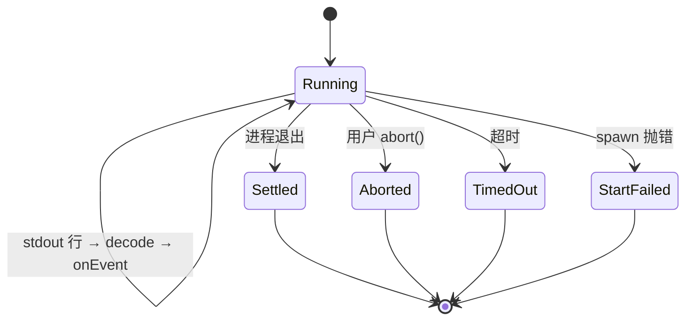
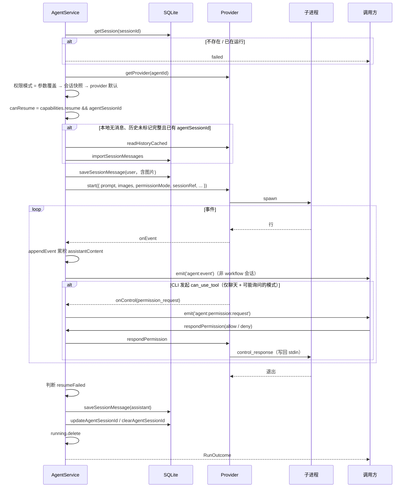

# 05 Agent 运行时抽象

## 1. 目的与边界

本层回答一个问题：

> 宿主如何以统一的方式驱动任意一个「命令行 AI Agent」，而不把某家 CLI 的协议知识泄漏到会话、工作流、IPC 与 UI。

包含：

- `AgentProvider` 契约；
- provider 注册表；
- 子进程传输层（spawn / stdin / 环境 / 终止）；
- 行分隔协议运行器；
- 事件模型与合并规则；
- `AgentService` 的会话运行编排、历史缓存、清理；
- 工具授权询问（permission prompt）的宿主侧中转；
- 一次性文本生成（`complete`）的 provider 选择与聊天身份常量。

不包含：

- 具体 CLI 的 JSON 解析（在 provider 内，见 `06-Claude-Code适配层`）；
- 会话列表 / UI；
- 工作流调度（见 08-10）。

**核心原则**：provider 拥有自己的传输方式、行切分、事件解码、会话存储；宿主只消费归一化后的 `AgentEvent` 与 `RunResult`。

---

## 2. Provider 契约

文件：`src/main/agents/types.ts`

### 2.1 `AgentProvider`

```ts
export interface AgentProvider {
  readonly manifest: AgentManifest;

  detect(): Promise<AgentStatus>;

  checkUpgrade?(): Promise<AgentUpgradeCheck>;
  upgrade?(onProgress?: (chunk: string) => void): Promise<AgentUpgradeResult>;

  configInfo?(): AgentConfigLocation;

  describeRuntimeConfig?(): Record<string, string>;

  defaultPermissionMode?(): string;

  prepareRun?(input: AgentRunInput): PreparedAgentRun | Promise<PreparedAgentRun>;

  prepareChatRun?(
    input: ChatRuntimeInput,
  ): PreparedChatRun | Promise<PreparedChatRun>;

  start(opts: RunOptions): RunSession;

  complete?(opts: CompleteOptions): Promise<string>;

  normalizeSessionRef(rawId: string, ctx: SessionContext): string;

  historyVersion(ref: string, ctx: SessionContext): Promise<string | null>;

  readHistory(ref: string, ctx: SessionContext): Promise<Message[]>;

  deleteSession(ref: string, ctx: SessionContext): Promise<void>;
}
```

**可选能力**（缺省即表示该 Agent 不支持，宿主据此关闭入口或回退）：

| 方法 | 作用 |
|---|---|
| `checkUpgrade` / `upgrade` | 版本检查与升级；缺省时设置页不展示升级入口 |
| `configInfo` | 本机配置路径；缺省时 UI 不展示「打开目录」 |
| `describeRuntimeConfig` | 运行产物的配置快照（模型 / 权限 / 接入地址） |
| `defaultPermissionMode` | 新会话的初始权限快照；缺省表示没有权限档位概念 |
| `prepareRun` | 工作流节点的员工运行时准备（同步常驻目录，不做 attempt 级临时投影） |
| `prepareChatRun` | 聊天会话的运行时 home（多员工共享同一份会话数据） |
| `complete` | 一次性文本生成（提交信息、标题、周报等） |

### 2.2 `AgentManifest` / 能力声明

来自 `shared/contracts/agent.ts`：

```ts
export interface AgentCapabilities {
  /** 是否支持 --resume 多轮 */
  resume: boolean;
  /** 会话数据是否在 CLI 侧，删除时要同步清理 */
  sessionCleanup: boolean;
  /** 是否支持按员工加载 Skill */
  skills: boolean;
  /** 是否支持按员工加载 MCP */
  mcp: boolean;
}

export interface AgentManifest {
  id: string;
  displayName: string;
  order: number;
  tone?: AgentTone;
  capabilities: AgentCapabilities;
  installCommand?: string;
}
```

**能力驱动的行为**：

- `resume=false`：后续运行不按已存引用恢复，每次都是新会话（本轮仍可能记录 `agentSessionId`，但不会用于 `--resume`）。
- `sessionCleanup=false`：删除会话时不调用 `deleteSession`。
- `skills=false` / `mcp=false`：工作流运行前给出告警并忽略相应绑定（聊天侧的资产投影当前不检查这两个位）。

Claude 的 manifest：

```ts
{
  id: "claude",
  displayName: "Claude Code",
  order: 30,
  tone: "sky",
  capabilities: { resume: true, sessionCleanup: true, skills: true, mcp: true },
  installCommand: "npm install -g @anthropic-ai/claude-code",
}
```

### 2.3 `RunOptions` — 一次调用的输入

```ts
export interface RunOptions {
  prompt: string;
  images?: InputImage[];             // 随本轮发送的图片（base64）
  cwd: string;
  mode?: "chat" | "workflow";
  sessionRef: string | null;
  opts?: SessionOptions;             // 宿主内部注入，如 { systemPrompt }
  timeoutMs?: number;
  env?: Record<string, string>;      // 追加环境变量
  envRemove?: string[];              // 剔除环境变量
  extraArgs?: string[];              // provider 额外参数
  permissionMode?: string;           // settings 命名；provider 映射成命令行开关
  configDir?: string | null;         // CLI 配置目录（历史定位用）
  allowPermissionPrompts?: boolean;  // 本轮是否允许把工具授权询问交给宿主
  onEvent: (event: AgentEvent) => void;
  onSessionId: (rawId: string) => void;
  onInvocation?: (info: AgentInvocationInfo) => void;
  onControl?: (control: AgentControlMessage) => void;  // 带外控制，不进聊天事件流
}

export type AgentControlMessage =
  | { type: "permission_request"; request: PermissionPromptRequest }
  | { type: "permission_cancel"; requestId: string };
```

### 2.4 `RunSession` — 运行句柄

```ts
export interface RunSession {
  readonly done: Promise<RunResult>;
  readonly aborted: boolean;
  abort(): void;
  /** 把一行控制应答写回子进程 stdin；已结束 / 被中断时返回 false */
  respondControl?(line: string): boolean;
  /** 回答一次工具授权询问；provider 负责编码成自己的协议 */
  respondPermission?(
    requestId: string,
    decision: PermissionPromptDecision,
  ): boolean;
}
```

### 2.5 `PreparedAgentRun` — provider 准备的环境

```ts
export interface PreparedAgentRun {
  configDir?: string | null;
  env?: Record<string, string>;
  envRemove?: string[];
  extraArgs?: string[];
  warnings?: string[];
  injected?: {
    mcpServers: string[];
    skills: string[];
  };
}
```

宿主只负责应用这些返回值，不感知它们如何生成。

### 2.6 `AgentInvocationInfo` — 审计信息

```ts
export interface AgentInvocationInfo {
  command: string;
  args: string[];
  cwd: string;
  stdin?: string;
  env?: Record<string, string>;
  envRemove?: string[];
  notes?: string[];
}
```

用于写 `execution.md`，排查“到底哪个参数不对”。

### 2.7 聊天运行时与一次性生成

聊天与工作流的环境形态不同：聊天需要一份可跨员工复用的 home（`projects` 始终指向同一目录，`--resume` 才能贯穿所有员工），工作流节点则复用员工级共享运行时。宿主只分配路径，provider 决定目录布局。

```ts
export interface ChatRuntimePaths {
  root: string;         // ~/.novastudio/runtime/<sessionId>/
  projectsDir: string;  // root/projects，所有 home 共享的 CLI 会话数据
}

export interface ChatRuntimeInput {
  session: Session;
  employee: DigitalEmployee | null;  // null = 通用助手
  paths: ChatRuntimePaths;
  purpose?: "send" | "materialize";  // materialize 可跳过知识库扫描
}

export interface PreparedChatRun extends PreparedAgentRun {
  configDir: string;
  systemPrompt?: string;  // 员工人设 / 知识库 / 通用助手边界提示
}
```

`CompleteOptions` 用于「不建会话、不开工具、只要最终文本」的任务（提交信息、标题、周报）：`prompt` / `cwd` / `timeoutMs` / `onChunk` / `signal`。provider 选择逻辑在 `src/main/agents/complete.ts`：优先设置里的 `defaultAgent`，否则用第一个具备 `complete` 的 provider。

`src/main/agents/chat-identity.ts` 只导出 `BASE_CHAT_NAME`（「通用助手」）——它是宿主概念，不属于任何具体 CLI，聊天运行时与 IPC 共用它，避免反向依赖会话模块。

---

## 3. Provider 注册表

文件：`src/main/agents/registry.ts`

```ts
const modules = import.meta.glob<{ provider: AgentProvider }>("./*/index.ts", {
  eager: true,
});
const PROVIDERS = Object.values(modules).map((m) => m.provider);

export function listProviders(): AgentProvider[] {
  return [...PROVIDERS].sort((a, b) => a.manifest.order - b.manifest.order);
}

export function getProvider(id: string): AgentProvider | undefined {
  return PROVIDERS.find((p) => p.manifest.id === id);
}
```

**约定**：

- 每个 provider 是一个目录：`src/main/agents/<id>/index.ts` 必须导出 `provider`；
- 可选 `manifest.ts` / `parse.ts` / `sessions.ts` / `prepare.ts`；
- 展示顺序由 `manifest.order` 决定，与目录名无关；
- 至少一个 provider，否则启动抛错。

**新增 Agent 的步骤**：

1. 新建 `src/main/agents/<id>/index.ts`，导出 `provider`；
2. 在 `manifest.ts` 声明 id / 能力 / 安装命令；
3. 实现 `start`（可复用 `startLineRun`）；
4. 实现历史相关方法；
5. 不需要改 registry、engine、IPC、UI。

---

## 4. 传输层

文件：`src/main/agents/transport.ts`

职责：把命令跑起来，把 stdout / stderr 原样吐出来。**不切行、不解析 JSON、不知道 Agent 存在。**

### 4.1 `spawnChild`

```ts
export function spawnChild(
  args: string[],
  cwd: string,
  envOverrides: Record<string, string> | undefined,
  envRemove: string[] | undefined,
  handlers: TransportHandlers,
): Transport;
```

`TransportHandlers`：

```ts
interface TransportHandlers {
  onData: (chunk: string) => void;     // stdout：协议数据
  onStderr?: (chunk: string) => void;  // stderr：诊断，单独通道
  onExit: (exitCode: number) => void;
}
```

### 4.2 Windows 特殊处理

Windows 下：

```ts
const file = "cmd.exe";
const argv = ["/d", "/s", "/c", `"${args.map(quoteForCmd).join(" ")}"`];

spawn(file, argv, {
  cwd,
  windowsHide: true,
  env: buildEnv(envOverrides, envRemove),
  windowsVerbatimArguments: true,
});
```

**为什么**：

- `claude` 通常是 npm 全局安装的 `.cmd`，必须经 `cmd.exe` 解析；
- Node 默认的逐参数引号只处理空白 / 双引号，不处理 cmd 的 `& | < > ^ ( ) % !`；
- `windowsVerbatimArguments` + 自己拼串 + 外层引号，配合 `/s` 由 cmd 去掉外层、保留参数自己的引号。

**引号规则**：

```ts
const NEEDS_QUOTE = /[\s"&|<>^()]/;
function quoteForCmd(arg: string): string {
  if (arg === "") return '""';
  return NEEDS_QUOTE.test(arg) ? `"${arg.replace(/"/g, '\\"')}"` : arg;
}
```

> `%VAR%` 展开是 cmd 自身语义，加引号也无法阻止；正常路径 / ID / 配置路径不会包含它。

### 4.3 环境变量

```ts
function buildEnv(overrides, remove) {
  const env = { ...process.env, ...overrides };
  for (const key of remove ?? []) delete env[key];
  return env;
}
```

**`envRemove` 必须最后生效**：否则 `process.env` 里的同名变量会在展开时重新出现，覆盖节点自己的隔离配置。

### 4.4 进程退出

- `close` 优先：保留尾部输出；
- `exit` 后留 500ms 宽限：如果 `close` 不来（MCP / hook 等孙进程持有 stdio），主动收尾；
- `reportExit` 保证只回调一次。

### 4.5 终止

```ts
kill() {
  if (process.platform === "win32" && child.pid) {
    spawn("taskkill", ["/pid", String(child.pid), "/T", "/F"], { windowsHide: true });
    return;
  }
  child.kill();
}
```

**为什么 Windows 用 taskkill**：子进程是 `cmd.exe`，只 kill 它不会带走 `claude`；`/T` 终止整棵进程树，避免取消后仍在后台跑。

### 4.6 写入 stdin

```ts
writeInput(data) { child.stdin?.end(data); }  // 写完即关（text 输入）
write(data)     { child.stdin?.write(data); } // 保持管道打开（控制应答）
endInput()      { child.stdin?.end(); }       // 显式关闭
```

prompt 必须走 stdin：Windows 下命令行参数中的换行会被 cmd 截断，后半段参数全部丢失。

0.3.0 起 stdin 还承担双向控制通道：启用交互式工具授权时，`stream-json` 输入先写入，CLI 通过 stdout 发来 `can_use_tool`，宿主把 `control_response` 写回同一根 stdin，收到 `result` 行后再关闭。

### 4.7 `stripAnsi`

过滤：

- CSI：颜色 / 光标 / 清屏 `\x1b[...X`
- OSC：窗口标题 `\x1b]...`
- 字符集选择 `\x1b(B` 等
- 单字符 ESC 序列
- 控制字符、`\r`

**为什么**：PTY / 子进程可能输出控制序列，会破坏 JSON 行解析。

### 4.8 `createLineBuffer`

```ts
push(chunk): string[]  // 返回本次凑齐的完整行，尾部残片留到下次
take(): string         // 进程退出时取走残片
```

### 4.9 `execCli`

签名 `execCli(args: string[], timeoutMs: number): Promise<string>`，用于安装探测、`npm view` 等一次性调用：

- Windows：`cmd.exe /d /s /c <commandLine>`
- 其他：直接 `execFile(args[0], args.slice(1))`
- `windowsHide: true`
- 带超时，返回 stdout

---

## 5. 行分隔运行器

文件：`src/main/agents/line-run.ts`

适用：stdout 按行输出、每行可独立解码的 CLI（Claude Code）。

### 5.1 输入

```ts
export interface LineRunConfig {
  args: string[];
  cwd: string;
  timeoutMs?: number;
  env?: Record<string, string>;
  envRemove?: string[];
  stdin?: string;
  keepStdinOpen?: boolean;           // 双向控制通道：写完不关，等 result
  onControlMessage?: (control: AgentControlMessage) => void;
  extractSessionId(line: string): string | null;
  decode(line: string): AgentEvent | AgentEvent[] | null;
  /** 合并解析：一次 JSON.parse 同时给出 sessionId / 事件 / 控制帧 / 是否关 stdin */
  decodeLine?(line: string): {
    sessionId: string | null;
    event: AgentEvent | AgentEvent[] | null;
    control?: AgentControlMessage;
    closeInput?: boolean;
  } | null;
}
```

### 5.2 生命周期



### 5.3 两个关键标志

| 标志 | 语义 | 影响 |
|---|---|---|
| `aborted` | 用户主动中断 | 不记为失败，不带错误信息 |
| `muted` | 已中断 / 已超时 / 启动失败 | 抑制后续输出与重复事件 |

**不能混用**：如果把超时、启动失败也当成 `aborted`，调用方会把失败误判为用户中断。

### 5.4 超时

```ts
timer = setTimeout(() => {
  const message = `Agent timed out after ${Math.round(timeoutMs / 60000)} min`;
  emit({ type: "error", message });   // 必须在 muted 之前发
  muted = true;
  transport?.kill();
  finish(-1, message);
}, timeoutMs);
```

默认 30 分钟，可由设置 `agentTimeoutMinutes` 覆盖。

### 5.5 中断

```ts
abort() {
  if (settled) return;
  aborted = true;
  muted = true;
  transport?.kill();
  setTimeout(() => finish(-1), 1500); // kill 可能不触发 exit
}
```

### 5.6 stderr

只保留尾部 4000 字符，用于非零退出的诊断；不进入协议解析。

### 5.7 退出收尾

- 先处理行缓冲残片（最后一行可能没有换行）；
- 非零退出且没有 error 事件时，补一条 `error`；
- `RunResult.error` 同时携带诊断，供宿主恢复策略使用。

### 5.8 行处理

```ts
const handleLine = (raw) => {
  const line = raw.trim();
  if (!line) return;
  // 优先合并解析：一次 JSON.parse 同时拿到会话 id 与事件
  if (config.decodeLine) {
    const out = config.decodeLine(line);
    if (!out) return;
    if (out.sessionId) handlers.onSessionId(out.sessionId);
    if (out.control !== undefined) {        // 控制帧不进对话事件
      config.onControlMessage?.(out.control);
      return;
    }
    if (out.closeInput) endInput();          // result 到达：关闭 stdin
    for (const event of toArray(out.event)) emit(event);
    return;
  }
  const sid = config.extractSessionId(line);
  if (sid) handlers.onSessionId(sid);
  for (const event of toArray(config.decode(line))) emit(event);
};
```

**每次运行新建解码器**：它需要记住本次运行内的工具调用 id → 工具名映射。

### 5.9 控制通道

`keepStdinOpen` 打开时，`RunSession.respondControl(line)` 向 stdin 追加一行（运行结束 / 中断后返回 false）。`line-run` 不解释控制协议，只负责把 `decodeLine` 拆出的 `control` 交给 `onControlMessage`，并把 `closeInput`（Claude 为 `result` 行）转成 `endInput()`。

---

## 6. 事件模型

类型见 `src/shared/types.ts`：

```ts
export type AgentEvent =
  | { type: "thinking"; content: string }
  | { type: "text"; content: string }
  | ({ type: "image" } & InputImage)   // 只出现在用户消息；data 为无前缀 base64
  | { type: "thinking_delta"; delta: string }
  | { type: "text_delta"; delta: string }
  | { type: "tool_call"; callId?: string; name: string; input: unknown;
      kind: ToolKind; target: string; lineStarts?: number[] }
  | { type: "tool_result"; callId?: string; name: string; output: string;
      isError?: boolean; images?: ToolResultImage[] }
  | { type: "error"; message: string }
  | { type: "warning"; message: string }
  | { type: "usage"; inputTokens: number; outputTokens: number;
      cacheCreationInputTokens: number; cacheReadInputTokens: number;
      scope?: "context"; contextWindow?: number; costUsd?: number; durationMs?: number }
  | { type: "done" }
  | { type: "message_end"; blocks: AgentEvent[] };
```

合并规则与实现见 `src/shared/agent-events.ts`（`appendEvent`）。

- `text` / `thinking` 始终作为新块追加；`*_delta` 追加到末尾同类型块。
- `message_end` 倒序移除末尾连续的累积块（thinking / text / tool_call）并换成本次 `blocks`；夹在中间的 `usage` 会先摘出、替换完再放回，避免正文重复。
- `tool_call` / `tool_result` / `error` / `warning` / `image` / `usage` 直接追加。

**宿主只依赖这些语义，不出现具体工具名。**

### 6.1 工具展示归一化

文件：`src/main/agents/tool-display.ts`

```ts
export interface ToolDisplay {
  kind: ToolKind;   // "read" | "write" | "exec" | "search" | "other"
  target: string;
}

export function describeTool(name: string, input: unknown): ToolDisplay;
```

- 工具名 → 分类的映射在 provider 侧（因为只有 provider 知道工具叫什么）：内置表覆盖 read/view、write/edit/patch/multiedit、grep/glob/search、bash/shell/sh，其余归 `other`；
- 操作对象从共享字段表 `TOOL_TARGET_KEYS`（`src/shared/tool-input.ts`）中按优先级取：`path` / `file` / `filePath` / `file_path` / `command` / `pattern` / `query`；
- 行号 `lineStarts` 由 provider 尽力提供（实时在磁盘上定位，回放读会话文件），拿不到就缺省；
- 所有工具都进入消息流，包括 Bash；是否折叠由展示层决定。

---

## 7. AgentService

文件：`src/main/agents/agent-service.ts`

`AgentService` 是会话与运行的唯一编排入口，不感知 Electron 与 IPC。

### 7.1 接口

```ts
export interface AgentService {
  listAgentInfos(): Promise<AgentInfo[]>;
  resolveCwd(...candidates: (string | undefined | null)[]): string;
  run(params: RunParams): Promise<RunOutcome>;
  abort(sessionId: string): boolean;
  isRunning(sessionId: string): boolean;
  hasRunningSessions(): boolean;
  isEmployeeInUse(employeeId: string): boolean;
  getSessionWithHistory(sessionId: string): Promise<Session | null>;
  getSessionPage(
    sessionId: string,
    input: { limit: number; beforeTimestamp?: number; beforeMessageId?: string },
  ): Promise<Session | null>;
  releaseSession(sessionId: string): Promise<void>;
  releaseProject(projectId: string): Promise<void>;
  shutdown(): Promise<void>;   // 中断并等待落库收尾，上限 5s
  respondPermission(
    sessionId: string,
    requestId: string,
    decision: PermissionPromptDecision,
  ): PermissionRespondResult;
  listPendingPermissions(): PermissionPromptView[];
  denyAllPending(message: string, reason: PermissionResolvedReason): void;
}
```

`RunOutcome` 除 `ok` / `exitCode` / `duration` / `aborted` / `error` 外，还带 `userMessageId`、`assistantMessageId`、`assistantText`（本轮权威正文，供工作流归属产物）与 `resumeFailed`。

### 7.2 内部状态

```ts
const running = new Map<string, RunSession>();
const runningEmployees = new Map<string, string | null>();
const pendingPermissions = new Map<string, PendingPermission>();
const historyCache = new Map<string, { version: string; messages: Message[] }>();
```

- `running`：同一会话只允许一个运行；
- `runningEmployees`：本轮实际回答者快照（会话绑定可在运行中改成「下一轮」的员工，不能用于判断「谁在运行」）；
- `pendingPermissions`：待回答的工具授权询问，键为 `sessionId + requestId`，不落库；
- `historyCache`：LRU，上限 32；缓存键是 `agentId + configDir + agentSessionId`。

### 7.3 `run()` 流程



### 7.4 用户消息先落库

```ts
db.saveSessionMessage(sessionId, userMsg);
params.onUserMessage?.(userMsg.id);
```

即使运行失败，用户也能看到原始指令。工作流用 `onUserMessage` 立即记录本轮起点。

用户消息内容先放图片（`image` 事件），再放非空正文；`contextPrompt`（带「@回答者」前缀）只送入 CLI 上下文，不落库、不显示。

### 7.5 assistant 消息落库

- 只累积非 `done` 事件；
- 无论成功 / 失败 / 中断，只要 `assistantContent.length > 0` 就落库；
- 落库时写入 `employeeId`（本轮回答者），历史回复因此保留当时的头像；
- 落库内容与渲染层使用同一套 `appendEvent`，保证内存与 DB 一致。

### 7.6 resume 失效自愈

```ts
const failureText = [result.error, ...errorMessages].filter(Boolean).join("\n");
const resumeFailed =
  Boolean(sessionRef) && !runSession.aborted && isResumeFailure(failureText);
if (resumeFailed) {
  historyCache.delete(previousKey);
  db.clearAgentSessionId(sessionId);
  // 推送 warning
}
```

`isResumeFailure` 覆盖文案：

```
No conversation found with session ID
could not find conversation
session ... not found
unable to resume
```

**为什么必须自愈**：否则后续每次发送都会继续 `--resume` 同一个不存在的会话，永久失败。

### 7.7 会话引用落库

```ts
if (!resumeFailed && captured.rawId) {
  const ref = provider.normalizeSessionRef(captured.rawId, { cwd });
  if (ref !== session.agentSessionId) db.updateAgentSessionId(sessionId, ref);
}
```

即使本轮被中断 / 超时，只要拿到了 CLI 会话 id 也要落库，因为 CLI 侧会话仍然存在且可恢复。否则用户追问时会“失忆”。

### 7.8 历史回放

```ts
getSessionWithHistory(sessionId) {
  const persisted = db.readSessionMessages(sessionId);
  if (persisted) return { ...session, messages: persisted };
  return { ...session, messages: readHistoryCached(session) };
}
```

- 优先 DB（含工具调用细节）；
- DB 无数据时回退 provider 从 CLI 侧回放（仅文本 + 工具回执）；
- 旧消息的 `tool_call` 缺 `lineStarts` 时，按 `callId` 从 provider 回放结果补全（只补缺失，不覆盖已有值）。

**分页**：`getSessionPage()` 用 `db.readSessionMessagesPage()` 只解析最近 N 条（1–500），返回 `hasMoreMessages`；`beforeTimestamp` / `beforeMessageId` 作为游标继续向前取。本地已有消息但当前页为空时不再回放 CLI 历史。

### 7.9 历史缓存

```ts
function readHistoryCached(session) {
  const version = provider.historyVersion(ref, ctx);
  if (version !== null) {
    const cached = historyCache.get(key);
    if (cached && cached.version === version) return cached.messages; // LRU touch
  }
  const messages = provider.readHistory(ref, ctx);
  if (version !== null) historyCache.set(key, { version, messages });
  return messages;
}
```

**缓存键必须包含 `configDir`**：同一会话引用在隔离配置目录下指向不同文件。

**版本号契约**：版本号不变 ⟺ `readHistory` 结果不变。Claude 用文件 mtime。

### 7.10 清理

```ts
releaseSession(sessionId) {
  running.get(sessionId)?.abort();
  await waitForIdle(sessionId);   // 最多 5s
  dropSessionArtifacts(sessionId);
}
```

- 先中断并等待收尾，再删 CLI 侧数据与缓存；
- 顺序不能反：运行收尾还会写 messages，提前删会话会触发外键错误。
- `releaseProject` 对项目下所有会话执行同样流程。

### 7.11 超时

```ts
function resolveTimeoutMs(): number {
  const raw = db.getSetting("agentTimeoutMinutes");
  const minutes = raw === null ? NaN : Number(raw);
  if (!Number.isFinite(minutes) || minutes <= 0) {
    return DEFAULT_SETTINGS.agentTimeoutMinutes * 60_000;
  }
  return Math.max(1, Math.round(minutes)) * 60_000;
}
```

至少 1 分钟，避免 0.5 分钟被向下取整成 0ms 立即超时。

### 7.12 `shutdown()`

中断所有运行中的会话，并在关库前等待它们完成落库收尾：以 `running` 变空为准，最长 5 秒；超时后打印告警并继续退出，避免应用关不掉。

### 7.13 工具授权询问

工具授权是带外控制，不进入 `AgentEvent`，也不落库：

1. provider 在 `allowPermissionPrompts` 为真且权限模式可能询问时启用双向通道（Claude 为 `--permission-prompt-tool stdio`）；
2. CLI 的 `can_use_tool` 经 `onControl({ type: "permission_request" })` 到达，`AgentService` 以 `sessionId + requestId` 挂入 `pendingPermissions`，推送 `agent:permission:request`；
3. 渲染层回答后调用 `respondPermission`，allow 时若界面没改写入参，会把原始 `input` 作为 `updatedInput` 回传（CLI 用它执行本次调用）；deny 时带提示文案；
4. 询问 5 分钟无人回答自动拒绝；没有可用窗口 / 无人值守运行直接拒绝；中断、删除会话、运行结束、窗口关闭会清掉该会话的待处理项并推 `agent:permission:resolved`。

`respondPermission` 的 `ok:false` 表示请求已失效（超时 / 已被回答 / 运行已结束），界面据此清理弹窗。

---

## 8. 版本探测

文件：`src/main/agents/probe.ts`

```ts
export async function probeVersion(bin, args = ["--version"]): Promise<AgentStatus>;
```

- 执行 `<bin> --version`；
- 失败即视为未安装；
- 从输出提取 `v?\d+\.\d+\.\d+`（可带 `-beta` 等后缀）；提取不到时退回整段输出；
- 10 秒超时；
- 异步执行，避免阻塞主进程启动。

---

## 9. 新增 provider 的最小清单

- [ ] `src/main/agents/<id>/index.ts` 导出 `provider`；
- [ ] `manifest.ts` 声明 id / displayName / order / capabilities / installCommand；
- [ ] 实现 `detect`（可复用 `probeVersion`）；
- [ ] 实现 `start`（行协议可复用 `startLineRun`，否则自己实现）；
- [ ] 实现 `normalizeSessionRef` / `historyVersion` / `readHistory` / `deleteSession`；
- [ ] 聊天需要会话级 home 时实现 `prepareChatRun`；
- [ ] 如需按员工注入 MCP/Skill，实现 `prepareRun`（工作流）与 `prepareChatRun`（聊天）；
- [ ] 如需运行产物配置快照，实现 `describeRuntimeConfig`；
- [ ] 不需要改 registry / engine / IPC / UI。

---

## 10. 复刻验收清单

- [ ] `AgentProvider` 契约完整，宿主不出现具体 CLI 工具名。
- [ ] registry 用 `import.meta.glob` 自动收集，按 order 排序。
- [ ] Windows 下 `.cmd` 经 `cmd.exe` 启动，特殊字符不被拆分。
- [ ] prompt 走 stdin，多行不被截断。
- [ ] 终止在 Windows 下杀整棵进程树。
- [ ] `aborted` 与 `muted` 语义分离。
- [ ] 超时 / 启动失败不会被误判为用户中断。
- [ ] `agent:event` 事件经过 `appendEvent`，内存与 DB 一致。
- [ ] 同一会话并发发送被拒绝。
- [ ] resume 失效会自动清除引用并提示。
- [ ] 工具授权询问经带外通道中转，超时 / 无界面自动拒绝。
- [ ] 历史缓存键包含 configDir，LRU 上限 32。
- [ ] 删除会话先中断等待，再删 CLI 数据与 DB 行。
