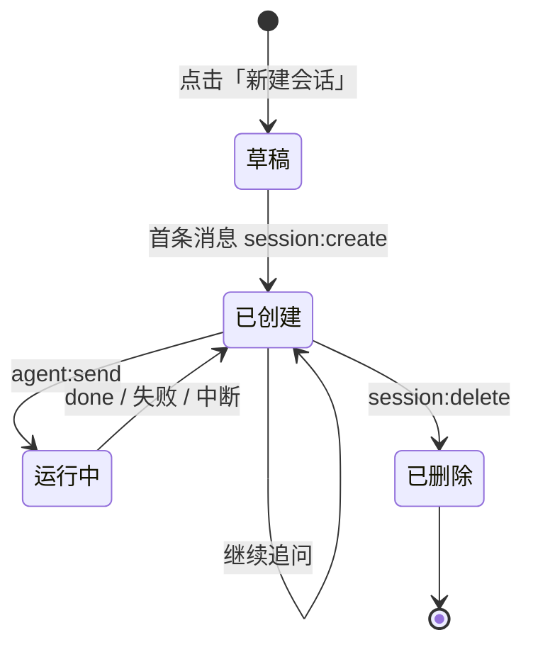
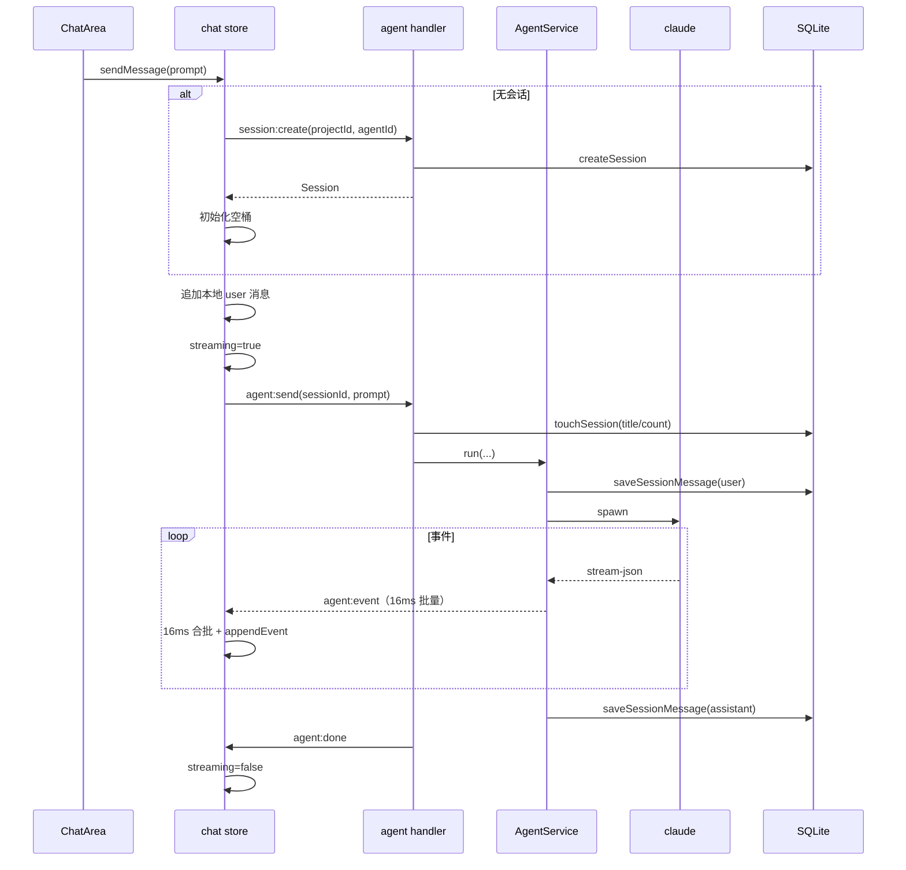

# 07 会话与聊天子系统

## 1. 目的与边界

本子系统负责：

- 会话的创建、列表、重命名、删除、绑定 / 解绑工作区；
- 一次对话从输入到流式渲染的完整链路；
- 多会话并发与事件路由；
- 历史消息的落库、回放与合并；
- 中断、失败、resume 失效的 UI 反馈。

不负责：

- CLI 协议解析（见 05 / 06）；
- 工作流节点会话（见 08-10；工作流会话 `source='workflow'` 不出现在聊天列表）；
- 文件内容读取（见 15）。

---

## 2. 领域模型

```ts
interface Session {
  id: string;
  projectId: string | null;
  source?: "chat" | "workflow";
  agentId: string;
  agentSessionId: string | null;
  title: string;
  cwd: string;
  configDir?: string | null;
  createdAt: number;
  updatedAt: number;
  messageCount?: number;
  messages?: Message[];
}

interface Message {
  id: string;
  role: "user" | "assistant";
  content: AgentEvent[];
  timestamp: number;
}
```

**关键点**：

- 会话**不强制绑定项目**。`projectId=null` 时使用默认目录（`defaultCwd` → `homedir()`）。
- `source='workflow'` 的会话不出现在普通列表。
- `agentSessionId` 是 CLI 侧引用，由 provider 解释。
- `messages` 只在 `session:get` 时填充；`session:list` 返回空数组。

---

## 3. 会话生命周期



### 3.1 草稿态

`newSession()` 只做：

```ts
set({ currentSessionId: null, currentProjectId: null });
```

**不预建空会话**，避免产生大量空记录。首条消息时才 `session:create`。

### 3.2 创建

`sendMessage` 在无当前会话时：

```ts
const picked = state.selectedAgentId || 第一个已安装的 Agent;
const session = await ipc.createSession(state.currentProjectId, picked);
sessionId = session.id;
set({ currentSessionId, currentProjectId, messagesBySession: { [id]: [] }, streamingBySession: { [id]: false } });
void loadSessions();
```

**必须预创建**：流式事件按 `sessionId` 路由，没有 id 就无法接住事件。

### 3.3 标题

- 创建时默认 `"新会话"`；
- 首条消息发送时，`agent:send` handler 用 prompt 前 40 字作为标题：

```ts
db.touchSession(sessionId, {
  title: session.messageCount === 0 ? prompt.slice(0, 40) : undefined,
  countDelta: 1,
});
```

- 用户可右键重命名，长度上限 120。

### 3.4 删除

```ts
await service.releaseSession(id); // 中断、等待收尾、删 CLI 侧数据
db.deleteSession(id);             // 删索引行，messages 级联
```

**顺序不能反**：运行收尾还会写 messages，提前删会话会触发外键错误。

---

## 4. 渲染层状态

文件：`src/renderer/stores/chat.ts`

### 4.1 状态形状

```ts
interface ChatState {
  agents: AgentInfo[];
  projects: Project[];
  sessions: Session[];
  currentProjectId: string | null;
  currentSessionId: string | null;
  messagesBySession: Record<string, Message[]>;
  streamingBySession: Record<string, boolean>;
  loadingHistoryFor: string | null;
  selectedAgentId: string;
  viewMode: ViewMode;
  showSettings: boolean;
  showWorkspace: boolean;
  projectsLoaded: boolean;
  sessionsLoaded: boolean;
  // actions...
}
```

### 4.2 为什么按会话分桶

- 多会话可同时运行，事件带 `sessionId` 到达；
- 切换会话只换 `currentSessionId`，后台会话继续累积；
- 每个会话独立的 `streamingBySession` 用于列表旋转图标与输入按钮状态。

### 4.3 选择器

```ts
selectCurrentMessages(s)   // 当前会话消息；无会话返回冻结空数组
selectCurrentStreaming(s)  // 当前会话是否流式
selectEffectiveAgentId(s)  // 当前生效 Agent：已开会话以会话记录为准，否则用选中项
```

**为什么 `selectEffectiveAgentId` 以会话为准**：会话可能由自动化创建，其 Agent 未必等于当前选中项。

### 4.4 `selectedAgentId` 的语义

只表示「新会话默认用谁」，只由输入框旁的 Agent 选择器显式修改。浏览历史会话不会悄悄改掉它。

---

## 5. 发送链路



### 5.1 前置失败

- 未检测到 Agent → `sendMessage` 抛错，ChatArea 把输入还给用户并 toast；
- `session:create` 失败 → 同上；
- 运行失败 → store 追加一条 assistant 错误消息。

### 5.2 重复发送

同一会话在 `streamingBySession[sessionId] === true` 时直接 return；主进程也会拒绝（`running` 表）。

### 5.3 输入处理

- `Enter` 发送，`Shift+Enter` 换行；
- 中文输入法选词时的回车（`isComposing` / `keyCode === 229`）不发送；
- 流式中再次提交被短路，但不会清空输入（先判断再 `setInput("")`）；
- 发送前清理输入与 `@` 引用。

---

## 6. 事件处理与合批

### 6.1 主进程侧

`agent:event` 走 16ms 批量队列（见 04）。工作流会话 `source='workflow'` 不推送聊天事件。

### 6.2 渲染层侧

`chat.ts` 再做一次 16ms 合批：

```ts
const EVENT_FLUSH_MS = 16;
let pendingEvents: Array<{ sessionId; event }> = [];
let pendingFlushTimer = null;

function flushPendingEvents() {
  const batch = pendingEvents;
  pendingEvents = [];
  useChatStore.setState((state) => {
    // 按 sessionId 分组
    // 同一会话事件合并成一个 appendEvent 链
    // 最后一条是 assistant 就并入，否则新建 assistant 消息
  });
}
```

**为什么需要两层**：

- 每个 token 一个 IPC 是几十次/秒；
- 渲染进程里每个 IPC 回调是独立任务，React 无法跨任务自动合批；
- 不合并会导致每秒几十次完整渲染（每次重解析 Markdown）。

### 6.3 `_onEvent`

```ts
_onEvent({ sessionId, event }) {
  if (event.type === "done") {
    flushPendingEvents();
    set streaming=false;
    return;
  }
  pendingEvents.push({ sessionId, event });
  if (!pendingFlushTimer) pendingFlushTimer = setTimeout(flushPendingEvents, 16);
}
```

### 6.4 `_onDone`

```ts
_onDone({ sessionId }) {
  flushPendingEvents();
  set streaming=false;

  // 内存里已有完整一轮（最后是 assistant 且有 user）→ 只刷新会话列表
  // 否则回读 DB 兜底（窗口刷新 / 运行中重连 / 首次订阅）
}
```

**为什么不再每轮重读全量历史**：主进程与渲染层消费同一串事件、同一套 `appendEvent`，内存结果与落库一致。重读会替换全部消息对象引用，导致转换缓存与 React 渲染全部失效，长会话在回复结束时卡一下。

**兜底条件**：

- 最后一条不是 assistant，或
- 内存里没有 user 消息（例如刷新后只收到孤立 assistant）。

---

## 7. 历史回放

### 7.1 打开会话

```ts
selectSession(id) {
  // 1. 立刻同步 currentProjectId（不等历史）
  // 2. 已有实时桶 → 直接切换
  // 3. 正在回放同一会话 → 忽略
  // 4. 乐观进入 loadingHistoryFor
  // 5. ipc.getSession(id)
  // 6. 合并历史与回放期间新产生的消息
}
```

**合并策略**：历史 + 本地桶中「不在历史里的消息」，避免回放期间发出的新消息被覆盖。

### 7.2 主进程回放

`AgentService.getSessionWithHistory`：

1. 优先 `db.readSessionMessages`（含工具调用 / 思考）；
2. DB 无数据 → `provider.readHistory`（CLI JSONL，仅文本 + 工具回执）；
3. 历史缓存 LRU 32，键含 `configDir`。

### 7.3 旧会话补全

升级旧版本时，本地 messages 可能为空。`run()` 在首次运行前：

```ts
if (!db.hasSessionMessages(sessionId) && session.agentSessionId) {
  const history = readHistoryCached(session);
  if (history.length > 0) db.importSessionMessages(sessionId, history);
}
```

避免新消息写入后旧对话在界面上“消失”。

---

## 8. 消息渲染

### 8.1 组件层级

```
ChatArea
├── PageHeader（标题 / 工作区路径 / 文件面板开关）
├── AssistantMessageList（assistant-ui 运行时）
│   ├── ThreadEmpty（空态 / 历史恢复中）
│   ├── UserMessage → UserBubble
│   └── AssistantMessage → Parts
│       ├── AnswerPart（text）
│       ├── ReasoningPart（thinking，默认折叠）
│       ├── ToolPart（tool-call，默认折叠）
│       ├── ErrorPart（data novaError）
│       └── WarningPart（data novaWarning）
└── 输入区
    ├── @ 引用文件 chips
    ├── textarea
    ├── ProjectSelector
    ├── AgentSelector（多 Agent 时才显示）
    └── 发送 / 停止按钮
```

### 8.2 `Message` → assistant-ui `ThreadMessageLike`

```ts
toThreadMessage(message, streaming) {
  user: { content: [{ type: "text", text }] }
  assistant: {
    status: streaming ? { type: "running" } : { type: "complete", reason: "stop" },
    content: assistantParts(message),
  }
}
```

`assistantParts` 把 `AgentEvent[]` 转成 part 数组：

| 事件 | part |
|---|---|
| `thinking` | `{ type: "reasoning", text }` |
| `text` | `{ type: "text", text }` |
| `tool_call` | `{ type: "tool-call", toolCallId, toolName, args, argsText, providerMetadata.nova = {kind,target} }` |
| `tool_result` | 配对到最近的同 callId / 同名未完成 tool-call |
| `error` | `{ type: "data", name: "novaError", data: { message } }` |
| `warning` | `{ type: "data", name: "novaWarning", data: { message } }` |
| `message_end` | 递归转换 `blocks` |

### 8.3 工具配对

`findOpenTool(parts, name, callId)` 从后往前找未完成的 tool-call：

- 有 `callId` 时按 id 精确匹配；
- 没有时按 `toolName` 匹配。

**历史修复**：旧版并行工具调用可能把同一 call 记录两次，而 result 只有一份。`assistantParts` 先收集 `resultsByCall`，最后给仍未配对的同名调用补上结果，避免永久“进行中”。

### 8.4 工具元数据

`providerMetadata.nova = { kind, target }`：

- `kind` 决定图标：read/write/exec/search/other；
- `target` 是操作对象原文，展示层决定截断。

**渲染层不认识任何具体工具名。**

### 8.5 工具状态

```ts
const done = props.result !== undefined;
const running = props.status?.type === "running";
const statusText = done
  ? hasError ? "失败" : "完成"
  : running ? "进行中" : "未完成";
```

**为什么有“未完成”**：运行被中断 / 超时 / 进程异常结束时，已发出的 tool_call 可能永远等不到 result；消息已结束，不能一直显示“进行中”。

### 8.6 思考块

- 默认折叠；
- 展开后独立滚动（`max-h-60`）；
- 贴近底部才自动跟随，用户上翻时不拉回。

### 8.7 Markdown 节流

`useThrottledValue` + `markdownInterval`：

```ts
function markdownInterval(length, base = 80) {
  if (length > 16_000) return Math.max(base, 200);
  if (length > 8_000) return Math.max(base, 150);
  return base;
}
```

- 短文本保持打字机手感；
- 长文本降低刷新频率（解析成本随长度线性增长）；
- 首个值立即生效，最后一次变化一定提交。

### 8.8 `convertMessage` 引用稳定

```ts
const convertMessage = useCallback(
  (message, index) => toThreadMessage(message, streaming && index === messageCount - 1),
  [streaming, messageCount],
);
```

**为什么**：assistant-ui 以 callback 引用作为转换缓存失效条件；每次渲染新建回调会导致每来一个 token 都重新转换整个会话，是长会话卡顿的主因。

---

## 9. 并发与中断

### 9.1 多会话并发

- 主进程按 `sessionId` 保存 `RunSession`；
- 每个会话独立运行，互不阻塞；
- 渲染层按 `sessionId` 桶路由事件；
- 会话列表用旋转图标标记运行中的会话；
- 切走再回来，流式仍继续。

### 9.2 中断

```ts
abort(sessionId) {
  const id = sessionId ?? currentSessionId;
  await ipc.abortAgent(id);
  set streaming=false;
}
```

主进程 `service.abort` → `runSession.abort()` → `line-run` kill → `done` resolve，`RunOutcome.aborted=true`。

**被中断不推送 `agent:done`**，也不记为完成。

### 9.3 关闭应用

`stopAgents()` 中断所有运行；数据库关闭前会尽量完成收尾。

---

## 10. 工作区绑定

### 10.1 绑定 / 切换 / 解绑

两条入口，同一套菜单（`components/chat/WorkspaceMenu.tsx`）：

1. 点击输入框左下方的「指定工作区」触发器（`ProjectSelector`）；
2. 在正文行首或空格后输入 `#`（`WorkspacePicker`），继续输入可过滤名称 / 路径。

菜单内容与顺序一致：解绑（仅已绑定时）→ 各工作区 → 管理工作区…
弹窗、行样式、当前项标记、键盘高亮都由 `WorkspaceMenuPanel` 提供，
两个调用方只负责触发方式与选中后的动作。

- 选中 = 绑定；「不使用工作区」= 解绑；
- 新增 / 删除工作区统一在「工作区」页面，菜单里的「管理工作区…」直接跳转；
- 已有消息的会话切换目录前二次确认（`lib/workspace-switch.ts` 统一处理）；
- 运行中禁止切换，两条入口给出同一条提示；
- 切换后 `agentSessionId` 清空（开启新上下文），本地消息保留。

### 10.2 目录解析

```ts
service.resolveCwd(project?.cwd, db.getSetting("defaultCwd"), homedir());
```

取第一个存在且非空的候选。

### 10.3 切换项目的 DB

```ts
setSessionProject(sessionId, projectId, cwd, resetAgentSession);
```

- `resetAgentSession=true` 时清空 `agent_session_id`；
- 条件：目录确实变化、会话已有上下文、且不是工作流会话。

---

## 11. @ 引用选择

文件：`src/renderer/components/chat/MentionPicker.tsx`

### 11.1 交互

1. 行首或空格后输入 `@` → 先弹出引用类型：文件 / 工具 / 技能 / 提示词 / 知识库；
2. 继续输入 → 在类型层过滤；选中类型后改为过滤该类型下的条目；
3. 文件类型保留目录下钻：继续输入 `/` 或选中目录进入子目录；
4. ↑↓ 导航，Enter 确认；空查询时 Backspace 返回上一级（子目录 → 父目录 → 类型层）；
5. Tab 强制选择，Esc / 外部点击关闭。

### 11.2 数据

- 文件：`ipc.listFiles(projectId, subPath)`，按 subPath 缓存；未绑定工作区时只显示提示；
- 工具 / 技能 / 知识库：复用 `stores/assets.ts` 的扫描结果；
- 提示词：每次进入分类都调用 `ipc.listPrompts()`，保证刚编辑过的内容可见；
- 切换项目清空文件缓存与已引用条目；切换会话清空已引用条目。

### 11.3 发送

- 文件：`@<relativePath>`；
- 工具 / 技能 / 知识库：按类型生成一句引用提示（如 `请使用技能「x」。`）；
- 提示词：正文直接插入输入框，不作为引用标签。

```ts
const referenceText = references.map((r) => r.promptText).join(" ");
const prompt = [trimmed, referenceText].filter(Boolean).join(" ");
```

---

## 12. 错误与提示

| 场景 | UI |
|---|---|
| 未检测到 Agent | toast + 输入保留 |
| 创建会话失败 | toast + 输入保留 |
| 运行失败 | assistant 错误块（红色） |
| 非致命 warning | assistant 警示块（中性） |
| resume 失效 | assistant warning 块 + 清除引用 |
| 历史回放中 | 空态显示“历史记录正在恢复中”+ 进度条 |
| 删除会话 | 全局 confirm 弹框 |
| 切换工作区 | 二次确认（会重置上下文） |

---

## 13. 关键文件索引

| 功能 | 文件 |
|---|---|
| 会话状态 / 发送 / 事件合批 | `src/renderer/stores/chat.ts` |
| 会话页布局 | `components/chat/SessionsView.tsx` |
| 会话列表 / 右键菜单 | `components/chat/SessionListPanel.tsx` |
| 对话区域 / 输入 | `components/chat/ChatArea.tsx` |
| 消息渲染适配 | `components/chat/AssistantMessageList.tsx` |
| 通用消息渲染（任务中心也用） | `components/chat/MessageList.tsx` |
| @ 引用选择 | `components/chat/MentionPicker.tsx` |
| 工作区选择 | `components/chat/ProjectSelector.tsx` |
| 标签页 | `components/chat/CenterTabs.tsx` / `CenterPane.tsx` |
| 节流 | `hooks/useThrottledValue.ts` |
| 发送 handler | `src/main/ipc/handlers/agent.ts` |
| 会话 handler | `src/main/ipc/handlers/session.ts` |
| 运行编排 | `src/main/agents/agent-service.ts` |

---

## 14. 复刻验收清单

- [ ] 新会话不预建空记录，首条消息才落库。
- [ ] 会话可独立于工作区存在。
- [ ] 多会话并发，事件按 sessionId 路由。
- [ ] 主进程 16ms + 渲染层 16ms 双层合批。
- [ ] `done` 先 flush 再复位流状态。
- [ ] 内存完整时 `_onDone` 不重读全量历史。
- [ ] 历史回放与实时消息正确合并，不覆盖新消息。
- [ ] `convertMessage` 引用稳定，长会话不整段重转。
- [ ] 工具 call/result 按 callId 配对，历史重复 call 也能收尾。
- [ ] 中断后 tool_call 显示“未完成”而不是“进行中”。
- [ ] 中文输入法回车不误发送。
- [ ] 切换工作区重置上下文并二次确认。
- [ ] @ 提及支持子目录、缓存、项目切换清理。
- [ ] 删除会话先中断等待，再删 DB。
