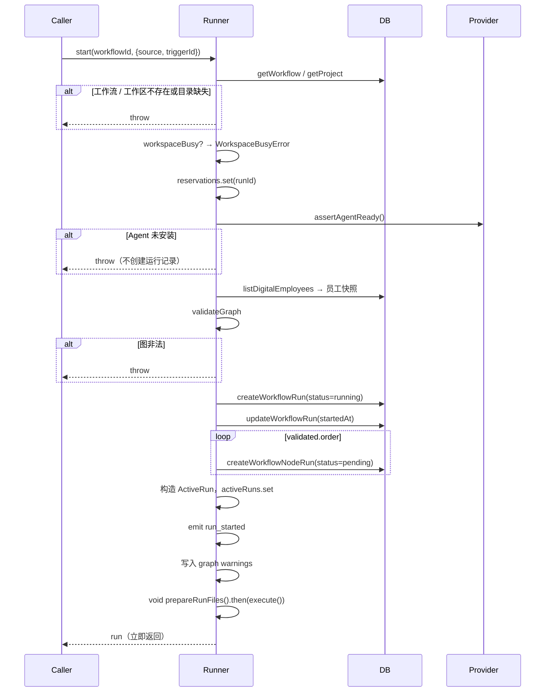
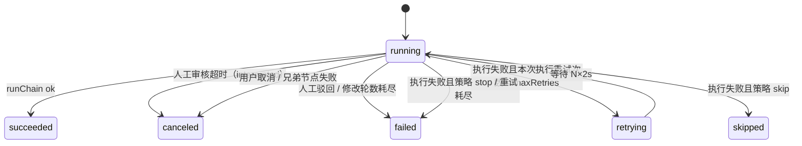

# 09 工作流 — 调度与执行

## 1. 目的与边界

本层定义工作流从“点击运行”到“全部节点结束”的执行过程：

- 启动校验与工作区互斥；
- DAG 并行调度；
- 单个节点的状态机；
- 执行尝试（attempt）与重试；
- 节点会话与临时配置投影；
- 提示词组装；
- 取消与收尾。

审核 / 修改 / 续跑 / 产物见 10。

---

## 2. 运行器装配

文件：`src/main/workflow/runner.ts`

```ts
export interface WorkflowRunnerDeps {
  service: AgentService;
  emit: (event: WorkflowRunEvent) => void;
  emitAgentEvent: (payload: {
    runId: string;
    nodeRunId: string;
    attempt: number;
    round: number;
    seq: number;
    event: AgentEvent;
  }) => void;
  userDataDir: string;
  flushEvents?: () => void;
  onRunFinished?: (run: WorkflowRun) => void;
}

export interface WorkflowRunner {
  start(workflowId: string, options?: { source?: WorkflowRunSource; triggerId?: string | null }): Promise<WorkflowRun>;
  resume(runId: string, nodeRunId?: string): Promise<WorkflowRun>;
  cancel(runId: string): boolean;
  approve(runId, nodeRunId, action: "approve" | "reject" | "revise", note?): boolean;
  hasActiveRunForWorkflow(workflowId: string): boolean;
  hasActiveRunInWorkspace(workspaceId: string): boolean;
  liveTranscript(runId, nodeRunId): { attempt; round; seq; events } | null;
  shutdown(): void;
}
```

在 `src/main/ipc/index.ts` 中创建，注入 `emit`（推送 `workflow:run:event`）、`emitAgentEvent`（推送节点实时事件）、`flushEvents`、`userDataDir`、`onRunFinished`（触发器结果回写）。

---

## 3. 内部状态

```ts
interface ActiveRun {
  id: string;
  workflow: Workflow;
  workspaceId: string;
  workspacePath: string;
  runDir: string;
  order: WorkflowNode[];           // 完整计划顺序（产物编号用）
  executionOrder: WorkflowNode[];  // 本次实际执行（续跑时为子集）
  seededDone: Set<string>;         // 续跑时已完成、本次直接视为 done 的节点
  predecessors: Map<string, string[]>;
  employees: Map<string, DigitalEmployee>;
  nodeRuns: Map<string, WorkflowNodeRun>; // nodeId → 运行记录
  canceled: boolean;
  stopping: boolean;
  sessions: Set<string>;           // 正在运行的节点会话
  approvals: Map<string, { resolve; timer }>;
  live: Map<string, { attempt; round; seq; events }>;
}
```

模块级：

```ts
const activeRuns = new Map<string, ActiveRun>();
const reservations = new Map<string, { workspaceId; workflowId }>();
```

### 3.1 `reservations` 解决启动竞争

`start()` 里有 `await assertAgentReady()`，在 await 之后才把 `activeRuns` 写好。这中间存在竞争窗口：两次 `start()` 都能看到“工作区空闲”。

`reservations.set(runId, ...)` 在第一个 await 之前同步完成占位，`workspaceBusy()` 同时检查 `activeRuns` 与 `reservations`：

```ts
function workspaceBusy(workspaceId) {
  return [...activeRuns.values()].some(r => r.workspaceId === workspaceId) ||
         [...reservations.values()].some(r => r.workspaceId === workspaceId);
}
```

---

## 4. 常量

| 常量 | 值 | 说明 |
|---|---|---|
| `MAX_PARALLEL_NODES` | 3 | 同一工作流内并行节点上限 |
| `RETRY_BASE_MS` | 2000 | 第 N 次重试等待 N × 2s |
| `UPSTREAM_SUMMARY_LIMIT` | 4000 | 交给下游的输出摘要上限 |
| `LIVE_EVENT_LIMIT` | 20000 | 单节点实时事件内存上限 |
| `APPROVAL_TIMEOUT_MS` | 30 分钟 | 人工审核最长等待 |

### 4.1 生效重试次数

```ts
function effectiveMaxRetries(node: WorkflowNode): number {
  if (node.config.failureStrategy !== "retry") return 0;
  const raw = Number(node.config.maxRetries);
  if (!Number.isFinite(raw)) return 1;
  return Math.min(5, Math.max(1, Math.round(raw)));
}
```

不信任 UI 的 1-5 限制，数据可能来自旧版本或外部导入。

### 4.2 生效修改轮数

```ts
function effectiveMaxRevisions(node: WorkflowNode): number {
  const raw = Number(node.config.maxRevisions);
  if (!Number.isFinite(raw)) return 1;
  return Math.min(3, Math.max(0, Math.round(raw)));
}
```

旧数据没有该字段时默认 1 轮。

---

## 5. 启动流程



### 5.1 为什么先校验 Agent 再建运行记录

否则用户会看到一条注定失败的运行记录，排查成本更高。

### 5.2 员工快照时机

```ts
await assertAgentReady();
const employees = new Map(db.listDigitalEmployees().map(e => [e.id, e]));
```

**必须放在最后一个 await 之后**：从这里到节点记录创建完成为止不再让出事件循环，校验过的员工就不可能在校验与写入之间被删除。

### 5.3 失败收尾

如果运行记录已创建但启动流程失败：

```ts
if (runCreated) failStartupRun(runId, error);
```

`failStartupRun`：

- run 置为 `failed`；
- 所有 `pending` / `running` 节点置为 `canceled`；
- 推送 `run_finished`；
- 调用 `onRunFinished`。

否则记录会永远停在“运行中”。

### 5.4 异步执行

```ts
void prepareRunFiles(active).then(() => execute(active)).catch(err => finish(active, "failed", messageOf(err)));
```

`start()` 不等执行完成，立即返回运行记录，UI 通过推送更新状态。

---

## 6. DAG 调度

### 6.1 主循环

```ts
async function execute(active: ActiveRun): Promise<void> {
  const done = new Set(active.seededDone);
  const remaining = new Set(active.executionOrder.map(n => n.id));
  const running = new Map<string, Promise<{ node; outcome?; error? }>>();
  let failedError = null;
  let interruptedError = null;

  const launch = (node) => {
    const task = executeNode(active, node)
      .then(outcome => ({ node, outcome }))
      .catch(err => ({ node, error: messageOf(err) }));
    running.set(node.id, task);
  };

  try {
    while (remaining.size > 0 || running.size > 0) {
      if (active.canceled) break;

      if (!failedError) {
        for (const node of active.executionOrder) {
          if (running.size >= MAX_PARALLEL_NODES) break;
          if (!remaining.has(node.id) || running.has(node.id)) continue;
          const predecessors = active.predecessors.get(node.id) ?? [];
          if (!predecessors.every(id => done.has(id))) continue;
          launch(node);
        }
      }

      if (running.size === 0) {
        if (failedError || active.canceled) break;
        failedError = "工作流调度无法继续：存在未满足的前置节点";
        break;
      }

      const settled = await Promise.race(running.values());
      running.delete(settled.node.id);
      if (settled.error) {
        if (active.canceled) break;
        failedError = settled.error;
        break;
      }

      const outcome = settled.outcome;
      done.add(settled.node.id);
      remaining.delete(settled.node.id);

      if (outcome === "failed") { failedError = nodeFailureMessage(...); break; }
      if (outcome === "interrupted") { interruptedError = ...; break; }
      if (outcome === "canceled") { if (!active.canceled) failedError = "节点执行被取消"; break; }
    }
  } finally {
    if (failedError || interruptedError || active.canceled) {
      active.stopping = true;
      cancelApprovals(active);
      abortSessions(active);
      await Promise.allSettled([...running.values()]);
    }
  }

  if (active.canceled) finish(active, "canceled");
  else if (interruptedError) finish(active, "interrupted", interruptedError);
  else if (failedError) finish(active, "failed", failedError);
  else finish(active, "succeeded");
}
```

### 6.2 调度语义

- **AND 汇合**：节点的所有直接前驱都在 `done` 里才启动；
- **skipped 也算 done**：下游继续执行，并在 prompt 里看到“已跳过，无产物”；
- **最多 3 个并行**：`running.size >= MAX_PARALLEL_NODES` 时停止启动新节点；
- **失败即停**：任一节点 `failed`，设置 `failedError`，不再启动新节点，并中断其他并行节点；
- **审核超时是 interrupted**：与 failed 区分，运行可续跑；
- **取消**：`active.canceled` 立即跳出循环。

### 6.3 不要在 promise 的 finally 摘掉 running

注释明确：

> 两个并行节点可能在同一微任务批次完成；先完成的那个如果立刻摘掉，下一个 race 就看不到它的结果，remaining 还在，会导致重复启动。由主循环处理完结果后再删除。

### 6.4 失败时的并行收尾

```ts
active.stopping = true;
cancelApprovals(active);  // 等审核的节点没有子进程，必须主动 resolve
abortSessions(active);    // 终止正在跑的 Agent
await Promise.allSettled([...running.values()]);
```

**为什么必须 await**：否则 `finish` 把节点标记为 canceled 之后，它们还可能继续写库。

### 6.5 调度死锁兜底

如果 `running.size === 0` 但 `remaining` 还有节点且没有失败：

→ `工作流调度无法继续：存在未满足的前置节点`。

正常情况下图校验会拦住这种图，这是防御。

---

## 7. 节点执行状态机

`executeNode()`：



### 7.1 入口校验

```ts
const employee = active.employees.get(node.config.employeeId ?? "");
if (!employee) throw new Error(`节点「${node.name}」没有可用数字员工`);
```

### 7.2 初始状态

```ts
updateStatus(initial.id, "running", { startedAt: Date.now(), error: null, round: 1 });
emitEvent(active.id, initial.id, "node_status", { status: "running", round: 1 });
```

### 7.3 attempt 循环

```ts
const maxRetries = effectiveMaxRetries(node);
let attempt = initial.attempt || 1;   // 运行记录里的累计编号（续跑会继续递增）
let retriesUsed = 0;                  // 本次执行内已用掉的自动重试次数
let lastError = "";

while (true) {
  if (active.canceled || active.stopping) throw new CanceledError();

  if (!lastError) {
    const attemptStartedAt = Date.now();
    updateStatus(initial.id, "running", { attempt, round: 1, startedAt: attemptStartedAt, finishedAt: null, error: null });
    emitEvent(..., "node_status", { status: "running", attempt, round: 1 });

    const outcome = await runChain(active, node, employee, attempt);

    if (outcome.ok) { updateStatus(succeeded); emit node_finished; return "succeeded"; }
    if (outcome.interrupted) { updateStatus(canceled); emit node_finished; return "interrupted"; }
    if (outcome.rejected) { updateStatus(failed); emit node_finished; return "failed"; }
    if (outcome.canceled) throw new CanceledError();
    lastError = outcome.error || "节点执行失败";
  }

  // 失败处理
  updateStatus(initial.id, "failed", { attempt, round: ..., error: lastError });

  if (retriesUsed < maxRetries) {
    retriesUsed += 1;
    updateStatus(initial.id, "retrying", ...);
    emit node_retry;
    await delay(active, RETRY_BASE_MS * retriesUsed);
    attempt += 1;
    lastError = "";  // 必须清空
    db.updateWorkflowNodeRun(initial.id, { attempt, round: 1, error: null });
    continue;
  }

  if (node.config.failureStrategy === "skip") {
    updateStatus(skipped); emit node_finished; return "skipped";
  }

  updateStatus(failed); emit node_finished; return "failed";
}
```

### 7.4 关键点

- 重试时 `startedAt` 以本轮实际开始时间为准，否则耗时会把等待重试的时间也算进去；
- **重试预算按「本次执行」计数**：续跑会把 `attempt` 继续递增，直接用 `attempt <= maxRetries` 会导致续跑后一次都不重试；退避时间也用 `retriesUsed` 而不是累计 `attempt`；
- `lastError = ""` 必须清空，否则下一轮会跳过执行（只重试等待、不真正运行）；
- 人工驳回 / 修改耗尽返回 `rejected`，**不套用失败重试策略**；
- 审核超时返回 `interrupted`，节点置 `canceled` 而不是 `failed`；
- CLI 可能在 result 行报告 `error_*` 却仍以 0 退出：运行期有错误事件且
  本轮没有正文时，必须按失败处理，不能只看 `exitCode`；
- `skip` 策略在重试耗尽后才生效。

### 7.5 取消检查

`delay()` 每 100ms 检查 `canceled` / `stopping`，可及时中断重试等待。

---

## 8. 执行尝试链

### 8.1 `runChain`

```ts
async function runChain(active, node, employee, attempt): Promise<AttemptOutcome> {
  let chain = await createAttemptChain(active, node, employee, attempt);
  let round = 1;
  let kind = attempt > 1 ? "retry" : "initial";
  let feedback = "";

  while (true) {
    const outcome = await runRound(active, node, employee, chain, round, kind, feedback);
    if (!outcome.ok) return outcome;
    if (node.config.reviewMode !== "manual") return outcome;

    const decision = await reviewNodeOutput(...);
    if (decision.action === "approve") return outcome;
    if (decision.action === "reject") return { ...outcome, ok: false, rejected: true, error: "人工审核驳回..." };
    if (round - 1 >= maxRevisions) return { ...outcome, ok: false, rejected: true, error: "已达到最大修改轮数..." };

    round += 1;
    kind = "revise";
    feedback = decision.note;
    update status running(round);
  }
}
```

### 8.2 `AttemptChain`

```ts
interface AttemptChain {
  attempt: number;
  sessionId: string;
  runtimeDir: string;
  prepared: PreparedAgentRun;
  warnings: string[];
  agentLabel: string;
  runtimeConfig: Record<string, string>;
  systemPrompt: string;
  knowledge: ExecutionReportKnowledgeBase[];
}
```

**同一 attempt 内的多轮修正必须复用**：

- `sessionId`：消息落库与前端事件路由；
- `runtimeDir` / `prepared`：临时 `CLAUDE_CONFIG_DIR` 与 MCP 投影。

这样下一轮才能靠 `--resume` 接上同一个 CLI 会话。

### 8.3 `createAttemptChain`

```ts
const runtimeDir = join(deps.userDataDir, "workflow-runs", active.id, `${node.id}-attempt-${attempt}`);

// 1. provider 配置摘要（失败不阻断）
const runtimeConfig = provider.describeRuntimeConfig?.() ?? {};

// 2. 能力告警
if (enabledSkills.length > 0 && !capabilities.skills) warnings.push(...);
if (enabledMcp.length > 0 && !capabilities.mcp) warnings.push(...);

// 3. 知识库解析
const knowledge = await resolveEmployeeKnowledge(employee.knowledgeBases);

// 4. 系统提示词
const systemPrompt = buildSystemPrompt(employee, knowledge.promptSection);

// 5. 创建 Nova 会话（source=workflow）
const session = db.createSession(
  agentId,
  active.workspaceId,
  active.workspacePath,
  `工作流「${name}」· ${node.name} · 第 ${attempt} 次`,
  null,
  "workflow",
);
active.sessions.add(session.id);

// 6. provider.prepareRun（Claude 生成临时配置投影）
const prepared = await provider.prepareRun?.({ mode: "workflow", sessionId, cwd, runtimeDir, employee, opts }) ?? {};

// 7. 告警落事件
for (const message of warnings) emitEvent(... "log", { level: "warning", message, attempt });
```

### 8.4 投影失败回收

```ts
catch (err) {
  active.sessions.delete(session.id);
  db.deleteSession(session.id);       // 会话还没有消息，直接回收
  await cleanupRuntimeDir(runtimeDir); // 可能已复制凭证 / 技能
  throw err;
}
```

### 8.5 为什么每个 attempt 独立会话

- 失败重试应该开新上下文，不污染原会话；
- 人工「要求修改」才复用当前 attempt 的会话；
- 产物 / 运行详情可以按 attempt 分组。

---

## 9. 单轮执行

`runRound(active, node, employee, chain, round, kind, feedback)`：

### 9.1 产物路径

```ts
const attemptDir = nodeArtifactDir(runDir, node, orderIndex, chain.attempt, round);
const inputPath = join(attemptDir, "execution.md");
const outputPath = join(attemptDir, "result.md");
```

### 9.2 登记调用

```ts
db.createWorkflowNodeAttempt({
  id: attemptId,
  runId, nodeRunId,
  attempt: chain.attempt,
  round,
  kind,
  sessionId: chain.sessionId,
  artifactDir: attemptDir,
});

db.updateWorkflowNodeRun(nodeRun.id, {
  sessionId: chain.sessionId,
  inputPath,
  outputPath,
  artifactDir: attemptDir,
  outputSummary: null,  // 清空上一轮结果，避免失败时展示旧内容
  round,
});
```

### 9.3 提示词

```ts
const prompt = kind === "revise" ? buildRevisionPrompt(feedback) : buildPrompt(active, node);
```

### 9.4 执行报告

`writeReport()` 每轮重写 `execution.md`，链式写入保证最终内容最新：

```ts
reportChain = reportChain.then(() => writeText(inputPath, content)).catch(() => {});
```

报告包含：身份信息、Agent 配置、注入能力、实际命令行、环境变量、系统提示词、任务输入、结果、错误。

### 9.5 实时事件

```ts
active.live.set(nodeRun.id, { attempt, round, seq: 0, events: [] });
```

`onEvent`：

```ts
const live = active.live.get(nodeRun.id);
if (live && live.attempt === chain.attempt && live.round === round) {
  live.seq += 1;
  if (live.events.length < LIVE_EVENT_LIMIT) live.events.push(event);
  deps.emitAgentEvent({ runId, nodeRunId, attempt, round, seq: live.seq, event });
}
```

- 只推送、不落库；
- 超过 20000 条只停止保留前缀，推送仍连续；
- 运行记录中途打开时按 `seq` 合并。

### 9.6 调用 AgentService

```ts
const result = await deps.service.run({
  sessionId: chain.sessionId,
  prompt,
  cwd: active.workspacePath,
  opts: chain.systemPrompt ? { systemPrompt: chain.systemPrompt } : {},
  env: chain.prepared.env,
  envRemove: chain.prepared.envRemove,
  extraArgs: chain.prepared.extraArgs,
  onUserMessage: (id) => db.updateWorkflowNodeAttemptMessages(attemptId, { userMessageId: id }),
  onInvocation: (info) => { reportState.invocation = info; writeReport(); },
  onEvent: (event) => { /* live + texts/deltas/runtimeError */ },
});
```

### 9.7 结果判定顺序

1. `active.canceled` → 失败（canceled）
2. `result.aborted` → 失败（canceled）
3. `!result.ok` → 失败（启动失败）
4. `result.exitCode !== 0` → 失败（运行时错误 / 退出码）
5. `result.resumeFailed` → 失败（修改轮接不上上下文）
6. 成功 → 写 `result.md`

> 修改轮 `resumeFailed` 必须失败：不能把“全新上下文跑出来的内容”当成修改结果。

### 9.8 输出优先级

```ts
const output =
  result.assistantText?.trim() ||   // 权威 message_end
  texts.join("\n\n").trim() ||
  deltas.join("").trim() ||
  "（无文本输出）";
```

### 9.9 异常路径

```ts
catch (err) {
  active.live.delete(nodeRun.id);
  reportState.error = message;
  writeReport();
  await reportChain;
  return failedAttempt(message, false, ...);
}
finally {
  await reportChain;
  active.live.delete(nodeRun.id);
}
```

异常（配置投影失败、落盘失败等）也要记到节点上，不能冒泡成“运行失败 + 节点被标记取消”这种无法排查的状态。

---

## 10. 提示词组装

### 10.1 系统提示词

```ts
function buildSystemPrompt(employee, knowledgeSection) {
  return [
    employee.role
      ? `你是「${employee.name}」，职位：${employee.role}。`
      : `你是「${employee.name}」。`,
    employee.systemPrompt,
    knowledgeSection,
    [
      "## 工作流协作约定",
      "你的最终回复会作为该节点的产物，交给下游节点使用。",
      "请只输出最终结论或交付物说明，不要重复分析过程；",
      "如果需要下游读取文件，请写出文件的完整路径。",
    ].join("\n"),
  ].filter(part => part?.trim()).join("\n\n");
}
```

### 10.2 任务输入

```ts
function buildPrompt(active, node) {
  const parts = [];
  parts.push(node.config.taskDetail.trim() || `请完成节点「${node.name}」分配给你的任务。`);

  const upstreamIds = active.predecessors.get(node.id) ?? [];
  if (upstreamIds.length > 0) {
    const nodeRuns = db.listWorkflowNodeRuns(active.id); // 一次取出，避免逐节点查询
    const blocks = upstreamIds.map(predecessorId => {
      const predecessor = active.order.find(n => n.id === predecessorId);
      const nodeRun = nodeRuns.find(n => n.nodeId === predecessorId);
      if (!nodeRun) return "";
      if (nodeRun.status === "skipped") return `### 上游节点：${name}\n状态：已跳过，无产物。`;
      return [
        `### 上游节点：${name}`,
        `状态：${nodeRun.status}`,
        nodeRun.outputPath ? `产物文件：${nodeRun.outputPath}` : "",
        nodeRun.artifactDir ? `产物目录：${nodeRun.artifactDir}` : "",
        nodeRun.outputSummary ? `输出摘要：\n${nodeRun.outputSummary}` : "输出摘要：无",
        "需要完整内容时，请直接读取上面的产物文件。",
      ].filter(Boolean).join("\n");
    });
    parts.push(`## 上游产物\n\n${blocks.filter(Boolean).join("\n\n")}`);
  }

  return parts.join("\n\n---\n\n");
}
```

### 10.3 修改轮输入

```ts
function buildRevisionPrompt(feedback) {
  return [
    "上一次输出未通过人工审核，请基于你上一次的产物直接修改，不要从头重做。",
    feedback ? `审核意见：${feedback}` : "审核人未填写具体意见，请自行复核并改进。",
    "修改完成后，只输出最终的完整版本。",
  ].join("\n\n");
}
```

**为什么修改轮不重复任务详情 / 上游产物**：复用同一会话，Agent 上一轮已经看过。

### 10.4 输出摘要

```ts
summary: truncate(output, UPSTREAM_SUMMARY_LIMIT) // 4000
```

下游 prompt 只拿摘要，完整内容让 Agent 自己读产物文件。

---

## 11. 取消

```ts
function cancel(runId): boolean {
  const active = activeRuns.get(runId);
  if (!active) return false;
  active.canceled = true;
  active.stopping = true;
  abortSessions(active);
  cancelApprovals(active);
  return true;
}
```

- `abortSessions`：对所有 `active.sessions` 调 `service.abort`；
- `cancelApprovals`：清定时器并 resolve `{ action: "cancel" }`；
- 主循环检测 `canceled` 后跳出，`finish(active, "canceled")`。

---

## 12. 收尾

```ts
function finish(active, status, error?) {
  if (!activeRuns.has(active.id)) return;
  const finishedAt = Date.now();
  db.updateWorkflowRun(active.id, { status, error: error ?? null, finishedAt });

  if (status !== "succeeded") {
    for (const nodeRun of db.listWorkflowNodeRuns(active.id)) {
      if (["pending","running","awaiting_approval","retrying"].includes(nodeRun.status)) {
        db.updateWorkflowNodeRun(nodeRun.id, { status: "canceled", finishedAt });
      }
    }
  }

  emitEvent(active.id, null, "run_finished", { status, error: error ?? null });
  activeRuns.delete(active.id);
  deps.onRunFinished?.(db.getWorkflowRun(active.id));
}
```

**幂等**：`activeRuns.has` 检查保证只收尾一次。

**非成功运行必须把活动节点置为 canceled**，不能留下“假装还在跑”的状态。

---

## 13. 应用退出

`shutdown()`：

- 对每个 active run：`canceled=true`、`stopping=true`、abort 会话、cancel 审批；
- run 置为 `interrupted`，error=`应用已退出，运行被中断`；
- 活动节点置为 `canceled`；
- 推送 `run_finished`；
- 清空 `activeRuns`。

启动时 `interruptStaleWorkflowRuns()` 兜底上次异常退出。

---

## 14. 运行事件

`emitEvent`：

1. 先 `deps.flushEvents?.()`，保证 token 批次先于状态事件到达；
2. `db.appendWorkflowRunEvent` 落库；
3. `deps.emit(event)` 推送。

事件类型见 `03-数据模型与数据库`。

节点实时对话走 `deps.emitAgentEvent`，不落库。

---

## 15. 关键坑位

1. **不要在并行 promise 的 finally 里删除 running**，会导致重复启动。
2. **失败恢复时要把 `lastError` 清空**，否则下一轮不执行。
3. **`startedAt` 每轮重置**，否则等待重试时间算进耗时。
4. **重试不套用于人工驳回 / 修改耗尽**。
5. **审核超时是 interrupted，不是 failed**。
6. **修改轮 `resumeFailed` 必须失败**。
7. **`finish` 非成功时必须清理活动节点**。
8. **`reservations` 必须在第一个 await 前占位**。
9. **员工快照必须在最后一个 await 后取**。
10. **取消时要主动 resolve 等待中的审批**，否则主循环永远等不到。

---

## 16. 复刻验收清单

- [ ] `start` 前校验工作流、工作区、目录、Agent。
- [ ] `reservations` 解决启动竞争窗口。
- [ ] 同一工作区互斥，抛 `WorkspaceBusyError`。
- [ ] 图校验失败不创建运行记录；Agent 未安装不创建运行记录。
- [ ] 启动失败时运行记录落终态。
- [ ] DAG 调度支持 AND 汇合、最多 3 并行、skipped 视为完成。
- [ ] 失败停止会中断其他并行节点并等待收尾。
- [ ] 节点状态机覆盖 running / retrying / succeeded / failed / skipped / canceled。
- [ ] 重试等待 N×2s，`lastError` 清空，`attempt` 递增。
- [ ] 人工驳回不重试。
- [ ] 每次 attempt 独立会话与临时配置目录。
- [ ] 同一 attempt 的多轮修改复用会话。
- [ ] 系统提示词包含员工身份、人设、知识库、协作约定。
- [ ] 下游 prompt 包含上游状态、产物路径、摘要。
- [ ] 结果写入 `result.md`，摘要上限 4000。
- [ ] 取消能中断 Agent 与审批。
- [ ] 收尾幂等，非成功运行清理活动节点。
- [ ] 应用退出时运行置为 interrupted。
- [ ] 状态事件前 flush 流式缓冲。
