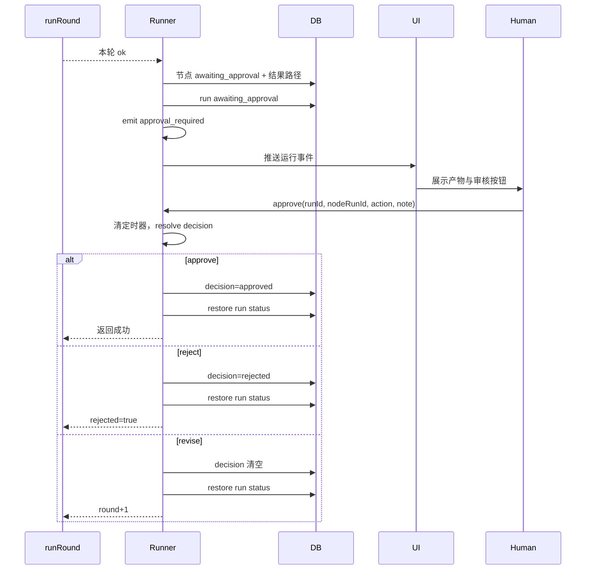

# 10 工作流 — 审核、续跑与产物

## 1. 目的与边界

本层覆盖：

- 节点执行后的**人工审核门禁**；
- 通过 / 驳回 / 要求修改 / 超时；
- 失败 / 取消 / 中断后的**续跑**；
- **产物目录**与 `execution.md` 执行现场；
- 运行记录 / 节点详情的读取；
- 级联**清理**。

节点调度与执行见 09。

---

## 2. 审核门禁

### 2.1 两种模式

```ts
export type WorkflowReviewMode = "auto" | "manual";
```

| 模式 | 行为 |
|---|---|
| `auto` | 节点执行完成后直接视为通过，继续下游 |
| `manual` | 节点执行完成后暂停，等人工确认产物 |

**门禁作用于“执行后”**：数字员工先跑完，产物落库并展示给审核人。

### 2.2 审核动作

```ts
type DecisionAction = "approve" | "reject" | "revise" | "cancel" | "timeout";
```

| 动作 | 结果 |
|---|---|
| `approve` | 节点成功，继续下游 |
| `reject` | 节点失败，**立即终止整条运行**，且不允许续跑 |
| `revise` | 复用同一会话，`round+1` 再执行一轮 |
| `cancel` | 运行被终止 |
| `timeout` | 30 分钟无人处理，运行按**中断**收尾，可续跑 |

### 2.3 修改轮数

```ts
function effectiveMaxRevisions(node): number {
  const raw = Number(node.config.maxRevisions);
  if (!Number.isFinite(raw)) return 1;
  return Math.min(3, Math.max(0, Math.round(raw)));
}
```

- `0` 表示只能通过 / 驳回；
- 旧数据没有字段默认 1；
- 修改轮数耗尽 → 节点失败（`rejected=true`），终止整条运行，且不能通过续跑绕过。

---

## 3. 审核流程



### 3.1 进入审核

`reviewNodeOutput()`：

```ts
updateStatus(nodeRunId, "awaiting_approval", {
  attempt,
  round,
  finishedAt: outcome.finishedAt,   // 定格，避免把人工等待算进耗时
  sessionId: outcome.sessionId,
  artifactDir: outcome.attemptDir,
  inputPath: outcome.inputPath,
  outputPath: outcome.outputPath,
  outputSummary: outcome.summary,
});
db.updateWorkflowRun(active.id, { status: "awaiting_approval" });

const remainingRevisions = Math.max(0, maxRevisions - (round - 1));
emitEvent(active.id, nodeRunId, "approval_required", {
  nodeId, nodeName, employeeName,
  taskDetail,
  attempt, round,
  remainingRevisions,
  outputPath: outcome.outputPath,
  summary: outcome.summary,
});
```

**产物先落库**：审批界面要能直接读到结果，而不是只有一个任务描述。

### 3.2 等待

等待 / 决定 / 超时的实现集中在 `src/main/workflow/approval-gate.ts`：`createApprovalGate()` 返回 `wait / settle / cancelAll`，状态表由每次运行自己的 `active.approvals` 持有。runner 中的 `waitApproval()` 只是转调 `approvalGate.wait(active.approvals, active.id, nodeRunId)`。其内部逻辑等价于：

```ts
function waitApproval(active, nodeRunId): Promise<ApprovalDecision> {
  return new Promise(resolve => {
    const timer = setTimeout(() => {
      if (!active.approvals.has(nodeRunId)) return;
      active.approvals.delete(nodeRunId);
      const minutes = Math.round(APPROVAL_TIMEOUT_MS / 60000);
      emitEvent(active.id, nodeRunId, "log", {
        level: "warning",
        message: `等待人工审核超过 ${minutes} 分钟，本次运行按中断处理，可稍后继续执行`,
      });
      resolve({ action: "timeout", note: `超过 ${minutes} 分钟未确认` });
    }, APPROVAL_TIMEOUT_MS);

    active.approvals.set(nodeRunId, { resolve, timer });
  });
}
```

### 3.3 人工响应

```ts
function approve(runId, nodeRunId, action, note?): boolean {
  const active = activeRuns.get(runId);
  if (!active) return false;
  return approvalGate.settle(active.approvals, nodeRunId, action, note);
}
```

`settle()` 未命中返回 `false`；命中时先清定时器，再以 `note?.trim() ?? ""` resolve。

### 3.4 结果处理

```ts
const decision = await waitApproval(active, nodeRunId);

if (decision.action === "cancel" || active.canceled) throw new CanceledError();

if (decision.action === "timeout") {
  // 不写 decision：让运行之后还能继续
  throw new ApprovalTimeoutError(
    `节点「${node.name}」等待人工审核超时（30 分钟），本次运行已中断；继续执行会重新执行该节点并重新审核`
  );
}

emitEvent(active.id, nodeRunId, "approval_decided", { decision, note, attempt, round });

if (decision.action === "revise") {
  db.updateWorkflowNodeRun(nodeRunId, { decision: null, decisionNote: null, decidedAt: null });
  restoreRunStatusAfterDecision(active, nodeRunId);
  return decision;
}

db.updateWorkflowNodeRun(nodeRunId, {
  decision: decision.action === "approve" ? "approved" : "rejected",
  decisionNote: decision.note || null,
  decidedAt: Date.now(),
});
restoreRunStatusAfterDecision(active, nodeRunId);
return decision;
```

### 3.5 恢复运行状态

并行分支可能还有别的节点在等审核，不能简单切回 running：

```ts
function restoreRunStatusAfterDecision(active, nodeRunId) {
  const stillAwaiting =
    active.approvals.size > 0 ||
    db.listWorkflowNodeRuns(active.id).some(
      item => item.id !== nodeRunId && item.status === "awaiting_approval"
    );

  if (stillAwaiting) {
    db.updateWorkflowRun(active.id, { status: "awaiting_approval" });
    return;
  }

  const run = db.getWorkflowRun(active.id);
  if (run?.status === "awaiting_approval") {
    db.updateWorkflowRun(active.id, { status: "running" });
  }
}
```

**不能把已取消 / 已结束的运行被一次迟到的审批回翻**：只在当前状态仍是 `awaiting_approval` 时才切回 running。

### 3.6 驳回

```ts
return {
  ...outcome,
  ok: false,
  rejected: true,
  error: decision.note ? `人工审核驳回：${decision.note}` : "人工审核驳回",
};
```

`executeNode` 看到 `rejected` 直接：

- 节点置 `failed`；
- 返回 `"failed"`；
- **不走失败重试策略**；
- 主循环 `failedError` → 整条运行 `failed`。

`resume()` 会检查 `decision === "rejected"`，直接拒绝续跑。

### 3.7 要求修改

```ts
if (round - 1 >= maxRevisions) {
  db.updateWorkflowNodeRun(nodeRunId, {
    decision: "rejected",
    decisionNote: `已达到最大修改轮数（${maxRevisions}）`,
    decidedAt: Date.now(),
  });
  return { ...outcome, ok: false, rejected: true, error: "已达到最大修改轮数..." };
}

round += 1;
kind = "revise";
feedback = decision.note;
update status running(round);
```

- 复用同一 `sessionId` 与员工常驻运行时 `configDir`；
- `buildRevisionPrompt(feedback)` 只给评审意见，不重复任务详情与上游产物；
- 新一轮的事件 `round` 递增；
- 运行详情按 attempt / round 分组展示。

### 3.8 超时

`ApprovalTimeoutError` 在 `runChain` 中被捕获：

```ts
if (err instanceof ApprovalTimeoutError) {
  return {
    ...lastOutcome,
    ok: false,
    interrupted: true,
    error: err.message,
    finishedAt: lastOutcome.finishedAt,
  };
}
```

`executeNode` 看到 `interrupted`：

- 节点置 `canceled`；
- 返回 `"interrupted"`；
- 主循环 `interruptedError` → 运行 `interrupted`。

**不是失败，也不是驳回**：保留产物，用户回来可以续跑。

---

## 4. 续跑

### 4.1 入口

```ts
resume(runId: string, nodeRunId?: string): Promise<WorkflowRun>
```

校验：

1. 应用未处于退出流程；
2. 运行存在；
3. `isRunBusy(runId)` 为假（执行中 / 启动占位 / 删除中都不允许续跑）；
4. 状态不是 running / awaiting_approval；
5. 工作流、工作区、目录存在；
6. 工作区不忙（含启动占位）；
7. **没有人工驳回的节点**（`decision === "rejected"`，也包含修改轮数耗尽）；
8. 目标节点是 employee 类型；
9. 异步阶段重新执行 `assertAgentReady()`，并用 `run.graph` 重新 `validateGraph`（续跑始终使用运行快照）。

### 4.2 目标节点选择

```ts
const target = nodeRunId
  ? nodeRuns.find(item => item.id === nodeRunId)
  : (nodeRuns.find(item => item.status === "failed") ??
     nodeRuns.find(item => item.status === "canceled" || item.status === "skipped"));
```

未指定时：第一个失败节点；没有则第一个取消 / 跳过节点。

### 4.3 执行集合

1. 从目标节点出发，沿出边收集全部下游；
2. 对执行集合中的每个节点，检查其**直接前驱**：
   - 已成功 / 已跳过 → 保留；
   - 未成功（failed / canceled / pending）→ 加入执行集合；
3. 递归，直到没有新增。

**为什么补上游**：并行分支 A/B 汇合到 C，A 失败导致 B 被取消；从 A 续跑时 B 也必须重跑，否则 C 会拿到一个 canceled 的上游。

```ts
const executionIds = new Set(descendants);
const queue = [...descendants];
const statusByNode = new Map(nodeRuns.map(n => [n.nodeId, n.status]));

while (queue.length) {
  const id = queue.shift();
  for (const predecessorId of validated.predecessors.get(id) ?? []) {
    if (executionIds.has(predecessorId)) continue;
    const status = statusByNode.get(predecessorId);
    if (status === "succeeded" || status === "skipped") continue;
    executionIds.add(predecessorId);
    queue.push(predecessorId);
  }
}
```

### 4.4 已完成节点

```ts
const seededDone = new Set(
  validated.order.filter(node => !executionIds.has(node.id)).map(node => node.id)
);
```

这些节点本次不执行，直接视为 `done`，供下游依赖判断。

### 4.5 重置节点记录

```ts
for (const node of executionOrder) {
  const attempts = db.listWorkflowNodeAttempts(nodeRun.id);
  const nextAttempt = Math.max(0, ...attempts.map(a => a.attempt)) + 1;

  db.updateWorkflowNodeRun(nodeRun.id, {
    status: "pending",
    attempt: nextAttempt,
    round: 1,
    sessionId: null,
    artifactDir: null,
    inputPath: null,
    outputPath: null,
    outputSummary: null,
    error: null,
    decision: null,
    decisionNote: null,
    decidedAt: null,
    startedAt: null,
    finishedAt: null,
  });
}
```

**历次尝试记录保留**在 `workflow_node_attempts`，运行详情仍可查看。

> 续跑的 `attempt` 会继续递增，但节点的自动重试预算按**本次执行**重新计算
> （`retriesUsed`），不会因为历史 `attempt` 已大于 `maxRetries` 而失效。

### 4.6 运行状态

```ts
db.updateWorkflowRun(runId, {
  status: "running",
  error: null,
  startedAt: Date.now(),
  finishedAt: null,
});
```

先取好 `refreshedNodeRuns` 快照，再切状态，避免“状态已变 running 但 active 未挂上”。

### 4.7 事件

```ts
emitEvent(runId, null, "run_started", {
  workflowId, workflowName, workspacePath, artifactDir,
  nodeCount: executionOrder.length,
  resumed: true,
  fromNodeId: target.nodeId,
  fromNodeName: target.nodeName,
});
```

### 4.8 不能续跑的情况

| 情况 | 原因 |
|---|---|
| 人工驳回 | 产物本身不合格，重跑没有意义 |
| 修改轮数耗尽 | 已标记 rejected，不能绕过限制 |
| 运行仍在执行 / 正在删除 | 会与当前运行冲突 |
| 工作区被占用 | 互斥 |
| 执行集合为空 | 图快照与节点记录不一致（防御分支，报“该节点没有可执行的后续节点”） |
| Agent 未安装 | 异步校验阶段拒绝，运行保持原终态 |

---

## 5. 产物目录

### 5.1 布局

```
<workspace>/.novastudio/
├── .gitignore                      # 内容为 *
└── workflows/
    └── <workflowId>/
        └── <runId>/
            ├── run.json
            ├── 01-需求分析/
            │   ├── execution.md   # 完整执行现场
            │   └── result.md      # Agent 最终返回
            ├── 02-开发.try-2/     # 第 2 次执行尝试
            │   ├── execution.md
            │   └── result.md
            └── 02-开发.try-2.rev-2/ # 第 2 次尝试的第 2 轮修改
                ├── execution.md
                └── result.md
```

### 5.2 目录命名

```ts
function nodeArtifactDir(runDir, node, index, attempt, round = 1) {
  const label = safeSegment(node.name).slice(0, 40) || node.id.slice(0, 8);
  const base = join(runDir, `${String(Math.max(0, index) + 1).padStart(2, "0")}-${label}`);
  const attemptSuffix = attempt > 1 ? `.try-${attempt}` : "";
  const roundSuffix = round > 1 ? `.rev-${round}` : "";
  return `${base}${attemptSuffix}${roundSuffix}`;
}
```

- 序号保证同名节点不覆盖；
- 首次尝试直接用节点目录；
- 重试用同级 `.try-N`；
- 修改轮用 `.rev-N`；
- 可叠加：`.try-2.rev-2`。

### 5.3 非法字符

```ts
function safeSegment(value) {
  return value
    .replace(/[\\/:*?"<>|\u0000-\u001f]/g, "-")
    .replace(/\s+/g, " ")
    .trim()
    .replace(/[. ]+$/g, "");
}
```

Windows 文件名不允许的字符全部替换。

### 5.4 `.novastudio/.gitignore`

```gitignore
*
```

Git 会把整个目录视为全部忽略，不需要改用户工作区根目录的 `.gitignore`。

### 5.5 员工运行时目录（常驻）

工作流不再为每个 attempt 生成临时投影目录；聊天与工作流共用同一套员工运行时（自 v0.2.0 起）：

```
~/.novastudio/
└── runtime/<employeeId>/          # 同一员工的多次运行共用
    ├── claude-home/               # CLAUDE_CONFIG_DIR
    │   ├── settings.json          # 从 ~/.claude 同步
    │   ├── .credentials.json      # 从 ~/.claude 同步
    │   ├── skills/                # 员工勾选的技能
    │   └── projects/              # CLI 会话 JSONL，--resume 的凭据
    └── mcp.json                   # --mcp-config 指向这里
```

- 由 `provider.prepareRun()` → `syncEmployeeRuntime()` 增量同步（settings / 凭证按 mtime，skills 按目录指纹）；同一员工的并发同步串行执行；
- 同一 attempt 的多轮修改共用同一个 `configDir`，所以下一轮 `--resume` 能接上同一个 CLI 会话；
- attempt 结束时 runner 只 `releaseSession` + `clearSessionCliRef`，删除该 Nova 会话的 CLI JSONL，运行时目录本身保留；
- 旧版 `<userData>/workflow-runs/<runId>/<nodeId>-attempt-N/` 已废弃，启动时由 `purgeLegacyWorkflowRuntimes()` 一次性清理（可能含凭证副本）；异常退出的工作流会话文件由 `purgeStaleWorkflowSessionFiles()` 兜底。

---

## 6. `execution.md`

文件：`src/main/workflow/execution-report.ts`

### 6.1 内容结构

```markdown
# 工作流节点执行信息

> 本文件记录本次节点尝试的完整执行上下文，用于排查参数 / 配置问题。
> API Key、TOKEN、SECRET 等敏感环境变量已脱敏。

## 基本信息
| 项目 | 值 |
| 运行 ID | ... |
| 工作流 | ... |
| 工作流 ID | ... |
| 节点 | ... |
| 节点 ID | ... |
| 节点类型 | ... |
| 数字员工 | name（id） |
| 员工职位 | ... |
| 尝试次数 | 第 N 次（最多重试 M 次） |
| 调用来源 | 初次执行 / 失败重试 / 人工要求修改 |
| 修正轮次 | 第 R 轮 / 最多 K 轮 |
| 失败策略 | stop / skip / retry |
| 审核门禁 | auto / manual |
| 会话 ID | ... |
| CLI 会话 ID | ... |
| 工作目录 | ... |
| 开始时间 | ... |
| 单次超时 | ... |
| 执行结果 | 成功 / 失败 / 已中断 |

## Agent 平台与本机配置
| Agent | Claude Code（claude） |
| 配置文件 | ... |
| 默认模型 | ... |
| 权限模式 | ... |
| Base URL | ... |
| API Key | ••••xxxx |
| 模型别名 ... | ... |

## 注入的能力
### MCP 服务（N 个）
- ...
### 技能（N 个）
- ...
### 知识库（N 个）
- name — path（N 个文件）

## 实际执行参数
命令行（按参数顺序展开）：
```
claude -p --output-format stream-json ...
```
argv（精确边界）：
```
[0] claude
[1] -p
...
```
工作目录：...
stdin：...
额外环境变量：
- ...
移除的环境变量：
- ...
说明：
- ...

员工运行时目录（CLI 配置目录，常驻）：...

## 运行告警
- ...

## 系统提示词
```
...
```

## 任务输入（stdin）
```
...
```
```

### 6.2 脱敏

```ts
const SECRET_KEY = /(token|secret|password|passwd|auth|api[-_]?key|access[-_]?key|credential)/i;
```

命中的环境变量值写成 `（已隐藏，长度 N）`，不写原文。

### 6.3 代码围栏

```ts
function codeBlock(content, language = "text") {
  const longest = Math.max(3, ...(content.match(/`+/g) ?? []).map(run => run.length));
  const fence = "`".repeat(longest + 1);
  return `${fence}${language}\n${content}\n${fence}`;
}
```

用比正文更长的反引号围栏，避免正文里的 ``` 提前结束代码块。

### 6.4 表格转义

```ts
function cell(value) {
  return String(value ?? "—").replace(/\|/g, "\\|").replace(/\r?\n/g, "<br>");
}
```

避免值里的竖线 / 换行破坏 Markdown 表格。

### 6.5 写入时机

- 本轮开始登记 attempt 后写一次（尚未有调用信息）；
- prompt 组装后重写；
- `onInvocation` 回调后重写（拿到命令行 / 环境变量）；
- 运行结束重写（结果 / 错误）；
- 异常时重写；
- 链式写入保证最终内容最新。

### 6.6 `result.md`

- 成功：Agent 本轮最终正文；
- 失败：`执行失败：<error>`；
- 即使失败也留文件，用户点开产物目录能看到原因。

---

## 7. 运行详情读取

### 7.1 `workflow:run:get`

返回 `WorkflowRunDetail`：

```ts
{
  run: WorkflowRun,
  nodes: WorkflowNodeRun[],
}
```

**不返回事件全量**：实时更新由 `workflow:run:event` 推送驱动；携带全量事件会让长运行的每次刷新变成全表读取。

### 7.2 `workflow:run:nodeDetail`

返回 `WorkflowNodeRunDetail`：

```ts
{
  execution: string;          // execution.md
  result: string;            // result.md
  notices: WorkflowNodeNotice[]; // log / node_retry / approval_decided
  files: WorkflowArtifactFile[]; // 产物目录文件
  attempts: WorkflowNodeAttemptDetail[]; // 每次尝试的对话
  live: WorkflowNodeLiveTranscript | null; // 运行中的实时快照
}
```

### 7.3 尝试对话切分

`workflow_node_attempts` 记录了每轮的 `user_message_id` / `assistant_message_id`。读取时按边界从 `messages` 表切分，只展示本轮产生的消息，避免整条会话重复。

### 7.4 实时快照

- `active.live` 在节点执行期间保留原始事件（不落库）；
- `liveTranscript()` 返回副本（调用方随后 await 文件读取，期间事件还在追加）；
- 运行结束后 `live` 删除，以 `messages` 表为准。

### 7.5 提示列表

`listWorkflowNodeNotices(nodeRunId)`：

- 取事件表里 `log` / `node_retry` / `approval_decided`；
- 最多 200 条；
- `node_retry` 格式化为“第 N 次执行失败...准备第 N+1 次尝试”；
- `approval_decided` 格式化为通过 / 驳回 / 要求修改。

---

## 8. 清理

文件：`src/main/workflow/cleanup.ts`

### 8.1 删除工作流

```ts
deleteWorkflowData(workflow, deps):
  1. db.deleteWorkflowRuns(workflow.id) → { runIds, sessionIds }
     （事件 / 尝试 / 节点 / 运行主记录在同一事务内删除）
  2. 对每个 sessionId: service.releaseSession + db.deleteSession
  3. db.deleteWorkflow(workflow.id)（同时删除 workflow_trigger_bindings）
  4. rm <workspace>/.novastudio/workflows/<workflowId>
```

不再需要按 runId 清理 `<userData>/workflow-runs`：该目录已废弃，只有启动时由 `purgeLegacyWorkflowRuntimes()` 统一清理。handler 在调用前用 `runner.withMaintenance({ workspaceId, workflowId }, ...)` 占位，防止清理期间被重新启动。

### 8.2 删除单次运行

```ts
deleteRunData(runId, deps):
  1. db.deleteWorkflowRun(runId) → { run, sessionIds }
  2. 释放会话
  3. rm run.artifactDir
```

运行中不允许删除：handler 先检查 `status` 是否为 `running` / `awaiting_approval`，再用 `runner.isRunBusy(runId)` 拦住正在启动或删除的运行，最后用 `runner.withMaintenance({ runId }, ...)` 占住删除窗口。

### 8.3 删除工作区

```ts
deleteWorkspaceData(projectId, deps):
  1. 对该工作区所有工作流 deleteWorkflowData
  2. service.releaseProject(projectId)
  3. db.deleteProject(projectId)
  4. 对普通聊天会话 removeSessionRuntime(sessionId)
  5. removeWorkspaceArtifacts(project.cwd)
```

`removeWorkspaceArtifacts`：

- 删 `.novastudio/workflows`；
- 如果 `.novastudio` 里只剩 `.gitignore`，一并删掉；
- **用户自己的文件与工作区目录本身永远不删**。

### 8.4 删除顺序

必须：

1. 先删运行事件 / 节点 / 尝试 / 运行主记录；
2. 再释放会话（需要 `session.configDir` 定位 CLI 数据）；
3. 再删索引行；
4. 最后删磁盘产物。

反过来会留下孤儿或外键错误。

---

## 9. 产物与运行记录的关系

| 数据 | 位置 | 生命周期 |
|---|---|---|
| 运行记录 | `workflow_runs` | 删除运行 / 工作流 / 工作区时清理 |
| 节点记录 | `workflow_node_runs` | 同上 |
| 尝试记录 | `workflow_node_attempts` | 同上 |
| 运行事件 | `workflow_run_events` | 同上 |
| 节点会话 | `sessions` + messages | 同上 |
| 执行现场 | `<workspace>/.novastudio/.../execution.md` | 删除运行 / 工作流 / 工作区 |
| 节点结果 | `result.md` | 同上 |
| 员工运行时 | `~/.novastudio/runtime/<employeeId>/` | 常驻，聊天与工作流共用；删除员工时清理 |
| 工作流会话 CLI JSONL | `runtime/<employeeId>/claude-home/projects/...` | attempt 结束删除；启动时清理异常退出残留 |
| 旧版临时配置 | `<userData>/workflow-runs/...` | 已废弃；启动时 `purgeLegacyWorkflowRuntimes()` 清理 |

---

## 10. 复刻验收清单

- [ ] 审核门禁在节点执行后暂停，不是执行前。
- [ ] 产物先落库，人工能看到结果再审核。
- [ ] 通过 / 驳回 / 要求修改 / 超时四种结果正确。
- [ ] 驳回终止整条运行且禁止续跑。
- [ ] 修改轮复用同一会话与配置目录，`round+1`。
- [ ] 修改轮数耗尽标记 rejected，不能续跑绕过。
- [ ] 审核超时按中断处理，保留产物，可续跑。
- [ ] 并行审核时运行状态正确恢复。
- [ ] 续跑从目标节点重跑其下游，并补齐未成功的上游。
- [ ] 续跑保留历次尝试记录，新 attempt 递增。
- [ ] 产物目录编号、`.try-N`、`.rev-N` 正确。
- [ ] `.novastudio/.gitignore` 内容为 `*`。
- [ ] `execution.md` 包含完整现场且敏感值脱敏。
- [ ] 失败也写 `result.md`。
- [ ] 运行详情按 attempt/round 切分对话。
- [ ] 删除工作流 / 运行 / 工作区成套清理，不删用户目录。
- [ ] 启动时清理异常退出残留的临时目录。
