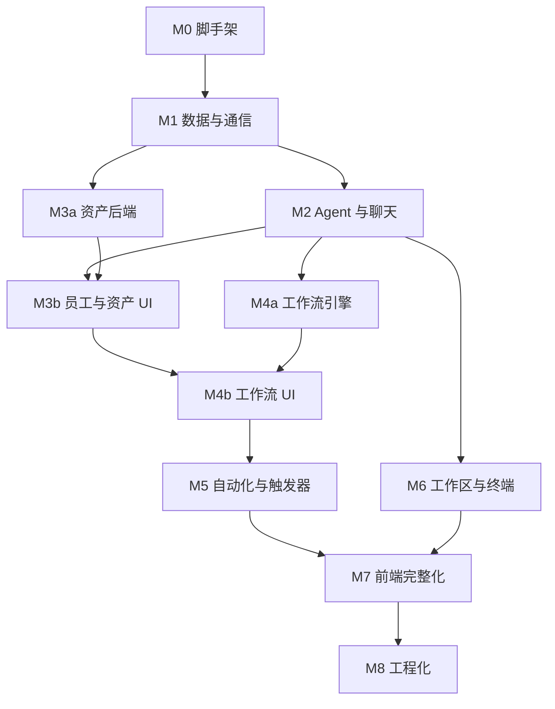

# 24 复刻实施指南

## 1. 目标

本文给出从零复刻 Nova Studio 的实施顺序、每个里程碑的交付物与验收标准。

**原则**：

- 先跑通“最小闭环”，再补资产与界面；
- 每个里程碑结束必须能演示，而不是“代码写完但跑不起来”；
- 数据库 schema、IPC 契约、状态机必须在对应里程碑一次定型，避免后期大改；
- 文档与源码冲突时，以源码事实为准，并修正文档。

---

## 2. 里程碑总览

| 里程碑 | 交付物 | 预计工作量 |
|---|---|---|
| M0 脚手架 | Electron + React + TS + Tailwind + electron-vite 可启动 | 小 |
| M1 数据与通信 | SQLite schema、IPC 契约、preload 桥、类型检查 | 中 |
| M2 Agent 与聊天 | Claude provider、会话、流式事件、历史回放 | 大 |
| M3 员工与资产 | 数字员工、MCP、Skill、知识库 | 大 |
| M4 工作流 | 图校验、DAG 调度、运行记录、审核、产物 | 最大 |
| M5 自动化与触发器 | 任务中心、定时触发器 | 中 |
| M6 工作区与终端 | 文件树、预览、Git、PTY | 中 |
| M7 前端完整化 | 11 个主视图、皮肤、设置 | 大 |
| M8 工程化 | 打包、更新、测试 | 中 |

> 工作量是相对估计，不是绝对人天。M4 通常占整个项目 30%–40%。

---

## 3. M0 脚手架

### 3.1 任务

- 初始化 `package.json`、`tsconfig.json`、`electron.vite.config.ts`；
- 安装 Electron / React / TypeScript / Tailwind / electron-vite；
- 创建 `src/main/index.ts`、`src/preload/index.ts`、`src/renderer/main.tsx`、`App.tsx`；
- 配置 `@shared` / `@renderer` 别名；
- 创建 `out/` 构建流程；
- 创建 `.gitignore`。

### 3.2 验收

- [ ] `npm run dev` 打开窗口，显示空白 React 页面。
- [ ] `npm run build` 产出 `out/main/index.js`、`out/preload/index.cjs`、`out/renderer/`。
- [ ] `npm run typecheck` 通过。
- [ ] 渲染层能通过 `window.nova` 调用一个测试 IPC 通道。

### 3.3 风险

- preload 在 dev / build 扩展名不同；
- sandbox 下 preload 只能是 CJS；
- 原生依赖必须 externalize。

---

## 4. M1 数据与通信

### 4.1 任务

1. 实现 `shared/types.ts` 的领域模型；
2. 实现 `shared/contracts/ipc.ts` 的通道契约；
3. 实现 `db/sqlite.ts` 的建表、WAL、外键、迁移框架；
4. 实现 `ipc/register.ts` 的类型安全 `handle`；
5. 实现 `ipc/push.ts` + `ipc/batch.ts` 的推送与批量聚合；
6. 实现 preload 的 `invoke` / `subscribe`；
7. 实现渲染层 `lib/ipc.ts` 的类型收敛。

### 4.2 数据库最小表

- `projects`
- `sessions`
- `messages`
- `settings`

后续里程碑按需补工作流、员工、知识库表。

### 4.3 验收

- [ ] `~/.novastudio/data.db` 初始化成功。
- [ ] 外键级联生效（删除会话删消息）。
- [ ] IPC 通道三处类型联动，改一处三处报错。
- [ ] `agent:event` 16ms 批量推送可验证。
- [ ] 设置读写可用。

### 4.4 风险

- `CREATE TABLE` 与旧库迁移要分开：新装用户走全量建表，旧库走 `ALTER`。
- 迁移标记存 `settings`，避免每次启动重复执行。
- `better-sqlite3` 同步 API，不要跨线程使用。

---

## 5. M2 Agent 与聊天

### 5.1 任务

1. 定义 `AgentProvider` 契约与 registry；
2. 实现 `transport.ts`（spawn / stdin / 环境 / 终止）；
3. 实现 `line-run.ts`（行缓冲 / 超时 / 中断 / stderr）；
4. 实现 Claude provider：
   - `manifest`
   - `index.ts`（命令行 / resume / 系统提示词临时文件）
   - `parse.ts`（stream-json 解码）
   - `sessions.ts`（JSONL 回放 / 删除）
   - `config.ts` / `settings.ts` / `models.ts`
5. 实现 `agent-service.ts`（运行编排 / 历史缓存 / resume 自愈 / 清理）；
6. 实现 `session` / `agent` IPC handler；
7. 实现聊天 UI：
   - 会话列表
   - 对话区
   - 消息渲染（assistant-ui）
   - 输入 / 停止
   - 16ms 合批

### 5.2 验收

- [ ] 能与本机 Claude Code 多轮对话。
- [ ] 流式思考 / 工具调用 / 正文正常。
- [ ] 中断后内容保留，按钮恢复。
- [ ] 重启后历史可回放（含工具调用）。
- [ ] 多会话并发不串台。
- [ ] resume 失效会清引用并提示。
- [ ] 删除会话清理 CLI 侧数据。

### 5.3 风险

- Windows `.cmd` 入口、命令行引号、进程树终止；
- prompt 必须走 stdin；
- assistant 事件按 content block 逐条发，必须按 message 归组；
- tool_result 到达时切断累积；
- `aborted` 与 `muted` 语义分离。

---

## 6. M3 员工与资产

### 6.1 任务

1. 数字员工表 + CRUD + 删除保护；
2. MCP：
   - 读写 `~/.claude.json` 顶层 `mcpServers`
   - 解析 / 校验 / 导入 / 改名同步 / 删除清理
3. Skill：
   - 扫描 `~/.claude/skills`
   - frontmatter 解析 / 校验
   - 导入目录 / 文件
   - 文件树 / 读取 / 写入
4. 知识库：
   - 目录 + `.kb.json`
   - 新建 / 上传 / 删除 / 预览 / 编辑
   - FTS5 trigram 索引 / 检索 / 降级
5. 员工绑定页签 UI；
6. 资产页 UI（MCP / Skill / 知识库）。

### 6.2 验收

- [ ] 员工可绑定三类资产。
- [ ] MCP 写回 `~/.claude.json`，保留其他键。
- [ ] Skill 可导入、编辑、删除。
- [ ] 知识库可上传、搜索、预览。
- [ ] 被引用的员工 / 知识库不能删除。
- [ ] 旧版内联 MCP / 路径 Skill 兼容。

### 6.3 风险

- `~/.claude.json` 可能被 Claude 同时写，必须原子写、无法解析时拒绝；
- Skill 文件可能有 `SKILL.md.txt`；
- 知识库 FTS external content 的增删改必须同步；
- 短查询要降级 LIKE。

---

## 7. M4 工作流

### 7.1 任务

1. 图模型与校验（shared）；
2. 工作流表 / 运行表 / 节点表 / 事件表 / 尝试表；
3. `runner.ts`：
   - 启动校验 / 工作区互斥 / reservations
   - DAG 调度（最多 3 并行 / AND 汇合）
   - 节点状态机 / 失败策略 / 重试
   - attempt / round / 会话
   - 人工审核 / 修改 / 驳回 / 超时
   - 续跑
   - 取消 / 收尾
4. `prepare.ts` 临时配置投影（Claude）；
5. `artifacts.ts` 产物目录；
6. `execution-report.ts` 执行现场；
7. `cleanup.ts` 级联删除；
8. 工作流 UI：
   - 列表 / 卡片
   - 编辑器 / 画布
   - 调试面板
   - 运行详情 / 运行历史

### 7.2 验收

- [ ] 串行图跑通，产物落盘。
- [ ] 并行 + AND 汇合正确。
- [ ] 失败 stop / skip / retry 正确。
- [ ] 人工审核四种结果正确。
- [ ] 续跑从失败节点重跑下游，并补齐未成功上游。
- [ ] 同一工作区互斥。
- [ ] 临时配置用完即删。
- [ ] 运行中打开详情能看到实时对话。
- [ ] 删除成套清理。

### 7.3 风险

- 启动竞争窗口（reservations）；
- 并行节点 promise 不能在 finally 摘 running；
- 重试时清空 `lastError`；
- 审核超时是 interrupted 不是 failed；
- 修改轮 resume 失败必须失败；
- 非成功运行必须清理活动节点；
- 临时目录可能含凭证，必须删。

---

## 8. M5 自动化与触发器

### 8.1 任务

1. `automation` 表 + handler + scheduler；
2. 轮询 / 并发 / 恢复 / 停止 / 重试；
3. 任务中心看板 UI；
4. `trigger-schedule.ts` 规则计算；
5. 触发器表 + 绑定表 + handler + scheduler；
6. 触发器 UI + 工作流绑定。

### 8.2 验收

- [ ] 任务自动拾取执行，状态正确。
- [ ] 停止 / 重试 / 删除可用。
- [ ] 应用重启不卡 running。
- [ ] 触发器按规则启动工作流。
- [ ] 工作区占用时排队，超时放弃。
- [ ] 重启不补跑。

### 8.3 风险

- 任务拾取必须离开 running；
- 用户停止后不被执行结束覆写；
- 触发器先推进 nextFireAt 再启动；
- 用 `WorkspaceBusyError` 判断排队。

---

## 9. M6 工作区与终端

### 9.1 任务

1. 项目 / 工作区 CRUD + 删除级联；
2. 文件树懒加载 + 忽略规则；
3. 文件预览（文本 / Markdown / 图片 / PDF / 二进制）；
4. Git 状态；
5. node-pty 终端管理；
6. 终端页 / 文件标签 / 文件面板 UI。

### 9.2 验收

- [ ] 工作区新增 / 删除 / 打开目录。
- [ ] 文件树懒加载，Git 状态正确。
- [ ] 文件预览各类型正确。
- [ ] 终端按工作区常驻。
- [ ] 删除工作区不删用户目录。

### 9.3 风险

- 路径越界（词法 + realpath）；
- 终端 cwd 必须是已登记工作区；
- 窗口关闭 / 崩溃回收 PTY；
- 文件预览大小限制。

---

## 10. M7 前端完整化

### 10.1 任务

1. 侧栏 / 视图切换 / 常驻挂载；
2. 其余页面：
   - 任务中心
   - 触发器
   - 数字员工
   - SKILL
   - MCP
   - 知识库
   - 工作区
   - Agent 配置
3. 设置弹框；
4. 皮肤系统：
   - token 契约
   - base + 两套皮肤
   - 注册表 / 校验
   - 明暗切换 / 原生外观
5. 通用 UI 组件；
6. 渲染性能：
   - 合批
   - Markdown 节流
   - 引用稳定。

### 10.2 验收

- [ ] 11 个主视图可用。
- [ ] 两套皮肤可切换，无 FOUC。
- [ ] 字号三档独立。
- [ ] `npm run verify:skins` 通过。
- [ ] 长会话流式不卡。

### 10.3 风险

- 组件只用语义 token；
- 皮肤 base 用 `:where()`；
- 会话 / 终端 / 工作流常驻挂载；
- 选择器订阅最小切片。

---

## 11. M8 工程化

### 11.1 任务

1. electron-builder 配置；
2. NSIS 打包；
3. GitHub Releases 发布；
4. electron-updater；
5. 测试补齐；
6. typecheck / skin verify 流程。

### 11.2 验收

- [ ] `npm run package:win` 产出安装包。
- [ ] 安装后可检查 / 下载 / 安装更新。
- [ ] `npm test` 全绿。
- [ ] `npm run typecheck` 通过。
- [ ] `npm run build && npm run verify:skins` 通过。

### 11.3 风险

- `electron-updater` 必须默认导入；
- 开发模式禁用更新；
- 不允许降级；
- 原生依赖 externalize。

---

## 12. 推荐实现顺序（含并行）

可并行：

- M2 与 M3a（资产后端不依赖聊天）；
- M4a（引擎）与 M7 的部分静态页面；
- M6 与 M5。

不建议并行：

- 同一张表的 schema 变更；
- IPC 契约大改；
- 皮肤 token 契约与组件大规模迁移。

---

## 13. 每个里程碑的“完成定义”

1. 代码可编译、可启动；
2. 对应文档已更新；
3. 验收清单逐项通过；
4. 关键路径有测试或手工验证记录；
5. 没有已知的、会阻塞下一里程碑的问题。

---

## 14. 复刻时最容易走样的地方

| 模块 | 容易写错 | 正确做法 |
|---|---|---|
| 事件流 | 把 delta 和完整块混用 | delta 追加、message_end 收敛 |
| Claude 解析 | 把单块当整轮 | 按 message 归组发全集 |
| 工具回执 | 继续累积导致重复 | 收到 result 清空 buffer |
| Windows 进程 | 只 kill cmd.exe | `taskkill /T /F` |
| prompt | 放命令行参数 | 走 stdin |
| 工作流调度 | 串行执行 | DAG + 最多 3 并行 + AND |
| 重试 | 不清 lastError | 每轮重置 |
| 审核超时 | 记成 failed | 记 interrupted，可续跑 |
| 续跑 | 只跑目标节点 | 补未成功上游 |
| 临时配置 | 不删 / 全局泄漏 | 结束即删 + strict mcp |
| 知识库 | 每次查询全量扫描 | 索引 + 2s 节流同步 |
| 皮肤 | 硬编码颜色 | 只用 token |
| 渲染 | 每个 token 重读全量历史 | 内存优先 + 合批 |

---

## 15. 最终验收（整套系统）

- [ ] 全新机器：安装依赖 → `npm run dev` → 检测 Claude → 对话 → 建员工 → 建知识库 → 建工作流 → 运行 → 审核 → 查看产物 → 定时触发 → 打包安装 → 更新。
- [ ] 数据都在本地，重启不丢。
- [ ] 删除工作区不删用户目录。
- [ ] 两套皮肤可切换。
- [ ] 测试 / 类型检查 / 皮肤校验全绿。
